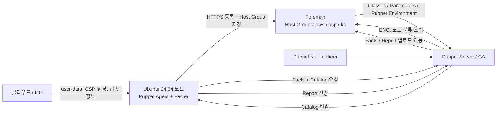

# Foreman / Puppet 아키텍처

## 목적과 범위

Foreman으로 노드의 등록·분류·상태를 관리하고, Puppet으로 서버 설정을 적용한다.
AWS, GCP, KC의 공통 구조와 Ubuntu 24.04 관리 대상 노드를 기준으로 설계한다.
KC는 이 프로젝트의 CSP 식별자이며 구체적인 공급자 연동은 별도로 확정한다.

이 디렉터리는 아키텍처 문서와 초기 Puppet 코드 환경을 포함한다.
Foreman/Puppet 설치, 등록 템플릿, GPU/MIG Custom Fact 수집기 및 실제 클라우드 배포는 후속 단계다.
코드 구성과 적용 절차는 [Puppet 코드 구성](docs/PUPPET_CODE.md)을 참고한다.
[Host Group과 코드 환경](docs/ENVIRONMENTS.md), [이중화와 인증서](docs/HA_AND_CERTIFICATES.md)에 운영 설계를 정리한다.

## 분류 원칙

- Host Group은 CSP만 구분한다. 최상위 그룹으로 `aws`, `gcp`, `kc`를 만든다.
- 개발·운영은 `deploy_env` Custom Fact의 `dev`, `prd` 값으로 표시한다.
- OS와 아키텍처는 Facter 기본 Facts를 사용한다.
- GPU 관련 정보는 GPU 존재 여부인 `gpu.present`와 실제 MIG 인스턴스 구성 여부인 `gpu.mig.configured` Custom Facts로 수집한다.
- Puppet Environment는 코드 선택 기준이다. 환경 Fact와 자동으로 연결하지 않는다.
- 적용할 Puppet Class는 Foreman의 Host Group 또는 개별 호스트에서 명시적으로 배정한다.

```text
Host Groups
├── aws
├── gcp
└── kc

각 그룹의 호스트
├── deploy_env: dev 또는 prd
├── os: Facter 기본 Fact
├── os.architecture: Facter 기본 Fact
├── gpu.present: Custom Fact
└── gpu.mig.configured: Custom Fact
```

## user-data 입력값과 Facts

### Host Group 및 부트스트랩 입력값

아래 대문자 이름은 향후 user-data 템플릿에서 사용할 입력 변수 규약이다.
Foreman API나 등록 명령의 실제 인자 이름은 아니다.

| 입력값 | 필수 | 예시 / 허용값 | 용도 및 처리 |
| --- | --- | --- | --- |
| `HOST_GROUP` | 필수 | `aws`, `gcp`, `kc` | Foreman 등록 시 지정한다. Fact로 보내는 값이 아니다. |
| `DEPLOY_ENV` | 필수 | `dev`, `prd` | `deploy_env` 외부 Fact 파일을 만든다. |
| `PUPPET_ENV` | 필수 | `development`, `production` | `dev/development`, `prd/production` 매핑으로 Foreman 호스트와 Agent의 코드 환경을 설정한다. Fact는 아니다. |
| `FOREMAN_URL` | 필수 | `https://foreman.example.internal` | 등록 요청 대상. 개발·운영 관리 서버가 분리되면 환경에 맞는 주소를 전달한다. |
| `PUPPET_SERVER` | 필수 | `puppet.example.internal` | Agent의 Puppet Server 연결 대상이다. |
| `PUPPET_CA_SERVER` | 필수 | `puppet-ca.example.internal` | HA 구성에서 Compiler와 분리한 CA endpoint다. |
| `CERTNAME` | 필수 | `aws-dev-node-001.example.internal` | Foreman 호스트 식별자와 일관되게 사용할 고유한 Puppet 노드 이름이다. |
| 등록 인증정보 | 등록 방식에 따라 필수 | 만료·권한이 제한된 등록 토큰 등 | 선택한 Foreman 등록 방식에 맞춰 제공하며 Facts에 저장하지 않는다. |

`HOST_GROUP`은 배포 시 해당 Foreman 인스턴스의 Host Group ID 등 실제 등록 인자로
변환한다. 개발용과 운영용 Foreman의 숫자 ID가 같다고 가정하지 않는다.

Puppet Environment는 등록 시 Foreman 호스트와 Agent에 명시한다.
`dev → development`, `prd → production`으로 지정하며 코드에서 매핑을 검증한다.
`DEPLOY_ENV` 값만으로 코드 환경이 선택되지는 않는다.

### Puppet을 통해 수집할 Facts

| Fact 경로 | 출처 | user-data의 역할 | 예시 / 데이터 규약 |
| --- | --- | --- | --- |
| `deploy_env` | 외부 Custom Fact | 필수 입력값을 파일로 생성 | 문자열 `dev` 또는 `prd` |
| `os.name` | Facter 기본 Fact | 직접 지정하지 않음 | `Ubuntu` |
| `os.release.full` | Facter 기본 Fact | 직접 지정하지 않음 | `24.04` 또는 해당 이미지에서 수집된 패치 버전 |
| `os.architecture` | Facter 기본 Fact | 직접 지정하지 않음 | Ubuntu에서 `amd64`, `arm64` 등 실제 수집값 사용 |
| `gpu.present` | 구조화된 Custom Fact | GPU 수집기 배치/설치 준비 | GPU 확인 시 `true`, GPU가 없음을 확인하면 `false`, 판별 불가 시 `null` |
| `gpu.mig.configured` | 구조화된 Custom Fact | MIG 수집기 배치/설치 준비 | 하나 이상의 GPU Instance(GI)가 있으면 `true`, 정상 조회 결과 GI가 없으면 `false`, 판별 불가 시 `null` |

GPU/MIG Facts는 향후 구현할 데이터 계약이다. Facter 기본 Facts라고 가정하지 않는다.
`gpu.present`는 드라이버 활성 여부와 구분해 장치 존재 여부를 실측한다.
GPU 장치는 확인했지만 MIG 조회에 실패했다면 `present: true`, `mig.configured: null`이다.
GPU가 없음을 확인했다면 두 값 모두 `false`이다. MIG 구성이 확인되면 GPU 존재도 `true`다.
노드 전체에서 하나 이상의 MIG GPU Instance(GI)가 실제로 생성되었는지 실측한다.
MIG 모드만 활성화하고 GI를 생성하지 않은 상태는 `false`이다.
이 값은 Compute Instance(CI)의 준비 상태나 워크로드 실행 가능 여부를 보장하지 않는다.
GPU가 없거나 MIG 미지원임을 정상적으로 확인한 경우에도 `false`로 기록한다.
명령 실행 실패, 권한 부족, 드라이버나 탐지 도구 부재 등으로 판별할 수 없으면 `null`이다.
여러 GPU 중 일부라도 GI가 확인되면 `true`, 하나도 확인되지 않고 일부 조회가 실패하면
`null`, 모든 장치의 조회 결과 GI가 없음을 확인하면 `false`로 집계한다.
GPU 개수·모델·MIG 모드·InfiniBand 정보는 수집 항목에 포함하지 않는다.

구조화된 Fact 결과 예시는 다음과 같다. 이 값은 user-data에 고정하지 않는다.

```yaml
gpu:
  present: true
  mig:
    configured: true
```

`os.architecture`와 `processors.isa`는 표현이 다를 수 있으므로 혼용하지 않는다.
실제 도입할 Agent/Facter 버전에서 키와 값을 확인한 뒤 조건식에 사용한다.

### Ubuntu 24.04 user-data 예시

AWS 개발 노드의 환경 Fact를 생성하는 cloud-init 조각이다.
Foreman 등록·Puppet 설치까지 실행하는 완성된 부트스트랩 스크립트는 아니다.

```yaml
#cloud-config
write_files:
  - path: /etc/puppetlabs/facter/facts.d/deployment.yaml
    owner: root:root
    permissions: '0644'
    content: |
      deploy_env: dev
```

이 노드의 등록 입력은 `HOST_GROUP=aws`, `DEPLOY_ENV=dev`이다.
운영 노드는 Host Group을 그대로 두고 Fact 값을 `prd`로 바꾼다.
GCP와 KC도 동일한 Fact 구조를 사용하고 Host Group만 각각 `gcp`, `kc`로 지정한다.
환경 Fact는 첫 Puppet 실행 전에 생성하며 재부팅 시에도 유지한다.

## 구성 요소와 연결



| 구성 요소 | 책임 |
| --- | --- |
| 클라우드 / IaC | CSP·환경을 결정하고 user-data를 제공한다. |
| user-data / cloud-init | 환경 Fact 생성, Agent 준비, Foreman 등록 및 Agent 설정을 수행한다. |
| Foreman | Host Group, 호스트, Facts, Class 배정, Parameters와 적용 결과를 관리한다. |
| Puppet Server / CA | 인증서 수명 주기, ENC 조회, Catalog 컴파일, Facts·Report 전달을 담당한다. |
| Puppet Agent / Facter | Facts 수집, Catalog 요청·적용, Report 제출을 수행한다. |
| Puppet 코드 / Hiera | 재사용 가능한 설정 코드와 설정 데이터를 관리한다. |

Foreman의 Puppet 연동 플러그인, Smart Proxy의 Puppet/CA 기능, ENC 및
Facts/Report 업로드 연동은 선택한 버전에 맞춰 구성한다.
Facts와 Report는 일반적인 Puppet 연동에서 Agent → Puppet Server → Foreman으로 전달된다.

## 등록 및 적용 순서

1. Foreman에 `aws`, `gcp`, `kc` Host Group을 생성하고 필요한 Puppet Classes를 가져와 배정한다.
2. Puppet Server의 ENC, Facts 업로드, Report 업로드 연동을 구성한다.
3. 클라우드 생성 단계에서 Host Group, 환경, 접속 대상과 고유한 certname을 결정한다.
4. user-data가 입력값을 검증하고 환경 Fact 파일을 생성한다.
5. 검증된 Agent 패키지와 GPU/MIG Fact 수집기를 설치하고 Puppet Server·certname을 설정한다.
6. Foreman 등록 절차를 실행하여 지정한 Host Group으로 호스트를 등록한다.
7. Agent가 인증서를 요청하고 승인 정책에 따라 서명받는다.
8. 첫 Agent 실행에서 Facts를 전송하고, Server가 Foreman의 분류 정보를 조회해 Catalog를 컴파일한다.
9. Agent가 설정을 적용하고 Report를 제출한다. 이후 주기 실행으로 상태를 유지한다.

Foreman Global Registration을 사용할 경우 선택한 버전과 등록 템플릿의
Ubuntu 24.04/Puppet 지원을 먼저 확인하고 생성된 등록 명령을 활용한다.
패키지 설치와 등록의 구체적 순서는 템플릿에 따라 통합할 수 있으나,
첫 설정 적용 전에 환경 Fact와 호스트 분류가 준비되어야 한다.

등록 재실행은 동일한 certname의 기존 호스트를 확인하도록 설계한다.
중복 호스트 생성이나 인증서 삭제·재발급을 무조건 수행하지 않는다.

## Class와 환경 사용

초기 공통 Role은 `role::base`이며, 세 CSP Host Group에 동일하게 배정한다.
`role::base` → `profile::base` → `profile::packages`, `profile::node_info` 순서로 구성한다.
기본 패키지와 노드 식별 파일을 관리하고, Hiera에서 환경별 패키지 목록을 선택한다.
역할별 설정이 필요하면 향후 별도 Role과 Profile을 추가한다.

Host Group이 CSP만 표현하므로, 같은 CSP에서 모든 노드에 적용할 수 있는 Class만
그룹에 공통 배정한다. OS·Arch·GPU/MIG Facts만 전송해도 Class가 자동 배정되는 것은 아니다.
지원하지 않는 OS/Arch는 Catalog 컴파일 또는 사전 검증 단계에서 명시적으로 차단한다.

`deploy_env`는 Foreman에서 개발·운영 호스트를 검색·표시하는 기준이다.
목록에 해당 Fact를 표시하는 방법과 검색 문법은 선택한 Foreman 버전에서 확인한다.
필요하면 Puppet/Hiera 조건에도 활용할 수 있지만 환경에 따른 설정 차이는 코드에 명시한다.

기본 제안은 공통 HA 관리 클러스터에서 Puppet 코드 환경을 개발·운영으로 분리하는 것이다.
관리 서버까지 분리할 경우에도 각 인스턴스의 Host Group 이름은 동일하게 유지한다.
user-data에는 환경에 맞는 접속 대상을 전달한다. 노드가 보낸 환경 Fact 자체는
등록 권한이나 운영 인증서 발급을 허가하는 근거로 사용하지 않는다.

## 통신 및 등록 조건

| 출발지 → 목적지 | 기본 TCP 포트 | 용도 |
| --- | --- | --- |
| 노드 → Foreman | 443 | HTTPS 등록 |
| 노드 → Puppet Server / CA | 8140 | 인증서 요청, Facts, Catalog, Report |
| Puppet Server → Foreman | 443 | ENC 조회, Facts·Report 업로드 |
| Foreman → Smart Proxy | 일반적으로 8443 | 활성화한 Puppet/CA 관리 기능. 실제 배포 설정에 맞춰 제한 |

노드와 관리 서버의 DNS, 시간 동기화, TLS 신뢰 체인을 준비한다.
Agent 패키지 저장소 및 코드 배포 경로의 네트워크 허용은 별도로 구성한다.
기본 흐름은 Agent의 아웃바운드 연결이며 미등록 서버의 네트워크 스캔을 요구하지 않는다.
Foreman에서 실행을 유도하는 Remote Execution은 선택 기능이며 별도 연결·인증이 필요하다.

등록 토큰은 Facts·Git·로그에 기록하지 않고 수명과 권한을 제한한다.
인증서는 사전 등록된 노드 정보 등에 근거해 승인하며 무조건 자동 서명하지 않는다.

## 구현 시 확인할 사항

- Foreman, Puppet 연동 플러그인, Puppet Server/Agent, Facter의 호환 버전을 고정한다.
- 관리 서버 OS 지원과 관리 대상 Ubuntu 24.04 Agent 지원을 별도로 확인한다.
- 등록 템플릿의 Host Group 지정 및 기존 호스트 재등록 동작을 확인한다.
- 개발·운영 관리 서버 분리 여부, DNS, 인증서 승인 정책을 확정한다.
- GPU 존재 및 MIG 구성 탐지 구현과 구조화된 Facts의 Foreman 저장·검색 동작을 확인한다.

## 도입 검증 기준

1. 각 CSP의 테스트 노드가 지정된 Host Group에 한 번만 등록된다.
2. 동일 Host Group 안에서 환경 Fact로 `dev`, `prd` 노드를 구분할 수 있다.
3. `facter os`로 Ubuntu 24.04 및 실제 아키텍처를 확인한다.
4. `facter deploy_env`로 환경 값이 입력과 일치하는지 확인한다.
5. GPU 유무와 MIG GI 구성·미구성(모드만 활성화 포함)·미지원·다중 GPU 부분 조회 실패 사례가 `true`/`false`/`null` 규약대로 수집된다.
6. Foreman에 Facts와 Report가 도착하고, 선택한 Class의 설정이 실제로 적용된다.
7. 변경 없는 두 번째 Puppet 실행에서 의도하지 않은 변경이 발생하지 않는다.
8. user-data 재실행이나 재부팅으로 중복 호스트·인증서 충돌이 생기지 않는다.

초기 코드는 Puppet 8.10.0에서 Catalog 컴파일로 검증했다.
실제 Foreman 연동, Agent 적용과 멱등성 검증은 아직 수행하지 않았다.
