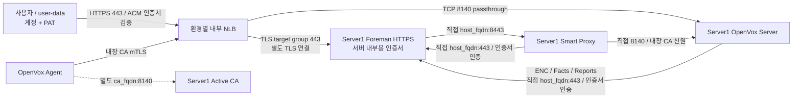

# NLB ACM 인증서와 서버 내부 TLS

웹/API는 NLB에서 ACM 인증서로 TLS를 종료하고 서버 HTTPS로 재암호화한다.
Agent의 8140은 TCP로 그대로 전달해 OpenVox 내장 CA의 상호 인증을 유지한다.
현재는 설계와 설치 입력/템플릿만 반영했으며 AWS 리소스나 실제 인증서는 생성하지 않았다.

## Listener와 통신 경로

| 호출자/용도 | 접속 이름·포트 | NLB listener / target group | 인증/신뢰 |
| --- | --- | --- | --- |
| 사용자·등록 API | foreman_fqdn:443 | TLS 443 + ACM → TLS 443 | ACM 체인 검증, 계정/PAT |
| Agent Catalog/파일/Report | puppet_fqdn:8140 | TCP 8140 → TCP 8140 | OpenVox 내장 CA의 노드 인증서 |
| Agent CSR·승인·갱신 | ca_fqdn:8140 | 초기에는 CA 담당 서버 직접 연결 | 내장 CA, 최초 CA 지문·수동 승인 |
| Puppet ENC/Facts/Report | host_fqdn:443 | NLB 우회, 내부 직접 HTTPS | 서버 내부용 CA/클라이언트 인증서 |
| Smart Proxy → Foreman | host_fqdn:443 | NLB 우회, 내부 직접 HTTPS | 서버 내부용 CA/클라이언트 인증서 |
| Foreman → Smart Proxy | host_fqdn:8443 | 내부 직접 HTTPS | 서버 내부용 CA/인증서와 인가 |

443 listener는 TLS이고 target group도 TLS다. TLS listener → TCP target은 복호화된 평문이므로 이 설계에 사용하지 않는다.
8140 listener는 TLS가 아닌 TCP다. 여기에 ACM 종료를 적용하지 않는다.
일반 웹/PAT listener에는 클라이언트 인증서 요구를 켜지 않는다. 서비스 인증서의 원래 TLS 신원은
NLB에서 종료한 뒤 backend TLS 연결에 자동 전달되지 않으므로 서비스 경로를 분리한다.
임의의 인증서/신원 헤더를 신뢰하도록 설정하지 않는다.

NLB TLS target group은 대상 인증서의 체인/이름을 검증하지 않는다. 따라서 backend 암호화와
내부 클라이언트의 CA/이름 검증을 구분한다. backend/Proxy/CA의 SG는 NLB 및 허용한 관리 경로로 제한한다.
웹 경로 테스트는 LB 로그인/PAT 성공까지, backend는 서비스 인증서로 ENC/Facts/Report 성공까지 확인한다.
TCP 443 health check만으로 DB·ENC·인증 연동 정상 상태를 판정하지 않는다.

## 인증서의 소유와 입력

| 자료 | 저장/적용 위치 | 범위 |
| --- | --- | --- |
| ACM 인증서 ARN | NLB TLS 443 listener | foreman_fqdn SAN, 해당 리전의 인증서 |
| backend 서버/클라이언트 인증서·키·CA | Server1 파일, bootstrap의 tls.* | Foreman HTTPS·Proxy 8443·서버간 인증서 인증 |
| OpenVox CA 전체 상태·노드 인증서 | OpenVox Server/각 Agent | Agent/Server 통신·발급·폐기·갱신 |

ACM 인증서를 EC2에 복사하는 설치가 아니다. backend는 사내 PKI 또는 별도 내부 서비스 CA에서 발급한
인증서/키/체인을 따로 준비한다. 현재 installer는 이를 생성하지 않고 tls.ca_cert/host_cert/host_key 경로로 읽는다.
현재 단일 서버 템플릿은 같은 내부 서비스 인증서를 Foreman/Proxy/연동 클라이언트에 사용하므로
host_fqdn SAN, serverAuth/clientAuth 용도, 만료·키 권한·Foreman/Proxy 허용 목록을 실제 PKI 정책과 대조한다.
CA 인증서 자체를 서버 leaf 인증서로 사용하지 않는다. 내장 Puppet CA 개인키도 웹 키로 사용하지 않는다.

backend 인증서에 foreman_fqdn SAN은 필수가 아니다. installer 검증은 내부 직접 접속 이름인 host_fqdn을 확인한다.
외부 이름 foreman_fqdn의 SAN과 갱신은 ACM listener에서 확인한다.
등록 코드의 FOREMAN_CA_CERT/Go CACert는 **ACM listener 인증서를 신뢰하는 CA 번들**이다.
공개 ACM 체인이면 OS CA 번들을 사용할 수 있고, ACM Private CA/가져온 인증서면 해당 발급 체인을 준비한다.
서버 입력 tls.ca_cert는 backend 서비스 CA이며 둘이 같다고 가정하지 않는다.
.private/.internal 예시 이름은 공개 ACM 인증서 발급 대상이라고 가정하지 않는다.
실제 소유 도메인의 공개 ACM 인증서 또는 ACM Private CA/가져온 인증서 중 DNS·신뢰 정책에 맞게 선택한다.

## 설치 설정과 단계별 경계

- Foreman public foreman_url/servername은 https://foreman_fqdn으로 유지한다.
- Apache에는 host_fqdn 별칭과 HTTPS 443을 설정한다. SSLVerifyClient=optional로 NLB의 일반 PAT/UI 접속을 허용하고
  직접 서비스 클라이언트가 인증서를 제출하면 검증한다. Foreman의 API 계정/인가를 생략하는 옵션이 아니다.
- puppet.server_foreman_url과 foreman_proxy.foreman_base_url은 https://host_fqdn이다.
  NLB의 ACM 이름을 이 서비스 인증 경로에 넣으면 계획 검증이 실패한다.
- CA-init의 OpenVox SAN·내장 CA 상태 보존·Agent CA 지문·autosign=false는 그대로다.
- 현재 실행기는 Server1·로컬 DB만 지원한다. RDS 이전 후 Server2를 추가할 때 내부 서비스 경로도 재검증한다.
  로컬 Foreman만 장애인 Compiler를 정상으로 풀에 남기지 않도록 readiness/격리를 시험한다.
  인증서 신원을 유지하는 내부 TCP passthrough endpoint 등은 HA 단계의 별도 설계이며
  기존 ACM listener로 서비스 호출을 바꾸는 것으로 대체하지 않는다.

설치 입력은 [bootstrap](../bootstrap/README.md), 실패 구분은 [장애 대응](FAILURE_RUNBOOK.md)을 따른다.

근거:
- [AWS NLB TLS listener / TCP passthrough](https://docs.aws.amazon.com/elasticloadbalancing/latest/network/load-balancer-listeners.html)
- [AWS NLB TLS target group과 backend 인증서](https://docs.aws.amazon.com/elasticloadbalancing/latest/network/load-balancer-target-groups.html)
- [Foreman webserver SSLVerifyClient·alias 설정](https://github.com/theforeman/puppet-foreman/blob/master/manifests/init.pp)
