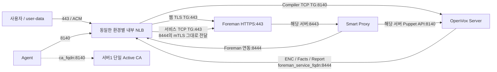

# 1단계부터 사용하는 NLB 443·8444·8140

같은 내부 NLB에 세 listener와 별도 Target Group을 둔다. 처음에는 모두 Server1 한 대를 대상으로 하고,
RDS 이전 후 Server2를 추가할 때 접속 이름/포트를 유지한다. 1·2단계는 관리 서버 한 대이므로 HA가 아니다.
현재는 계획 입력과 설치 템플릿만 반영했으며 AWS 리소스·실제 인증서·readiness endpoint는 생성하지 않았다.

| 용도 | 접속 주소 | NLB listener → Target Group | 신뢰 |
| --- | --- | --- | --- |
| 웹·PAT 등록 API | foreman_fqdn:443 | TLS 443 + ACM → TLS 443 | 클라이언트는 ACM 발급 체인 검증 |
| ENC·Facts·Report·Proxy→Foreman | foreman_service_fqdn:8444 | TCP 8444 → TCP 443 | backend까지 TLS 그대로 전달, 서비스 인증서 인증 |
| Agent Catalog/파일/Report | puppet_fqdn:8140 | TCP 8140 → TCP 8140 | OpenVox 내장 CA의 노드 인증서 |
| 인증서 발급·승인·갱신·폐기 | ca_fqdn:8140 | 초기 CA 담당 Server1 직접 | 내장 CA, 최초 지문·수동 승인 |
| Foreman→Smart Proxy | 각 host_fqdn:8443 | 해당 Proxy 직접 | 내부 서비스 CA·고유 인증서·인가 |

8444는 **NLB listener 포트**다. EC2에는 기존 Foreman HTTPS 443이 받으며 별도 8444 서버를 띄우지 않는다.
443과 8444는 같은 EC2 443을 향해도 Target Group이 각각 TLS/TCP로 다르다.
8444 listener/TG를 TLS로 만들거나 ACM 인증서를 붙이면 원래 클라이언트 TLS 신원이 보존되지 않는다.

## 왜 8444를 1단계부터 두는가

Puppet이 localhost 또는 물리 서버 주소에 고정되면 해당 Foreman만 장애일 때 다른 Foreman을 사용할 수 없다.
처음부터 서비스용 NLB 주소를 쓰면 3단계에서 정상 Foreman으로 신규 연결을 분산할 수 있다.
443은 ACM 종료용, 8444는 기존 서비스 인증서를 그대로 보존하는 통로라 분리한다.
로컬 DB/RDS 선택이 이 TLS 전달 방식을 바꾸지는 않는다. DB가 모든 Foreman에서 공유되는 것은 3단계의 필수 조건이다.

## 같은 서버로 돌아오는 통신과 SG

Server1이 8444를 호출해 NLB가 Server1:443으로 돌려보내는 경로가 1단계부터 발생한다.
서비스 TCP Target Group의 preserve_client_ip.enabled=false를 설정하고 그 경로를 실기로 검증한다.
Proxy Protocol v2는 활성화하지 않는다. NLB가 이 TCP 경로의 TLS를 종료하지 않으므로 클라이언트 인증서는 유지된다.
8444는 관리 서버에서만 접근하도록 NLB SG를 제한한다. backend 443은 NLB와 허용한 관리 경로만 열고,
8443은 Foreman 관리 서버, CA 8140은 필요한 노드/관리 경로만 허용한다.

## 인증서와 설정

- ACM 인증서 ARN은 NLB 443에만 둔다. foreman_fqdn SAN/체인·갱신을 확인한다.
- backend 내부 서비스 인증서 SAN에는 **각 host_fqdn과 공통 foreman_service_fqdn**을 넣는다.
  서비스 클라이언트는 서비스 DNS와 내부 CA를 검증한다. NLB의 public foreman_fqdn SAN은 backend에 필수가 아니다.
- Server2에는 같은 신뢰 체계에서 발급한 고유 cert/key를 사용한다. 두 서버가 서로의 서비스 클라이언트 신원을
  허용하도록 Foreman/Proxy의 인증서 허용 목록을 검증한다. 개인키를 공통 이미지로 복제하지 않는다.
- Foreman의 public URL은 https://foreman_fqdn이다. Apache alias에는 host_fqdn과 foreman_service_fqdn을 둔다.
- puppet.server_foreman_url과 foreman_proxy.foreman_base_url은 **https://foreman_service_fqdn:8444**로 고정한다.
  로컬 직접 주소나 ACM listener 주소로 바꾸면 설치 계획에서 거부한다.
- backend SSLVerifyClient=optional은 ACM frontend의 PAT/UI와 인증서 기반 서비스 요청을 함께 받기 위한 값이다.
  클라이언트가 인증서를 제출하면 검증하며 Foreman의 API 인증/인가를 생략하지 않는다.
- tls.ca_cert/host_cert/host_key는 별도로 준비하는 backend 서비스 CA/인증서/키다. installer는 이를 발급하지 않는다.
  현재 템플릿은 serverAuth/clientAuth 용도·host/service SAN·유효기간·키 권한을 실제 발급 정책과 대조해야 한다.
- NLB 웹 TLS TG는 backend 인증서의 체인/이름을 검증하지 않는다. 반면 TCP 8444 경로의 서비스 클라이언트는 직접 검증한다.
- 등록 함수의 FOREMAN_CA_CERT/Go CACert는 ACM listener의 발급 체인 번들이다. backend 서비스 CA와 같다고 가정하지 않는다.
  공개 ACM 체인은 OS CA 번들을 사용할 수 있으며 Private CA/가져온 인증서는 해당 발급 체인을 준비한다.
  .internal 같은 예시 이름을 공개 ACM 발급 대상이라고 가정하지 않는다.
- OpenVox 내장 CA·Agent certname/SAN·autosign=false·지문·CRL·백업은 별도로 유지한다.

서버 JSON에는 foreman_service_fqdn을 추가해야 한다. 미정/누락은 적용을 차단한다.
NLB listener·TG 속성·ACM ARN·health 입력은 server/dev.example.yaml의 **계획값**이며 AWS 적용 코드는 아니다.

## Health check와 장애 전환의 조건

Foreman의 웹/서비스 두 TG는 앱과 DB 사용 가능 여부를 확인하는 readiness를 사용해야 한다.
계획 YAML의 HTTPS health path는 아직 null이다. endpoint 구현·무인증 health 요청의 도달 경로·HTTP 200/503 동작을
실제 Foreman 버전에서 검증하기 전에는 앱 장애 시 자동 전환이 완성됐다고 보지 않는다.
TCP 443 또는 항상 200을 내는 정적 페이지, 인증 실패 401을 정상으로 취급하는 경로는 대체물이 아니다.
NLB health 요청 Host 헤더가 서비스 DNS가 아닐 수 있고 HTTPS 검사에는 TLS 1.2 지원도 필요하다.

Compiler의 TCP 8140 검사는 프로세스 가용성만 본다. HA 전에 JRuby·코드·8444 ENC 조회까지 확인하는
통합 readiness/격리를 추가 검증한다. 요청 중 장애는 기존 연결·Catalog 실행을 다른 서버로 실시간 이동시키지 않는다.
검사/연결 재수립 동안 실패가 발생할 수 있다. 관리 API의 생성 POST를 자동 재시도하는 설정도 추가하지 않는다.
모든 대상이 unhealthy이면 NLB가 fail-open할 수 있으므로 장애 복구를 LB 하나에 맡기지 않는다.

## 장애 예시

| 단계/장애 | 결과와 대응 |
| --- | --- |
| 1단계 Server1 전체 장애 | 모든 서비스·로컬 DB·CA 중단. 대체 대상이 없으므로 LB가 있어도 복구/백업 복원이 필요 |
| 2단계 Server1 전체 장애 | RDS 데이터는 분리돼 있지만 앱·Compiler·CA가 없다. 여전히 관리 서버 복구 필요 |
| 3단계 Foreman1만 장애, Puppet1 정상 | 앱/DB health가 Foreman1을 제외한 뒤 Puppet1의 새 8444 연결은 Foreman2로 가고 공용 RDS에서 같은 분류 조회 가능 |
| 3단계 Puppet1만 장애 | Compiler TG가 제외한 뒤 새 8140 연결은 Puppet2 사용. Foreman1이 정상이라면 웹/8444 TG에서는 계속 사용 가능 |
| 3단계 Server1 전체 장애 | 정상 Foreman2/Puppet2로 신규 연결. 유효한 인증서·CA 신뢰·CRL을 가진 기존 Agent는 통신 가능. Server1 CA의 신규 발급/승인/갱신/폐기는 복구 전 중단 |
| RDS 또는 모든 Foreman 장애 | 설정 분류/Report 저장에 공통 장애. NLB에 보낼 정상 앱이 없어 DB/앱 복구 필요; fail-open이 서비스를 정상화하지 않음 |

3단계 예시는 같은 DB·코드·플러그인/비밀값·인증 신뢰와 정상 대상·health 설정·충분한 잔여 용량이 있는 조건이다.
CA 복구는 기존 CA 상태 승계·fencing·DNS 전환 절차를 따른다. [장애 대응](FAILURE_RUNBOOK.md)을 참조한다.

근거:
- [NLB listener](https://docs.aws.amazon.com/elasticloadbalancing/latest/network/load-balancer-listeners.html)
- [TLS target group의 인증서 검증 범위](https://docs.aws.amazon.com/elasticloadbalancing/latest/network/load-balancer-target-groups.html)
- [NLB hairpin / client IP preservation](https://docs.aws.amazon.com/elasticloadbalancing/latest/network/load-balancer-troubleshooting.html)
- [NLB health check와 fail-open](https://docs.aws.amazon.com/elasticloadbalancing/latest/network/target-group-health-checks.html)
