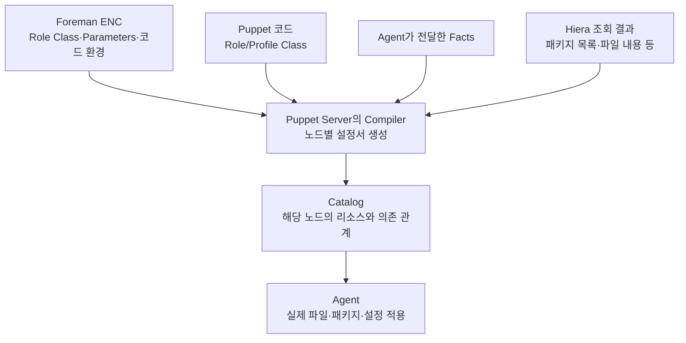
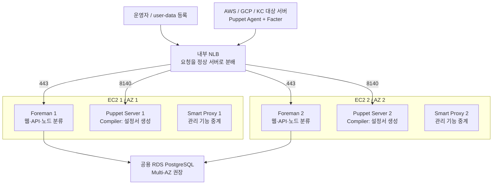
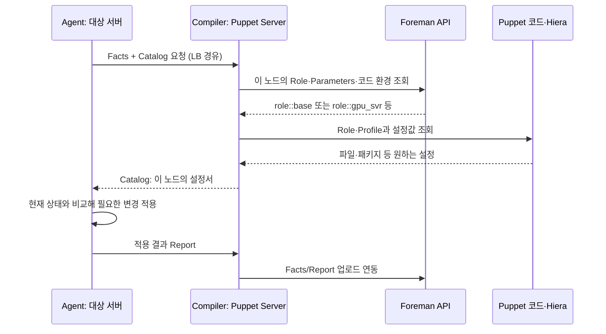
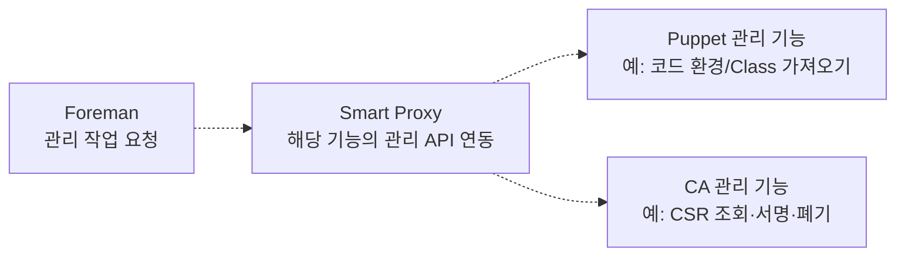

# 용어로 보는 고정 2노드 아키텍처

이 그림은 설계이며 현재 서버를 설치한 상태가 아니다.
개발·운영은 같은 방식으로 구성하되 별도 서버·DB·endpoint와 코드 환경을 사용한다.

## 먼저 알아둘 이름

| 이름 | 쉽게 설명하면 | 우리 구성에서 하는 일 |
| --- | --- | --- |
| Foreman | 관리 화면과 노드 분류부 | 호스트·Host Group·Role·Parameters·Facts·Report 관리 |
| Puppet Server | 설정을 계산하는 서버 프로그램 | 코드·Facts·분류·Hiera 값으로 Catalog 생성 및 Agent 통신 |
| Compiler | Puppet Server가 수행하는 설정 계산 역할 | 노드마다 적용할 리소스 목록과 의존 관계를 컴파일. 별도의 추가 제품 이름이 아님 |
| Catalog | 한 노드에 적용할 설정서 | 설치 패키지·파일 내용·서비스 동작과 의존 관계를 기록 |
| Puppet Agent | 각 관리 대상 서버의 실행 담당 | Facts 수집, Catalog 요청·적용, Report 전송 |
| Smart Proxy | Foreman 관리 기능의 중계 서비스 | Foreman이 Puppet/CA 등 원격 관리 기능을 호출하도록 연동 |
| LB / NLB | 요청 분배 입구 | 포트별 target group의 정상 서버로 연결 전달 |
| PostgreSQL / RDS | Foreman의 공용 데이터 저장소 | 두 Foreman이 같은 호스트·Facts·Report·분류 데이터를 읽고 씀 |
| CA | 인증서 발급·폐기 담당 | 노드 신원을 위한 인증서 발급 수명 주기. 별도 PKI/장애 전환 설계 필요 |

## Compiler와 Class/Profile의 구분

**Compiler는 Puppet Server 측에서 Catalog를 컴파일하는 역할을 뜻한다.**
Foreman이 Class/Profile을 부르는 이름이 아니다. 확장 구성에서 Catalog 컴파일을 담당하는
Puppet Server를 전용 Compiler 서버라고 부르기도 하며, 별도의 추가 제품이라는 뜻은 아니다.

- Foreman: 이 호스트에 배정할 Role Class·Parameters·코드 환경을 ENC로 전달한다.
- Role/Profile: 적용할 설정을 정의한 Puppet Classes다. 이 프로젝트에서는 `.pp` 파일에 있다.
- Compiler: 그 코드와 Facts·Hiera 조회 결과·Foreman 분류를 조합해 노드별 Catalog를 만든다.
- Agent: 받은 Catalog와 실제 상태를 비교해 필요한 변경을 적용한다.

## 1. 서버 배치와 입구

한 EC2 안의 세 상자는 같은 서버에서 실행되는 프로그램/역할이다. EC2가 여섯 대라는 뜻이 아니다.
NLB에는 Foreman용 443 target group과 Compiler용 8140 target group을 분리한다.
CA의 접속 주소와 발급 상태는 이 그림의 Compiler pool과 별도로 설계한다.
이 그림은 주요 입구와 배치를 강조하므로 내부 API·관리 연결은 다음 그림에서 구분한다.

## 2. 일상적인 설정 적용 경로

이 과정에서 서비스/파일을 실제로 변경하는 주체는 Agent다.
Compiler는 설정서를 계산한다. Foreman은 노드를 분류하고 결과를 조회한다.
정상 실행 전체가 Smart Proxy를 거쳐 흐르는 구조는 아니다.
각 Compiler는 Foreman의 공통 API endpoint에 연결하며 TLS·허용 목록·LB 내부 호출을 검증한다.

## 3. Smart Proxy는 언제 쓰는가

사용 가능한 기능은 설치한 Proxy 플러그인과 CA 방식에 따른다.
사내 CA 직접 발급이면 그 CA가 기존 Puppet CA API를 제공한다고 가정하지 않는다.
Foreman은 등록한 Proxy의 주소/인증서 신원과 기능을 알고 있어야 한다.

여기서 proxy는 Foreman의 관리 기능을 대신 연결하는 중계 서비스다.
LB는 요청을 분배하는 입구다. 둘은 역할이 다르며 Smart Proxy가 다른 Agent를 대신 실행하지 않는다.

## 4. 두 서버가 같아야 하는 부분과 달라야 하는 부분

| 같아야 하는 것 | 각각 고유해야 하는 것 |
| --- | --- |
| Foreman/플러그인 버전과 공용 DB | EC2 호스트 이름·서버 신원 |
| Foreman 암호화 키·세션 서명 비밀값 | 서버별 인증서와 개인키 |
| 같은 코드 환경의 Puppet commit·모듈·Hiera | Smart Proxy의 등록 주소와 신원 |
| 노드 분류·허용 정책의 일관성 | 로컬 로그 등은 중앙 수집과 연계 |

Foreman DB를 RDS에 두는 것만으로 코드·키·CA 상태까지 자동으로 공유되지는 않는다.
RDS Multi-AZ DB instance의 Standby는 장애 전환용이며 일반 읽기 분산용 노드가 아니다.
CA Active/Standby 상태 복구가 구현되기 전에는 신규 등록까지 완전한 HA라고 보장하지 않는다.

상세 설계는 [관리 서버 구성](SERVER_TOPOLOGY.md), [LB와 확장](LB_AND_SCALING.md)을 참고한다.
