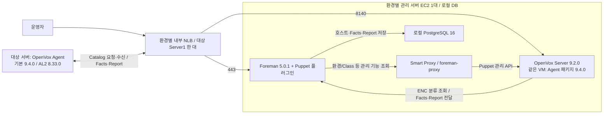
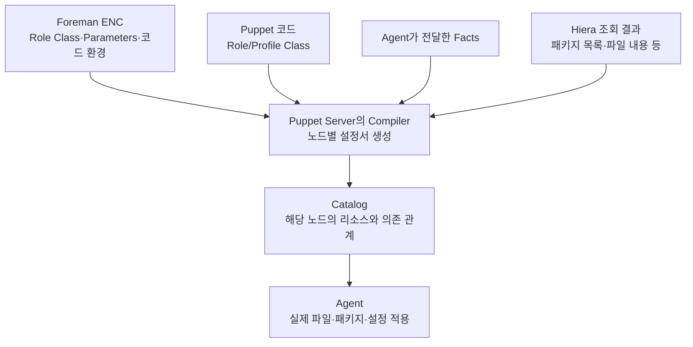
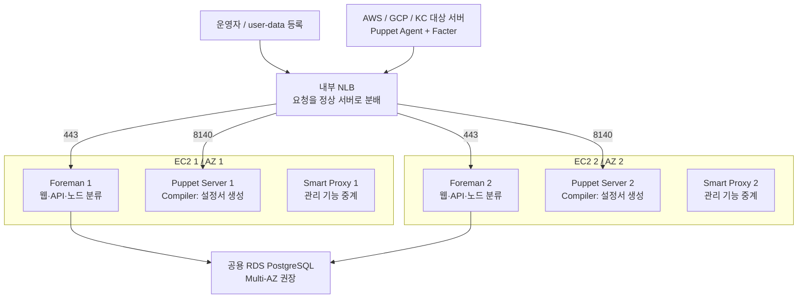
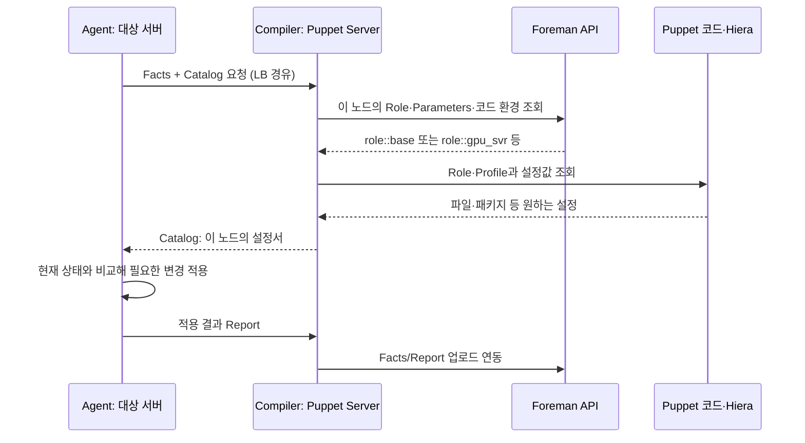
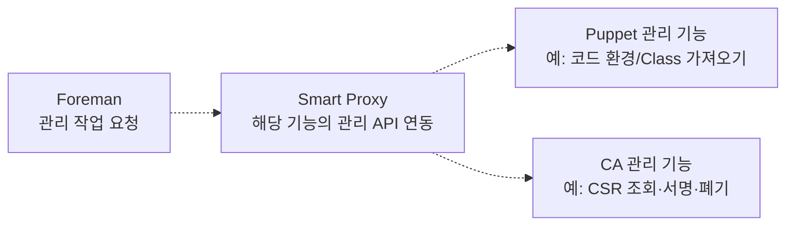

# Foreman / OpenVox 구성과 아키텍처

이 그림은 설계이며 현재 서버를 설치한 상태가 아니다.
아래 2노드 그림은 3단계 개발·운영 목표다. 두 환경 모두 1단계부터 각자의 LB + Server1 + 로컬 DB를 사용한다.
[단계별 구축](PHASED_ROLLOUT.md)에서 단일 서버와 이전 흐름을 확인한다.
개발·운영은 별도 서버·DB·endpoint와 코드 환경을 사용한다.

## 최초 개발·운영 서버 구성과 버전

2026-11-22 변경 기준이다. **개발 관리 서버 EC2 1대에 Foreman·Smart Proxy·OpenVox Server·
로컬 PostgreSQL을 함께 설치**한다. 대상 서버에는 OpenVox Agent를 설치하며 Foreman Agent나
Smart Proxy를 별도로 설치하지 않는다. 개발·운영 각각 처음부터 NLB를 사용하고 2단계에 RDS 이전, 3단계에 Server2를 추가한다.

```text
개발·운영 각각의 관리 서버 — Ubuntu 24.04 x86_64 / AWS EC2 1대
├── Foreman 5.0.1                 # 웹·API·호스트 분류·결과 조회
│   └── Foreman Puppet 플러그인    # Puppet Class·Environment·Report 관리 기능
├── Smart Proxy (foreman-proxy)    # Foreman의 Puppet 관리 API 중계, 별도 서비스
├── OpenVox Server 9.2.0          # Compiler: 노드별 Catalog 생성
├── OpenVox Agent 9.4.0 패키지     # Server가 사용하는 Ruby 코드·런타임 포함
└── PostgreSQL 16                 # 1단계는 로컬 DB

관리 대상 서버 — AWS / GCP / KC
└── OpenVox Agent                 # Facts 전송·Catalog 수신/적용·Report 전송
    ├── 기본: 9.4.0
    └── Amazon Linux 2: 8.33.0
```



Smart Proxy는 Foreman의 플러그인과 다른 프로세스다. 같은 VM에 함께 두지만 나중에 분리할 수 있다.
Agent와 Compiler의 일상적인 통신 전체를 Smart Proxy가 중계하지 않는다.
관리 서버의 Agent 패키지는 Server 의존성이며, 설치만으로 관리 서버의 정기 설정 적용을 켜지 않는다.

| 구성 요소 | 패키지/선택 버전 | 관리 기준 |
| --- | --- | --- |
| Foreman | foreman 5.0.1 | 5.0 저장소의 전체 배포판 revision을 확인해 고정 |
| Foreman Puppet 플러그인 | ruby-foreman-puppet | Foreman 5.0 호환 버전을 확인해 별도로 고정. 본체와 같은 버전 번호로 가정하지 않음 |
| Smart Proxy | foreman-proxy | Foreman 5.0 저장소의 호환 패키지 버전/revision 고정 |
| 설치 도구 | foreman-installer | Foreman 5.0 저장소의 호환 버전/revision 고정 |
| OpenVox Server | openvox-server 9.2.0 | 같은 VM에 Agent 9.4.0 패키지도 설치 |
| OpenVox Agent | openvox-agent 9.4.0 | Ubuntu 22/24/26, Rocky 8/9, Amazon Linux 2023 대상 |
| AL2 OpenVox Agent | openvox-agent 8.33.0 | Amazon Linux 2만 8 계열 예외 |
| DB | PostgreSQL 16 | Ubuntu 보안 수정이 포함된 16.x 전체 패키지 버전 기록 |
| JVM | Java 21 | 지원되는 배포 패키지의 보안 패치 버전 기록 |
| 웹/기타 Ruby 런타임 | 패키지 의존성·Installer가 요구하는 호환 구성 | 간접 의존성도 설치 목록과 보안 수정 여부 확인 |

Remote Execution·Ansible·Katello는 현재 설치 범위에 포함하지 않는다.
플러그인이나 의존성의 버전은 Foreman 본체 버전과 별도로 기록·점검한다.
실제 패키지 revision과 FQDN은 미확정이며 실제 OS 설치·Foreman/OpenVox 9 통합도 검증 전이다.
Foreman 공식 5.0 Quickstart의 OpenVox 8 경로와 차이가 있으므로 선택 버전의 보안 수정 여부와
Foreman 연동 호환성 검증은 별개로 진행한다.

## 중앙 분류 파라미터와 자동 Facts

2026-11-21 결정: deploy_env(dev/prd), team(미정은 null/미설정), dr_site(primary/secondary 또는 미설정)는
Foreman 호스트 파라미터로 관리한다. user-data는 최초 등록 입력만 전달하며 등록 후 중앙 값을
덮어쓰지 않는다. csp는 CSP Host Group의 ENC 파라미터를 상속한다. 자동 Facts는 OS·Arch·GPU/MIG다.
Hiera는 ::deploy_env와 ::csp로 조회하고 Role은 호스트에 배정한 Class로 결정한다.
sandbox는 TODO로 유지한다. 저장 위치·변경·이전 절차는 [조회·등록 관계](LOOKUP_AND_REGISTRATION.md)를 따른다.

## 설치 자동화 언어와 현재 구현 상태

**설치 자동화는 Bash + 설정 파일 + Foreman Installer를 사용하고, 별도 Python/PyYAML 버전 관리를
추가하지 않는 방향**으로 한다. APT/YUM 저장소, 서버 answers YAML, Agent puppet.conf를
설정 원본으로 유지한다. YAML 병합 등 구조화된 처리는 Installer 환경의 Ruby를 활용하는 방향이다.
Foreman·OpenVox 운영 자체에 이 프로젝트 전용 Python 실행기가 필수인 것은 아니다.

현재 실행기는 repo/install의 Bash+jq와 config/ca-init의 OpenVox Ruby 표준 라이브러리로 전환했다.
설치 순서는 OpenVox Agent 패키지를 먼저 준비해 Ruby를 확보한다. Python/PyYAML은 필요 없다.
OS나 다른 패키지가 사용하는 Python을 제거하는 정책은 아니다.
내장 CA는 ca-init에서 명시적으로 생성하고 일반 configure는 기존 CA를 요구한다.
기존 외부 PKI 설치를 자동 변환하거나 CA를 재생성하지 않는다. [설치 파일](../bootstrap/README.md)을 따른다.

## 보안 수정 중심의 버전 업데이트 정책

- 위 버전을 최초 설치 기준으로 고정하고, 새 기능이나 새 버전 출시만을 이유로 업데이트하지 않는다.
- Foreman·플러그인·OpenVox·OS·DB·Java 및 간접 의존성의 공식 보안 공지를 정기 확인한다.
  설치 버전이 영향을 받으며 보안 수정이 필요한 경우에 업데이트한다. 버전 고정은 보안 패치 거부가 아니다.
- 필요한 수정이 포함된 호환 버전으로 변경한다. 지원 종료로 보안 수정을 받을 수 없으면
  보안 유지에 필요한 지원 계열 전환을 계획한다. 무조건 최신 major로 자동 전환하지 않는다.
- 개발에서 백업과 복구 경로를 준비하고 설치·TLS·Smart Proxy·ENC·Facts/Report·Catalog 적용을
  검증한 후 운영에 같은 검증 버전을 적용한다. 긴급 보안 수정은 영향도에 따라 우선 처리한다.
- 전체 패키지 Version-Release, 관련 CVE/GHSA, 수정 버전, 적용 날짜·검증 결과를 기록한다.
  OS 패키지와 번들 런타임은 보안 패치 backport 여부도 확인해 버전 문자열만으로 판정하지 않는다.
- Agent 9.4.0 및 AL2 8.33.0의 계열 예외를 유지한다. 관리 서버의 Agent 패키지도 Server와 함께
  점검하고, 런타임 변경 후 필요한 서비스 재시작을 수행해 실제 적용 버전을 확인한다.

2026-11-18 공식 공지 대조에서 확인한 주요 수정은 다음과 같다. 전체 의존성 스캔이나
모든 취약점의 부재를 보증한 결과는 아니며, 실제 설치 시점에도 다시 대조한다.

| 선택 버전 | 확인한 주요 보안 수정 |
| --- | --- |
| Foreman 5.0.1 | Safemode 우회 RCE, provisioning token 검증 오류, 여러 명령어 주입/역직렬화 수정 |
| Server 9.2.0 + 같은 VM Agent 9.4.0 | GHSA-q4hm-33rc-572g 인증서 이름 검증 오류, GHSA-ffr6-rwpm-p5wq Report RCE 수정 |
| AL2 Agent 8.33.0 | 8.32.0 Report 처리 수정과 앞선 OpenSSL/Ruby backport 포함. Report RCE의 직접 노출 지점은 Server |

근거: [Foreman 5.0.1 공지](https://community.theforeman.org/t/foreman-5-0-1-is-now-available/47825),
[Foreman/플러그인 보안 공지](https://theforeman.org/security.html),
[OpenVox Server 9 릴리스 노트](https://docs.openvoxproject.org/openvox-server/9.x/release_notes.html),
[Agent 9 릴리스 노트](https://docs.openvoxproject.org/openvox/9.x/release_notes.html),
[Agent 8 릴리스 노트](https://docs.openvoxproject.org/openvox/8.x/release_notes.html).

## 먼저 알아둘 이름

| 이름 | 쉽게 설명하면 | 우리 구성에서 하는 일 |
| --- | --- | --- |
| Foreman | 관리 화면과 노드 분류부 | 호스트·Host Group·Role·Parameters·Facts·Report 관리 |
| Puppet Server | 설정을 계산하는 서버 프로그램 | 코드·Facts·분류·Hiera 값으로 Catalog 생성 및 Agent 통신 |
| Compiler | Puppet Server가 수행하는 설정 계산 역할 | 노드마다 적용할 리소스 목록과 의존 관계를 컴파일. 별도의 추가 제품 이름이 아님 |
| Catalog | 한 노드에 적용할 설정서 | 설치 패키지·파일 내용·서비스 동작과 의존 관계를 기록 |
| Puppet Agent | 각 관리 대상 서버의 실행 담당 | Facts 수집, Catalog 요청·적용, Report 전송 |
| Smart Proxy | Foreman 관리 기능의 중계 서비스 | Foreman이 Puppet/CA 등 원격 관리 기능을 호출하도록 연동 |
| LB / NLB | 요청 분배 입구 | 포트별 target group의 정상 서버로 연결 전달 |
| PostgreSQL / RDS | Foreman의 공용 데이터 저장소 | 두 Foreman이 같은 호스트·Facts·Report·분류 데이터를 읽고 씀 |
| CA | 인증서 발급·폐기 담당 | 노드 신원을 위한 인증서 발급 수명 주기. 별도 PKI/장애 전환 설계 필요 |

## Compiler와 Class/Profile의 구분

**Compiler는 Puppet Server 측에서 Catalog를 컴파일하는 역할을 뜻한다.**
Foreman이 Class/Profile을 부르는 이름이 아니다. 확장 구성에서 Catalog 컴파일을 담당하는
Puppet Server를 전용 Compiler 서버라고 부르기도 하며, 별도의 추가 제품이라는 뜻은 아니다.

- Foreman: 이 호스트에 배정할 Role Class·Parameters·코드 환경을 ENC로 전달한다.
- Role/Profile: 적용할 설정을 정의한 Puppet Classes다. 이 프로젝트에서는 `.pp` 파일에 있다.
- Compiler: 그 코드와 Facts·Hiera 조회 결과·Foreman 분류를 조합해 노드별 Catalog를 만든다.
- Agent: 받은 Catalog와 실제 상태를 비교해 필요한 변경을 적용한다.



## 1. 서버 배치와 입구



한 EC2 안의 세 상자는 같은 서버에서 실행되는 프로그램/역할이다. EC2가 여섯 대라는 뜻이 아니다.
NLB에는 Foreman용 443 target group과 Compiler용 8140 target group을 분리한다.
CA의 접속 주소와 발급 상태는 이 그림의 Compiler pool과 별도로 설계한다.
이 그림은 주요 입구와 배치를 강조하므로 내부 API·관리 연결은 다음 그림에서 구분한다.

## 2. 일상적인 설정 적용 경로



이 과정에서 서비스/파일을 실제로 변경하는 주체는 Agent다.
Compiler는 설정서를 계산한다. Foreman은 노드를 분류하고 결과를 조회한다.
정상 실행 전체가 Smart Proxy를 거쳐 흐르는 구조는 아니다.
각 Compiler는 Foreman의 공통 API endpoint에 연결하며 TLS·허용 목록·LB 내부 호출을 검증한다.

## 3. Smart Proxy는 언제 쓰는가



사용 가능한 기능은 설치한 Proxy 플러그인과 CA 방식에 따른다.
사내 CA 직접 발급이면 그 CA가 기존 Puppet CA API를 제공한다고 가정하지 않는다.
Foreman은 등록한 Proxy의 주소/인증서 신원과 기능을 알고 있어야 한다.

여기서 proxy는 Foreman의 관리 기능을 대신 연결하는 중계 서비스다.
LB는 요청을 분배하는 입구다. 둘은 역할이 다르며 Smart Proxy가 다른 Agent를 대신 실행하지 않는다.

## 4. 두 서버가 같아야 하는 부분과 달라야 하는 부분

| 같아야 하는 것 | 각각 고유해야 하는 것 |
| --- | --- |
| Foreman/플러그인 버전과 공용 DB | EC2 호스트 이름·서버 신원 |
| Foreman 암호화 키·세션 서명 비밀값 | 서버별 인증서와 개인키 |
| 같은 코드 환경의 Puppet commit·모듈·Hiera | Smart Proxy의 등록 주소와 신원 |
| 노드 분류·허용 정책의 일관성 | 로컬 로그 등은 중앙 수집과 연계 |

Foreman DB를 RDS에 두는 것만으로 코드·키·CA 상태까지 자동으로 공유되지는 않는다.
RDS Multi-AZ DB instance의 Standby는 장애 전환용이며 일반 읽기 분산용 노드가 아니다.
CA Active/Standby 상태 복구가 구현되기 전에는 신규 등록까지 완전한 HA라고 보장하지 않는다.

상세 설계는 [관리 서버 구성](SERVER_TOPOLOGY.md), [LB와 확장](LB_AND_SCALING.md)을 참고한다.

서버·LB·DB·인증 장애 및 CA 서버 1 장애 시 수동 승계·DNS 전환·복귀는 [장애 대응](FAILURE_RUNBOOK.md)을 따른다.
내장 CA와 백업 기반 수동 복구가 이 절차의 대상이다. 최초 CA 설정은 bootstrap에 반영했지만 실제 복구·Server2 설정은 별도 구현/검증이 필요하다.
