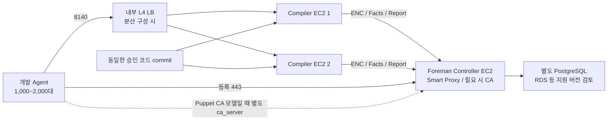

# AWS 배치와 노드 규모에 따른 단계별 구성

## 확인한 요구와 결정 상태

| 항목 | 상태 |
| --- | --- |
| 개발 관리 서버 위치 | AWS 확정. 리전·VPC·서브넷·CSP 간 연결은 미정 |
| 개발 관리 대상 | 1,000대 이상, 2,000대 이하 |
| 운영 관리 대상 | 약 250대 |
| 초기 검증 | 관리 서버 1대로 소수 노드부터 기능 검증 |
| 운영 | 별도 HA 구성 |
| 설치 방식 | EC2 VM에 OS 패키지 직접 설치를 권장. 컨테이너 필수 요구는 없음 |
| 점검 주기 | 미정. 아래 계산은 30분 가정 |

여기서 개발은 실험용 소규모라는 의미가 아니다. 개발의 총 노드 수가 운영보다 많으므로
용량은 환경 이름이 아닌 실제 요청량으로 산정한다. 개발 단일 VM은 소수 노드의 시작점이며
전체 2,000대 수용이 확인된 아키텍처가 아니다.

## VM과 컨테이너 비교

| 항목 | EC2 + OS 패키지 | 컨테이너 |
| --- | --- | --- |
| 초기 설치 | foreman-installer와 OS 서비스 중심으로 구성 | 이미지·네트워크·볼륨·구성 요소별 실행 방식을 별도로 설계 |
| 운영 확인 | systemd·패키지·서비스 로그를 직접 확인 | 컨테이너 및 오케스트레이터의 로그·상태·업그레이드 절차 필요 |
| 영구 상태 | DB·인증서·CA 상태·코드·설치 설정을 백업 | 같은 상태를 영구 볼륨/외부 서비스로 보존해야 함 |
| 확장 | 별도 Compiler VM과 DB 분리 | Compiler 확장 배포가 가능하지만 코드·인증·DB 정책도 필요 |
| 이번 권장 | VM 직접 설치 | 조직의 표준 컨테이너 운영 요구가 생기면 재검토 |

컨테이너 자체가 Catalog 컴파일·Foreman DB 처리량을 높여주는 것은 아니다.
직접 설치도 Ansible/설치 자동화로 재현하고, 승인한 commit으로 코드 배포를 반복할 수 있다.
설치 방법은 처리 용량·HA 설계와 구분한다.

## 1단계: 소수 노드 기능 검증

AWS의 새 전용 EC2에 Foreman·Puppet 계열 Server·Smart Proxy·로컬 PostgreSQL을 함께
설치한다. CA는 선택한 사내 PKI 모델에 맞춰 구성한다. 관리 OS 후보는 Ubuntu 24.04 amd64다.

4 vCPU·16 GiB RAM·100 GiB SSD를 **소수 노드 검증용 시작 후보**로 제안한다.
이는 공식 2,000대 권장 사양도, 성능 보장도 아니다. 실제 크기·볼륨·가격·가용성은 생성 전에
AWS 환경과 예산에 맞춰 확정한다. 최초 시험 대상은 예를 들어 10~50대 수준으로 제한한다.
동시에 수천 대를 등록하는 시험은 기능 검증이 끝난 뒤 별도로 계획한다.

## 2단계: 개발 1,000~2,000대 수용 후보

전체 노드를 연결하기 전 Controller·Compiler·DB 분리를 권장 구성 후보로 검토한다.

Compiler 2대는 측정할 확장 후보이며 이 대수로 2,000대를 처리한다고 보장하지 않는다.
한 대로 목표 처리량과 여유 용량을 만족하는지, 더 필요한지는 실제 Profile로 부하 시험 후 정한다.
추가 Compiler의 CA는 끄고 인증서 요청은 단일 CA endpoint로 보낸다.
Foreman·DB가 각각 한 대라면 전체 관리 평면은 HA가 아니며 개발의 허용 중단 시간에 따라
백업/복구와 추가 이중화 필요성을 정한다. RDS를 쓴다고 항상 Multi-AZ인 것도 아니다.
RDS의 PostgreSQL 버전·접속·스키마 요구는 선택한 Foreman 버전과 검증한다.

컨트롤러 한 대에서 ENC·Facts·Report를 모두 처리할 수 있는지도 측정한다.
병목이 Foreman API나 DB이면 Compiler만 추가하지 않고 해당 계층을 조정한다.

## 3단계: 운영 약 250대 HA

운영은 개발보다 요청량이 작더라도 관리 서비스 중단을 줄이기 위한 HA가 필요하다.
Foreman·Compiler·LB·DB·CA의 장애 대응은 [기존 HA 설계](HA_AND_CERTIFICATES.md)를 따른다.
역할별 서비스를 별도 VM에 둘지 일부 함께 배치할지는 N-1 용량·장애 도메인·예산으로 정한다.
250대라는 수치만으로 개발 서버보다 무조건 작은 인스턴스를 선택하지 않는다.

## 30분 주기 가정의 요청량

`평균 Catalog 실행 요청/초 = 노드 수 ÷ 실행 주기(초)`

| 환경 | 노드 수 | 평균 Catalog 실행 요청/초 | 하루 실행 수 |
| --- | ---: | ---: | ---: |
| 개발 | 1,000 | 약 0.56 | 48,000 |
| 개발 | 2,000 | 약 1.11 | 96,000 |
| 운영 | 250 | 약 0.14 | 12,000 |

균등 분산된 경우의 계산이며 전체 HTTP 요청량은 아니다. 각 실행의 Facts 업로드,
ENC 조회, 파일 전송, Report 처리, 재시도와 최초 등록 요청이 추가된다.
컴파일 시간이 길수록 같은 평균 요청량에도 더 많은 동시 처리 자원이 필요하다.
Agent 실행 주기·splay와 최초 user-data 등록의 배치/지연을 별도로 설계한다.

Report/Facts 크기와 보존 기간을 정하고 DB 쓰기·정리 비용을 측정한다.
하루 96,000회 실행이라는 계산만으로 필요한 저장소 GB를 확정하지 않는다.

## 단계별 측정 및 수용 기준

- 대표 OS·Role·CSP의 실제 Profile로 Catalog 크기와 평균/상위 지연 컴파일 시간 측정
- Compiler CPU·메모리·JVM heap/GC·JRuby 대기 시간과 요청 큐 확인
- Foreman ENC/Facts/Report 지연·오류율, 웹/API 응답 시간 확인
- PostgreSQL CPU·IO·연결 수·잠금·복제/정리 작업·디스크 증가량 측정
- Agent 실행이 목표 주기 안에 완료되는지와 backlog가 누적되지 않는지 확인
- 10~50대 기능 검증 후 단계적으로 확대. 재부팅/등록 집중과 대량 코드 변경 시점도 시험
- 운영은 한 계층의 한 대가 중단된 N-1 상태에서 목표 주기와 수용 가능한 지연을 만족하는지 검증

수용 가능한 오류율·상위 지연·RTO/RPO 기준을 정하고 측정 결과로 사양·대수·주기를 확정한다.
현재 저장소의 600개 Catalog 조합 테스트는 기능 검증이며 이 부하 시험을 대신하지 않는다.

## 확인할 다음 항목

1. VM 직접 설치 권장안 채택 여부와 설치 엔진/버전
2. Agent 실행 주기·실행 시간 분산·일괄 등록 규모
3. AWS 리전·VPC·사설 접속·GCP/KC와의 연결·조직 DNS
4. 개발/운영의 Report 보존 기간·예산·RTO/RPO
5. 소수 노드 검증 VM 사양과 전체 규모 확대 시 계층별 분리 시점

## 참고

- [Puppet Server 튜닝과 JRuby 자원](https://help.puppet.com/core/current/content/puppetcore/server/tuning_guide.htm)
- [Puppet Server 성능 지표](https://help.puppet.com/core/current/content/puppetcore/server/puppet_server_metrics_performance.htm)
- [OpenVox Server 튜닝](https://docs.openvoxproject.org/openvox-server/8.x/tuning_guide.html)
- [Foreman 공식 패키지 설치 가이드](https://docs.theforeman.org/5.0/Quickstart/index-foreman-deb.html)
