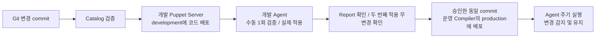

# 이미지·부트스트랩·지속 관리의 역할

## 기본 방향

이 프로젝트의 목표는 시스템 설정을 처음 적용한 뒤에도 유지하는 것이다.
Puppet Agent가 주기적으로 Catalog를 받아 현재 상태와 비교하고, 필요한 변경만 적용한다.
파일이 관리 내용과 달라지면 복구하고, 이미 맞는 상태이면 변경하지 않는다.
현재 저장소는 Catalog 코드이며 Agent 서비스의 설치·주기 설정 자동화는 아직 없다.
인증서의 실제 설정은 후속 단계로 두며 TLS를 끄는 변경은 하지 않는다.

| 단계 / 도구 | 담당할 작업 | 실행 시점 |
| --- | --- | --- |
| OS 이미지 빌드 | 부팅에 필요한 기반, 큰 패키지 등 사전 준비 | 새 이미지 버전 생성 시 |
| user-data | 고유 노드 신원·접속 설정, 환경 Fact, Agent 준비, Foreman 등록 및 Role 배정 | 인스턴스 최초 생성 시 |
| Foreman / Puppet | 패키지·설정 파일·커널 파라미터·서비스의 승인된 상태 유지 | 최초 적용 + Agent 주기 실행 |
| Ansible 등 작업 자동화 | 순서가 필요한 배포, 점검, 마이그레이션, 계획된 재시작 등 | 운영자가 승인한 실행 시점 |

이미지에서 미리 넣은 설정을 Puppet에서도 관리할 수 있다. 이미지의 초기값을 같은
Puppet 정책과 일치시키고, 부팅 이후 해당 설정의 최종 관리 주체를 Puppet으로 정한다.
이미지 빌드 명령을 주기적으로 실행되는 `exec`로 그대로 옮기지 않는다.
패키지는 `package`, 파일은 `file`, 서비스는 `service` 등 상태 리소스로 표현한다.
`exec`가 필요한 경우에는 현재 상태 검사와 재실행 조건을 따로 설계한다.

현재 이미지 빌드 작업 목록/스크립트가 제공되지 않아 실제 시스템 정책으로의 변환은
아직 수행하지 않았다. sysctl·limits·서비스·GPU 드라이버·MIG 등 구체적 요구를 받은 뒤
공통 Profile과 GPU/DB/Hadoop 선택 Profile의 범위를 정한다.

## Puppet 코드 배포와 Agent 적용은 별개



개발은 관리 서버 1대에서 시작하며 운영 HA는 이후 구축한다.
운영의 여러 Compiler는 같은 코드 환경에 동일 commit을 제공하도록 배포한다.
처음에는 소수 검증 노드로 영향과 재시작 여부를 확인한 후 대상 범위를 넓힌다.
정확한 주기와 실행 시간 분산(splay), 변경 시간대·재시작 정책은 설치 자동화 단계에서 정한다.

## 1회 실행도 가능한가

가능하다. Agent/Server 연결과 인증서가 준비된 테스트 노드에서 다음과 같이 실행할 수 있다.

```sh
# 예상 변경 확인: 실제 적용은 하지 않음
puppet agent --test --noop --detailed-exitcodes

# 한 번 적용하고 종료
puppet agent --test --detailed-exitcodes
```

한 번 실행하는 명령과 Agent 서비스의 주기 실행 여부는 별개다.
서비스나 스케줄러가 이미 동작하면 수동 실행 이후에도 자동 실행은 계속될 수 있다.
실제 적용의 종료 코드 `0`은 무변경 성공, `2`는 변경 성공이며 `4/6`은 실패를 포함한다.
noop 결과는 예상 변경이며 등록 완료나 실제 적용 성공으로 판정하지 않는다.

Puppet도 한 번만 실행할 수 있지만 자동 재실행이 없으면 이후 설정 이탈을 자동 복구하지 않는다.
Ansible도 반복 실행·스케줄링할 수 있고 많은 모듈이 멱등성을 지원한다.
따라서 두 도구를 각각 “무조건 지속성”, “무조건 일회성”으로 구분하지 않는다.
지속적으로 노드 상태를 유지할 현재 목적에는 Puppet Agent 서비스가 적합하고,
사람이 정한 시점에 여러 서버를 순서대로 작업하는 경우에는 Ansible이 유용하다.

## 공동 사용 규칙

- 같은 파일·sysctl·서비스 설정을 Puppet과 Ansible이 서로 다른 값으로 관리하지 않는다.
- Puppet 소유 설정을 Ansible이나 사람이 임시 변경하면 다음 Puppet 적용에서 복구될 수 있다.
- GPU 드라이버·커널·재부팅처럼 영향이 큰 변경은 버전·재시작·실행 시간 정책을 먼저 정한다.
- 등록 성공은 로컬 파일 대신 [최신 Facts/Report와 실행 결과](LOOKUP_AND_REGISTRATION.md)로 확인한다.
- 코드 rollback이 데이터 마이그레이션이나 모든 패키지 변경을 자동 복원한다고 가정하지 않는다.

## 근거 문서

- [Puppet Agent 서비스](https://help.puppet.com/core/current/Content/PuppetCore/nix_agent_as_service.htm)
- [Puppet Agent 일회 실행 옵션](https://help.puppet.com/core/current/Content/PuppetCore/Markdown/agent.htm)
- [Ansible Playbooks와 멱등성](https://docs.ansible.com/projects/ansible/latest/user_guide/playbooks_intro.html)
