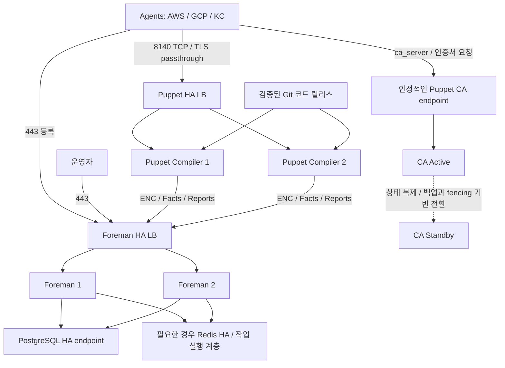

# 이중화와 인증서 운영 설계

이 문서는 배포 제안이다. LB, DB, CA, Foreman 또는 Puppet Server를 실제 생성하는
IaC나 서버 설정 파일은 아직 포함하지 않는다. Foreman 단독 + Puppet 연동을 대상으로 하며
Katello를 추가할 경우 동일한 HA 구조가 지원된다고 가정하지 않는다.

## 인증서 선택

| 구간 | 기본 선택 | 다른 인증서 사용 | 인증서 생략 |
| --- | --- | --- | --- |
| 사용자 / 등록 스크립트 → Foreman HTTPS | 조직에서 신뢰하는 웹 서버 인증서 | 사내 CA 또는 접속 이름에 맞는 공인 인증서 가능 | 운영에서는 HTTPS 유지 |
| Agent ↔ Puppet Server | Puppet CA가 발급한 노드별 인증서로 mTLS | 외부 CA로 발급한 호환 인증서 또는 사내 CA 아래의 Puppet 중간 CA 가능 | 일반적인 Agent/Server 구성에서는 생략하지 않음 |
| Foreman ↔ Smart Proxy, Puppet → Foreman 연동 | 연동 구간의 서버·클라이언트 인증서 및 신뢰 체인 | 각 서비스의 인증 요구사항을 충족하는 외부 CA 구성 가능 | 선택한 연동 방식의 TLS/클라이언트 인증 조건 유지 |

인증서를 다른 CA에서 발급받는 것과 노드 인증을 없애는 것은 다른 문제다.
Puppet Agent/Server의 표준 운영은 서버 인증과 노드별 클라이언트 인증을 사용한다.
등록 토큰이나 SSH 키는 이 mTLS 인증서를 대신하지 않는다.

외부 CA를 사용하려면 노드 certname에 맞는 고유한 식별자, 서버 접속 이름을 포함한 SAN,
필요한 서버/클라이언트 인증 용도(EKU), 인증서 체인, CRL 및 갱신·폐기 절차를 맞춰야 한다.
일반 웹 서버용 인증서 하나를 모든 Agent에 복사해서 사용하지 않는다.
Smart Proxy와 Foreman의 클라이언트 인증 신뢰 설정도 함께 검증한다.

초기 권장안은 다음과 같다.

- Foreman UI/등록 HTTPS: 사내 CA 또는 공인 웹 인증서
- Puppet Server·Agent: Puppet CA가 발급하는 노드별 인증서
- 기존 조직 PKI 통합이 필요하면 사내 Root CA 아래의 Puppet Intermediate CA 검토

`puppet apply`로 로컬 코드만 실행하면 Puppet Server와의 mTLS는 필요하지 않지만,
이는 현재 목표인 Foreman ENC + Agent/Server 운영과 다른 구성이다.
TLS 검증 해제는 이 아키텍처의 대안으로 사용하지 않는다.

## HA 구성 단위

관리 클러스터 하나를 다음 구조로 구성한다. 관리 클러스터를 개발·운영으로 물리 분리할
경우에는 각 클러스터에 같은 원칙을 적용하고 DB·CA·인증정보를 별도로 관리한다.

### 구성 요소별 방식

| 구성 요소 | 권장 방식 | 조건 |
| --- | --- | --- |
| Foreman UI / API / ENC | 2대 Active/Active + HTTPS LB | 같은 DB, 동일 버전·플러그인·암호화 키·세션 서명 비밀값 및 관련 설정 |
| Foreman PostgreSQL | 관리형 Multi-AZ DB 또는 검증된 Primary/Standby 구성 | 쓰기 endpoint 전환, 백업·복구, 복제 지연·데이터 손실 정책 검증 |
| Redis / 작업 실행 계층 | 사용하는 기능에 맞게 별도 HA | 캐시와 작업 큐의 요구를 구분. 플러그인/Dynflow의 작업 소유권·복구·중복 실행 검증 |
| Puppet Compiler | 2대 이상 Active/Active + L4 LB | CA 기능 비활성화, 동일 코드·모듈·Hiera·ENC 연동 |
| Puppet CA | 단일 Active + 복구 가능한 Standby | 동일 CA 신원, CA 상태 보존, 동시 기동 방지 및 전환 절차 |
| Smart Proxy | Compiler별 고유 Proxy, CA용 안정적인 Proxy endpoint | 등록된 Proxy의 신원과 기능을 유지. 일반 웹 서버처럼 무조건 LB 뒤에 묶지 않음 |
| LB / DNS / 코드 저장소·배포 | 자체 HA 또는 관리형 서비스 | 앞단 LB나 코드 배포 경로가 단일 장애점이 되지 않도록 설계 |

단일 CA 원칙은 Puppet Server 기본 구조에 따른 것이다. 위 Active/Standby 전환은
제품에 내장된 자동 CA 클러스터 기능이라고 가정하지 않는다.
CA 키·체인 외에도 서명 인증서, CSR, serial, inventory, CRL 등 선택한 버전의 CA 상태를
일관되게 복구해야 한다. 두 CA를 동시에 쓰기 가능하게 실행하지 않는다.
공유 스토리지를 쓴다면 스토리지 자체 HA와 fencing이 필요하다.
백업만 준비한 경우에는 자동 HA가 아니라 복구 시간만큼 중단되는 DR 구성이다.

자체 구축 DB/Redis의 장애 판단에 합의 시스템을 사용한다면 2대만으로 과반수와
네트워크 단절을 해결한다고 가정하지 않는다. 필요한 3개 투표 노드/장애 도메인 또는
관리형 서비스의 장애 전환 구성을 따로 준비한다.

### Puppet LB와 인증서

- Agent의 `server`는 `puppet.example.internal` 같은 안정적인 LB 이름을 사용한다.
- `ca_server`는 `puppet-ca.example.internal` 같은 CA endpoint를 별도로 사용한다.
- 각 Compiler는 자기 certname과 개인키를 유지한다. Agent가 사용하는 LB 이름을
  각 Compiler 서버 인증서의 SAN에 포함한다.
- L4 LB에서 TLS를 통과시켜 Compiler가 Agent 인증서를 직접 검증하도록 구성한다.
- L7 TLS 종료가 필요하면 Puppet의 External SSL Termination 절차와 신뢰할 프록시의
  인증 헤더·접근 제한을 별도로 설계한다. 웹 서버 TLS 설정만으로 대체하지 않는다.
- Compiler별 ENC 인증서와 Foreman의 허용·신뢰 설정을 일치시키고 모든 Facts/Report를
  같은 Foreman 서비스 endpoint로 보낸다.

### 코드 배포와 장애 처리

한 Puppet 코드 환경에 대해 모든 Compiler에 같은 Git commit의 코드·Hiera를 배포한다.
배포 중 서로 다른 코드를 제공하지 않도록 대상 노드를 LB에서 제외하고 배포·검증한 뒤
다시 편입하거나, 동등한 원자적 릴리스/환경 전환 절차를 마련한다.
환경 캐시 갱신도 포함해 Compiler 간 환경 목록과 Class 목록을 일치시킨다.

장애의 영향은 다음과 같이 구분한다.

| 장애 | 예상 영향 |
| --- | --- |
| Compiler 한 대 | 정상 Compiler로 전환. LB 상태 검사와 여유 용량 필요 |
| Foreman 한 대 | 정상 Foreman으로 UI/API/ENC 전환 |
| Foreman 전체 또는 DB | 신규 등록·ENC·Facts/Report 처리에 영향. 최신 Catalog 컴파일 지속을 보장하지 않음 |
| CA | 신규 등록·서명·갱신·폐기에 영향. 유효한 기존 인증서의 일반 Catalog 요청은 다른 의존성이 정상이고 CRL 검증 조건을 충족하면 계속 가능 |
| 관리 클러스터 전체 | 새 설정 전달 중단. Agent의 기존 캐시 사용 여부는 Agent 정책에 따름 |

먼저 한 CSP의 서로 다른 AZ/장애 도메인에 관리 서버를 분산하고 AWS/GCP/KC 노드가
VPN/사설 연결로 접근하도록 설계한다. CSP 전체 장애까지 대응해야 하면 다른 리전/CSP에
복구 가능한 별도 관리 클러스터와 DNS 전환 절차를 추가한다.
여러 CSP 사이에 DB 쓰기를 분산하는 구성을 초기 전제로 삼지 않는다.

## 도입 시 확인

- Foreman 단독/플러그인 조합의 다중 인스턴스·작업 실행 지원 확인
- CA 상태의 일관된 복제와 fencing, 키 보호, 전환·복귀 리허설
- Foreman DB·암호화 키·세션 비밀값·인증서 및 코드 버전의 복구 가능성 확인
- Compiler 및 Foreman 한 대 중단, DB 전환, CA 전환 중 등록·적용·Report 시험
- 대상 노드 수·실행 주기·Catalog 컴파일 비용에 따른 CPU/RAM 및 N-1 용량 산정
- 허용 중단 시간(RTO)과 허용 데이터 손실(RPO)을 정한 뒤 동기/비동기 복제 및 자동 전환 범위 결정

## 근거 문서

- [Puppet: Certificate authority and SSL](https://help.puppet.com/core/current/Content/PuppetCore/ssl_certificates.htm)
- [Puppet: External CA](https://help.puppet.com/core/current/content/puppetcore/config_ssl_external_ca.htm)
- [Puppet: Scaling Puppet Server](https://help.puppet.com/core/current/Content/PuppetCore/server/scaling_puppet_server.htm)
- [Foreman: Multiple Foreman instances](https://theforeman.org/manuals/3.18/index.html#5.8MultipleForemaninstances)

참고한 Puppet 현행 문서와 이 저장소의 컴파일 검증 버전(8.10.0)은 다를 수 있다.
실제 배포할 Foreman/Puppet 버전을 고정한 후 인증서·HA·설정 경로의 호환성을 검증한다.
