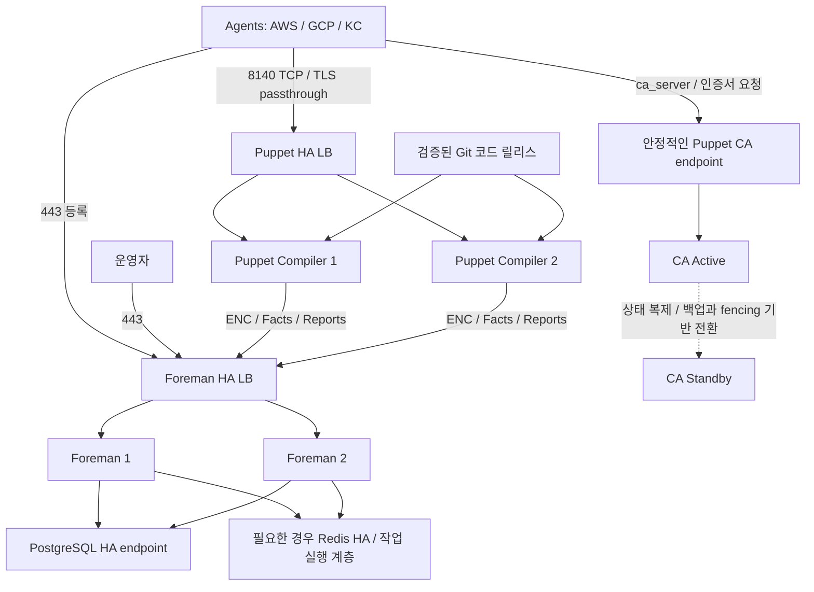

# 이중화와 인증서 운영 설계

이 문서는 배포 제안이다. LB, DB, CA, Foreman 또는 Puppet Server를 실제 생성하는
IaC나 서버 설정 파일은 아직 포함하지 않는다. Foreman 단독 + Puppet 연동을 대상으로 하며
Katello를 추가할 경우 동일한 HA 구조가 지원된다고 가정하지 않는다.

## 확정한 구축 단계

| 단계 | 관리 서버 구성 | 검증 대상 |
| --- | --- | --- |
| 1. 개발 | 관리 서버 1대에 Foreman·Puppet Server/CA·Smart Proxy·PostgreSQL을 함께 배치. Redis 등은 사용하는 기능에 따라 추가 | 사내 인증서, 등록, Facts, ENC, Catalog 적용과 멱등성 |
| 2. 운영 | Foreman·Compiler·DB·CA를 아래 HA 설계대로 분리·이중화 | 정상 운영, 한 대 장애, DB·CA 전환, 복구 |

개발 1대는 관리 서버 수이며 관리 대상 Agent 노드는 별도다.
이 개발 서버는 단일 장애점이 있는 검증 환경이고, 운영 서비스에 대한 HA를 제공하지 않는다.
관리 서버 OS는 선택한 Foreman/Puppet 버전의 지원 목록에 따라 정한다.
이 저장소의 Ubuntu 24.04 기준은 관리 대상 Agent 노드의 기준이다.

```text
개발 관리 서버 1대
├── Foreman                  # UI, 호스트 분류, Facts/Report 조회
├── Puppet Server            # Catalog 컴파일과 Agent 통신
├── Puppet Intermediate CA   # 사내 CA에서 위임받는 발급 방식 사용 시
├── Smart Proxy              # Puppet/CA 관리 연동
└── PostgreSQL               # Foreman 데이터 저장
        ↑
AWS / GCP / KC의 개발 Agent 노드
```

처음부터 Foreman·Puppet·CA에 각각 논리 DNS 이름을 정한다. 개발에서는 같은 IP를
가리켜도 된다. 이후 운영 LB/CA endpoint에는 운영용 이름을 사용한다.
개발·운영의 CA 키와 Agent 인증서는 별도로 관리하고, 개발 CA 개인키를 운영에 복제하지 않는다.
사내 Root CA는 공통이어도 별도 발급 CA와 허용 정책으로 개발·운영 신원을 구분한다.

## 인증서: 사내 CA 사용

Foreman·Puppet Server·Agent 모두 사내 CA 신뢰 체계를 사용하는 것으로 정한다.
실제 인증서·개인키·CA 키는 Git에 저장하지 않고 서버별로 안전하게 배포한다.

| 구간 | 사용할 인증서 | 조건 |
| --- | --- | --- |
| 사용자 / 등록 스크립트 → Foreman HTTPS | 사내 CA 발급 웹 서버 인증서 | 접속 DNS 이름의 SAN 및 CA 신뢰 체인 배포 |
| Agent ↔ Puppet Server | 사내 CA 신뢰 체계 아래의 노드별 인증서 | certname, SAN, mTLS 용도, 체인·CRL·갱신·폐기 절차 일치 |
| Foreman ↔ Smart Proxy, Puppet → Foreman | 사내 CA 신뢰 체계 아래의 서비스별 인증서 | 서버/클라이언트 인증 용도와 상대 서비스의 허용 목록 일치 |

Puppet용 기본 제안은 **사내 Root/발급 CA → 전용 Puppet Intermediate CA → 노드별 인증서**다.
이 방식이면 사내 CA가 위임한 중간 CA로 Puppet의 CSR·발급 수명 주기를 유지할 수 있다.
사내 PKI의 중간 CA 위임 정책과 인증서 프로파일을 먼저 확인한다.
중간 CA 위임이 불가능하면 사내 CA가 모든 Puppet 노드 인증서를 직접 발급하는 방식으로
구성할 수 있지만, 아래와 같이 부트스트랩과 인증서 관리 절차가 달라진다.

| 발급 방식 | Agent 등록·갱신 | Puppet/Foreman CA 관리 |
| --- | --- | --- |
| 사내 CA 아래의 Puppet Intermediate CA | Agent가 Puppet CA endpoint에 CSR을 보내고 승인 정책에 따라 발급 | Puppet CA와 Smart Proxy를 통한 인증서 관리 흐름 유지 |
| 사내 CA 직접 발급 | 외부 발급 절차로 인증서·개인키·신뢰 체인·CRL을 미리 배치하고 갱신 | 내장 Puppet CA는 비활성화. 사내 CA가 Puppet CA API를 제공한다고 가정하지 않으며 Foreman의 기존 CA 서명 UI로 직접 관리하지 않음 |

`PUPPET_CA_SERVER`와 아래 CA Active/Standby 설계는 Puppet Intermediate CA 방식에 해당한다.
사내 CA 직접 발급 방식은 외부 PKI의 HA·등록·갱신 절차로 대체하고, 일반 Puppet CSR 요청을
`ca_server` 주소만 바꿔 사내 발급 서비스에 보내는 방식으로 구현하지 않는다.
발급 방식 확정 전 실제 서버 인증서/CA 설정은 생성하지 않는다.

Agent마다 고유한 인증서·개인키를 사용한다. 공통 웹 인증서 하나를 모든 Agent에 공유하지 않는다.
등록 토큰이나 SSH 키는 Agent/Server mTLS 인증서를 대신하지 않는다.
`puppet apply` 로컬 실행에는 Server와의 mTLS가 필요하지 않지만 현재 중앙 관리 방식과 다르다.
TLS 검증은 유지한다.

## 인증서 없이 통신한다는 옵션의 구분

표준 Agent/Server 구성은 mTLS이며 현재 프로젝트는 사내 인증서 사용 결정을 유지한다.
다만 인증서가 없는 요청을 허용하거나 특정 구간에서 TLS를 종료하는 옵션 자체는 존재한다.
아래는 기능 설명이며 해당 설정을 적용한 것은 아니다.

| 옵션 / 방식 | 실제 의미 | 인증서 없는 전체 Agent 운영인가 |
| --- | --- | --- |
| `auth.conf`의 `allow-unauthenticated: true` | 일치하는 API 규칙에서 인증된 이름을 확인할 수 없는 요청도 허용 | API 인가 규칙이다. TLS 수립·클라이언트 인증서 요구·Agent 부트스트랩을 모두 끄는 단일 옵션이 아님 |
| External SSL Termination | 프록시가 Agent 인증서를 검증하고 신원을 헤더로 전달. Puppet Server 백엔드는 HTTP 사용 가능 | 백엔드 구간에서 TLS를 생략하는 것이며 Agent↔프록시의 인증서가 없어지는 것은 아님 |
| `certificate_revocation = false` | 인증서 폐기 목록(CRL) 확인을 끔 | 인증서 자체나 서버/클라이언트 인증을 제거하지 않음 |
| `puppet apply` | 로컬에서 코드로 Catalog를 구성·적용 | Puppet Server 통신 인증서는 필요 없지만 현재 ENC/Agent-Server 흐름과 다름 |

따라서 “인증서 없이”가 HTTP 전송, 서버 인증서 검증 해제, 클라이언트 인증서 생략,
CA 서명 자동화 중 무엇을 뜻하는지 구분해야 한다. 일부 endpoint에서 인증서가 필요 없는 것과
Catalog·Facts·파일 다운로드·Report를 포함한 전체 Agent 실행이 동작하는 것도 다르다.
최초 CSR/CA 인증서 조회 등 부트스트랩 요청 역시 전체 관리 API의 무인증 운영과 구분한다.

미인증 관리 API를 열면 노드 신원과 권한을 보호할 별도 설계가 필요하다.
외부 TLS 종료의 인증 헤더는 프록시가 검증 결과로 생성하고 사용자 제공 헤더는 신뢰하지 않는다.
Puppet 백엔드에는 그 프록시만 접근하도록 제한한다.
현재는 무인증 API 허용이나 TLS 종료 방식으로 변경하지 않는다.

공식 문서:

- [Puppet Server auth.conf](https://help.puppet.com/core/current/content/puppetcore/server/config_file_auth.htm)
- [External SSL termination](https://help.puppet.com/core/current/content/puppetcore/server/external_ssl_termination.htm)
- [Configuration Reference: certificate_revocation](https://help.puppet.com/core/current/Content/PuppetCore/Markdown/configuration.htm#certificate_revocation)

## 운영 HA 구성 단위

개발 검증 이후 운영 관리 구성을 다음 구조로 구축한다.
아래 구성은 운영 목표이며 개발 단일 서버에 먼저 적용하지 않는다.
CA 부분은 사내 CA 아래의 Puppet Intermediate CA 발급 방식에 대한 설계다.



### 구성 요소별 방식

| 구성 요소 | 권장 방식 | 조건 |
| --- | --- | --- |
| Foreman UI / API / ENC | 2대 Active/Active + HTTPS LB | 같은 DB, 동일 버전·플러그인·암호화 키·세션 서명 비밀값 및 관련 설정 |
| Foreman PostgreSQL | 관리형 Multi-AZ DB 또는 검증된 Primary/Standby 구성 | 쓰기 endpoint 전환, 백업·복구, 복제 지연·데이터 손실 정책 검증 |
| Redis / 작업 실행 계층 | 사용하는 기능에 맞게 별도 HA | 캐시와 작업 큐의 요구를 구분. 플러그인/Dynflow의 작업 소유권·복구·중복 실행 검증 |
| Puppet Compiler | 2대 이상 Active/Active + L4 LB | CA 기능 비활성화, 동일 코드·모듈·Hiera·ENC 연동 |
| Puppet CA | 단일 Active + 복구 가능한 Standby | 동일 CA 신원, CA 상태 보존, 동시 기동 방지 및 전환 절차 |
| Smart Proxy | Compiler별 고유 Proxy, CA용 안정적인 Proxy endpoint | 등록된 Proxy의 신원과 기능을 유지. 일반 웹 서버처럼 무조건 LB 뒤에 묶지 않음 |
| LB / DNS / 코드 저장소·배포 | 자체 HA 또는 관리형 서비스 | 앞단 LB나 코드 배포 경로가 단일 장애점이 되지 않도록 설계 |

단일 CA 원칙은 Puppet Server 기본 구조에 따른 것이다. 위 Active/Standby 전환은
제품에 내장된 자동 CA 클러스터 기능이라고 가정하지 않는다.
CA 키·체인 외에도 서명 인증서, CSR, serial, inventory, CRL 등 선택한 버전의 CA 상태를
일관되게 복구해야 한다. 두 CA를 동시에 쓰기 가능하게 실행하지 않는다.
공유 스토리지를 쓴다면 스토리지 자체 HA와 fencing이 필요하다.
백업만 준비한 경우에는 자동 HA가 아니라 복구 시간만큼 중단되는 DR 구성이다.

자체 구축 DB/Redis의 장애 판단에 합의 시스템을 사용한다면 2대만으로 과반수와
네트워크 단절을 해결한다고 가정하지 않는다. 필요한 3개 투표 노드/장애 도메인 또는
관리형 서비스의 장애 전환 구성을 따로 준비한다.

### Puppet LB와 인증서

- Agent의 `server`는 `puppet.example.internal` 같은 안정적인 LB 이름을 사용한다.
- `ca_server`는 `puppet-ca.example.internal` 같은 CA endpoint를 별도로 사용한다.
- 각 Compiler는 자기 certname과 개인키를 유지한다. Agent가 사용하는 LB 이름을
  각 Compiler 서버 인증서의 SAN에 포함한다.
- L4 LB에서 TLS를 통과시켜 Compiler가 Agent 인증서를 직접 검증하도록 구성한다.
- L7 TLS 종료가 필요하면 Puppet의 External SSL Termination 절차와 신뢰할 프록시의
  인증 헤더·접근 제한을 별도로 설계한다. 웹 서버 TLS 설정만으로 대체하지 않는다.
- Compiler별 ENC 인증서와 Foreman의 허용·신뢰 설정을 일치시키고 모든 Facts/Report를
  같은 Foreman 서비스 endpoint로 보낸다.

### 코드 배포와 장애 처리

한 Puppet 코드 환경에 대해 모든 Compiler에 같은 Git commit의 코드·Hiera를 배포한다.
배포 중 서로 다른 코드를 제공하지 않도록 대상 노드를 LB에서 제외하고 배포·검증한 뒤
다시 편입하거나, 동등한 원자적 릴리스/환경 전환 절차를 마련한다.
환경 캐시 갱신도 포함해 Compiler 간 환경 목록과 Class 목록을 일치시킨다.

장애의 영향은 다음과 같이 구분한다.

| 장애 | 예상 영향 |
| --- | --- |
| Compiler 한 대 | 정상 Compiler로 전환. LB 상태 검사와 여유 용량 필요 |
| Foreman 한 대 | 정상 Foreman으로 UI/API/ENC 전환 |
| Foreman 전체 또는 DB | 신규 등록·ENC·Facts/Report 처리에 영향. 최신 Catalog 컴파일 지속을 보장하지 않음 |
| CA | 신규 등록·서명·갱신·폐기에 영향. 유효한 기존 인증서의 일반 Catalog 요청은 다른 의존성이 정상이고 CRL 검증 조건을 충족하면 계속 가능 |
| 관리 클러스터 전체 | 새 설정 전달 중단. Agent의 기존 캐시 사용 여부는 Agent 정책에 따름 |

운영 단계에서는 한 CSP의 서로 다른 AZ/장애 도메인에 관리 서버를 분산하고 AWS/GCP/KC 노드가
VPN/사설 연결로 접근하도록 설계한다. CSP 전체 장애까지 대응해야 하면 다른 리전/CSP에
복구 가능한 별도 관리 클러스터와 DNS 전환 절차를 추가한다.
여러 CSP 사이에 DB 쓰기를 분산하는 구성을 초기 전제로 삼지 않는다.

## 도입 시 확인

- Foreman 단독/플러그인 조합의 다중 인스턴스·작업 실행 지원 확인
- CA 상태의 일관된 복제와 fencing, 키 보호, 전환·복귀 리허설
- Foreman DB·암호화 키·세션 비밀값·인증서 및 코드 버전의 복구 가능성 확인
- Compiler 및 Foreman 한 대 중단, DB 전환, CA 전환 중 등록·적용·Report 시험
- 대상 노드 수·실행 주기·Catalog 컴파일 비용에 따른 CPU/RAM 및 N-1 용량 산정
- 허용 중단 시간(RTO)과 허용 데이터 손실(RPO)을 정한 뒤 동기/비동기 복제 및 자동 전환 범위 결정

## 근거 문서

- [Puppet: Certificate authority and SSL](https://help.puppet.com/core/current/Content/PuppetCore/ssl_certificates.htm)
- [Puppet: External CA](https://help.puppet.com/core/current/content/puppetcore/config_ssl_external_ca.htm)
- [Puppet: Scaling Puppet Server](https://help.puppet.com/core/current/Content/PuppetCore/server/scaling_puppet_server.htm)
- [Foreman: Multiple Foreman instances](https://theforeman.org/manuals/3.18/index.html#5.8MultipleForemaninstances)

참고한 Puppet 현행 문서와 이 저장소의 컴파일 검증 버전(8.10.0)은 다를 수 있다.
실제 배포할 Foreman/Puppet 버전을 고정한 후 인증서·HA·설정 경로의 호환성을 검증한다.
