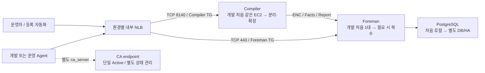

# 개발·운영 공통 LB와 확장 경계

## 결정과 권장 구조

개발도 LB를 사용해 운영과 같은 접속 방식으로 시작한다.
환경별로 별도 LB/endpoint와 신뢰 체계를 두되 같은 IaC 구조와 운영 절차를 사용한다.
초기 개발은 LB 뒤의 대상 EC2가 한 대여도 된다. LB만 있다고 애플리케이션까지 HA인 것은 아니다.

AWS 내부 NLB의 TCP passthrough를 기본 권장안으로 둔다.
프론트엔드 TLS listener에서 TLS를 종료하는 방식과 구분한다.
이 방식은 서버/프록시가 기존 TLS·클라이언트 인증서를 검증하게 해 인증 연동 변경을 줄인다.
ALB/L7 TLS 종료를 선택하려면 Foreman/Puppet 연동의 클라이언트 신원 전달과 신뢰 헤더를
추가 설계해야 하므로 단순 교체하지 않는다.

하나의 내부 NLB에 포트별 listener와 target group을 분리하는 구성을 후보로 한다.

| 논리 endpoint | listener | target group | 초기 대상 |
| --- | --- | --- | --- |
| Foreman DNS 이름 | TCP 443 | Foreman HTTPS | 개발 관리 EC2 1대 |
| Puppet DNS 이름 | TCP 8140 | Puppet Compiler | 같은 개발 EC2 1대 |
| CA DNS 이름 | CA 전용 경로 | Compiler pool과 분리 | 선택한 CA 모델의 발급 서버 |

Foreman/Puppet DNS 이름은 같은 NLB를 가리킬 수 있다. 서버 인증서 SAN에 실제 접속 이름을
포함하고 대상 그룹은 실제 백엔드 포트로 전달한다. SG·NLB 배치·cross-zone 설정은 네트워크
설계 시 검증한다. 여러 AZ에 배치할 때 대상이 없는 AZ의 전달 동작도 확인한다.

초기 통합 VM에서 Puppet Server가 Foreman LB를 호출하면 요청이 같은 EC2로 돌아올 수 있다.
NLB의 client IP preservation이 켜진 동일 대상 hairpin 경로는 지원되지 않으므로,
이 경로의 target group에서 보존을 끄는 등 설계와 실제 호출 시험이 필요하다.
보존을 끄면 백엔드에 보이는 source IP가 달라지므로 접근 정책·로그도 함께 검토한다.
Proxy Protocol v2는 백엔드가 지원하도록 설정하지 않은 상태에서 활성화하지 않는다.
TLS passthrough와 클라이언트 인증서 검증은 별도로 유지한다.

CA는 초기에는 Controller의 별도 사설 DNS endpoint로 둘 수 있다. 이후 HA를 정할 때
전용 LB 또는 장애 전환 경로를 설계한다. CA 이름을 Compiler NLB의 같은 8140 listener로
무조건 보내면 CA 기능을 끈 Compiler에 요청이 갈 수 있으므로 별도 설계 없이 재사용하지 않는다.
현재 NLB/target group/CA 경로를 실제 생성한 것은 아니다.

## HA에서 지금 정할 것과 나중에 정할 것

지금은 안정적인 논리 DNS, 환경별 분리, Foreman/Compiler/DB/CA 책임과 상태 저장 위치를 정한다.
정확한 대수·DB 복제·CA 전환 구현·RTO/RPO·장애 도메인·failover 시험은 뒤에서 상세화할 수 있다.
단, HA 상세화를 미뤄도 인증서·DB가 삭제되어도 되는 임시 디스크에만 있도록 설계하지 않는다.

## Autoscaling은 역할별로 판단

| 역할 | 정책 |
| --- | --- |
| Compiler | 재생성 가능한 형태로 만들면 수평 확장/ASG 가능. 초기에는 고정 대수 권장 |
| Foreman Web/API | DB·암호화/세션 키·설정·작업 실행 상태를 중앙화하고 다중 인스턴스 조건을 충족하면 확장 가능. 초기 동적 확장은 보류 |
| CA | CA 상태를 가진 발급 계층. 일반적인 다중 Active ASG scale-out/임의 교체 대상이 아님 |
| PostgreSQL | 일반 EC2 ASG로 데이터 노드를 늘리거나 삭제하지 않음. RDS/DB 전용 HA·확장 방식 사용 |
| 모든 기능이 합쳐진 초기 EC2 | DB/CA가 포함되어 있으므로 범용 ASG의 자동 교체·scale-in을 적용하지 않음 |

ASG의 고정 대수 운영과 부하에 따른 동적 증감은 구분한다. min=desired=max로 두어도
상태 검사에 의한 인스턴스 교체는 발생할 수 있다. 상태 복구/부트스트랩이 검증되지 않으면
고정 대수 ASG 역시 CA/DB 상태 보존의 대안이 아니다.

## Compiler ASG를 나중에 도입할 조건

1. CA/DB를 외부화하고 Compiler의 CA 기능을 끈다.
2. 이미지에는 노드별 인증서/개인키를 공통으로 굽지 않는다. 새 Compiler마다 고유 신원을 발급한다.
3. 승인한 동일 코드·모듈·Hiera commit을 배포하고 ENC/Facts/Report 연동을 준비한다.
4. 부트스트랩과 JVM/JRuby warmup 후 실제 Catalog 및 인증 연동 검증을 통과해야 LB에 편입한다.
   TCP 포트가 열린 것만으로 준비 완료라고 판정하지 않는다.
5. Foreman의 관련 허용 목록·Smart Proxy 등록이 필요한 구성에서는 고유 노드의 수명 주기를 연동한다.
6. scale-in은 LB에서 요청을 빼고 진행 중 요청을 drain한 뒤 종료한다. 로그를 중앙 보관하고
   폐기한 Compiler의 인증서·Proxy 등록 등 잔여 상태를 정리한다.
7. 급격한 증감은 피하고 최소 용량·warmup·cooldown을 실제 컴파일 시간으로 정한다.
   CPU뿐 아니라 JRuby 대기·요청 큐·상위 지연을 확인한다.
8. Foreman/DB가 병목인 상태에서 Compiler만 늘리는 정책을 만들지 않는다.

초기 권장안은 개발·운영 모두 LB + 고정 대수 서버다. 부하 시험과 노드 수명 주기 자동화가
준비된 후 Compiler 계층만 ASG 도입을 검토한다. HA가 반드시 동적 Autoscaling을 요구하지는 않는다.

## 참고

- [AWS NLB listener와 TLS passthrough](https://docs.aws.amazon.com/elasticloadbalancing/latest/network/load-balancer-listeners.html)
- [Puppet Server 확장과 CA 분리](https://help.puppet.com/core/current/Content/PuppetCore/server/scaling_puppet_server.htm)
- [ASG lifecycle hooks](https://docs.aws.amazon.com/autoscaling/ec2/userguide/lifecycle-hooks.html)
- [ASG 인스턴스 수명 주기](https://docs.aws.amazon.com/autoscaling/ec2/userguide/ec2-auto-scaling-lifecycle.html)

- [NLB 동일 대상 연결/hairpin 제한](https://docs.aws.amazon.com/elasticloadbalancing/latest/network/load-balancer-troubleshooting.html)
