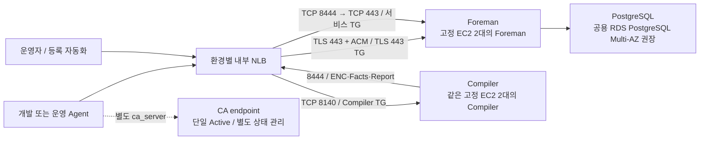

# 개발·운영 공통 LB와 확장 경계

## 결정과 권장 구조

최초 개발·운영 모두 각자의 내부 NLB + Server1 + 로컬 PostgreSQL 16으로 시작한다.
[단계별 계획](PHASED_ROLLOUT.md)의 2단계에서 RDS로 이전하고 3단계에서 기존 LB에 Server2를 추가한다.
환경별로 별도 LB/endpoint와 신뢰 체계를 두되 같은 IaC 구조와 운영 절차를 사용한다.
아래는 3단계 개발·운영 각각의 LB 뒤 고정 EC2 2대 목표다. 각 EC2에 Foreman·Compiler를 함께 배치하고
공용 RDS PostgreSQL Multi-AZ를 권장한다. LB만으로 DB/CA까지 HA가 되는 것은 아니다.

웹/API는 **NLB TLS 443 + ACM → TLS target 443**, 내부 Foreman 연동은 **TCP 8444 → TCP 443**, Agent는 **TCP 8140 passthrough**를 1단계부터 사용한다.
[인증서 소유·내부 연동 경로](ACM_AND_BACKEND_TLS.md)가 현재 기준이다.

| 논리 endpoint | listener | target group | 초기 대상 |
| --- | --- | --- | --- |
| Foreman 웹/PAT API | TLS 443, ACM 인증서 | TLS 443, 서버 내부용 인증서 | Server1 한 대, 3단계 두 대 |
| Puppet Agent | TCP 8140 | TCP 8140, 내장 CA mTLS | Server1 한 대, 3단계 두 대 |
| CA | 별도 CA DNS 8140 | 일반 Compiler pool과 분리 | 단일 Active CA |
| ENC/Facts/Report·Proxy→Foreman | foreman_service_fqdn:8444 | 별도 TCP 443 TG | Server1 → 3단계 Server1/2 |
| Foreman→각 Proxy | host_fqdn:8443 직접 | NLB 우회 | Proxy별 고유 주소 |

NLB에서 종료된 TLS 클라이언트 인증서가 backend TLS로 자동 전달된다고 가정하지 않는다.
Puppet/Proxy의 인증서 인증 경로를 웹/PAT listener로 바꾸지 않는다. NLB가 backend 인증서의 체인/이름을
검증하는 것도 아니므로 SG와 내부 클라이언트의 CA/이름 검증을 별도로 유지한다.
여러 AZ의 대상 분산·없는 AZ의 전달·cross-zone과 SG를 검증한다.
1단계부터 관리 서버가 자신을 대상으로 하는 NLB 8444를 호출하므로 해당 TCP TG의 client IP preservation을 끈다.
인증서 신원은 TLS로 유지하고 실제 동일 서버 반환·교차 AZ 연결을 검증한다. Proxy Protocol v2는 backend가 준비되지 않으면 켜지 않는다.

CA는 초기에는 Controller의 별도 사설 DNS endpoint로 둘 수 있다. 이후 HA를 정할 때
전용 LB 또는 장애 전환 경로를 설계한다. CA 이름을 Compiler NLB의 같은 8140 listener로
무조건 보내면 CA 기능을 끈 Compiler에 요청이 갈 수 있으므로 별도 설계 없이 재사용하지 않는다.
현재 NLB/target group/CA 경로를 실제 생성한 것은 아니다.

## HA에서 지금 정할 것과 나중에 정할 것

지금은 안정적인 논리 DNS, 환경별 분리, Foreman/Compiler/DB/CA 책임과 상태 저장 위치를 정한다.
정확한 대수·DB 복제·CA 전환 구현·RTO/RPO·장애 도메인·failover 시험은 뒤에서 상세화할 수 있다.
단, HA 상세화를 미뤄도 인증서·DB가 삭제되어도 되는 임시 디스크에만 있도록 설계하지 않는다.

## Autoscaling: 현재 보류, 고도화 참고

| 역할 | 정책 |
| --- | --- |
| Compiler | 재생성 가능한 형태로 만들면 수평 확장/ASG 가능. 초기에는 고정 대수 권장 |
| Foreman Web/API | DB·암호화/세션 키·설정·작업 실행 상태를 중앙화하고 다중 인스턴스 조건을 충족하면 확장 가능. 초기 동적 확장은 보류 |
| CA | CA 상태를 가진 발급 계층. 일반적인 다중 Active ASG scale-out/임의 교체 대상이 아님 |
| PostgreSQL | 일반 EC2 ASG로 데이터 노드를 늘리거나 삭제하지 않음. RDS/DB 전용 HA·확장 방식 사용 |
| 모든 기능이 합쳐진 초기 EC2 | DB/CA가 포함되어 있으므로 범용 ASG의 자동 교체·scale-in을 적용하지 않음 |

ASG의 고정 대수 운영과 부하에 따른 동적 증감은 구분한다. min=desired=max로 두어도
상태 검사에 의한 인스턴스 교체는 발생할 수 있다. 상태 복구/부트스트랩이 검증되지 않으면
고정 대수 ASG 역시 CA/DB 상태 보존의 대안이 아니다.

## 고도화 시 Compiler ASG를 도입할 조건

1. CA/DB를 외부화하고 Compiler의 CA 기능을 끈다.
2. 이미지에는 노드별 인증서/개인키를 공통으로 굽지 않는다. 새 Compiler마다 고유 신원을 발급한다.
3. 승인한 동일 코드·모듈·Hiera commit을 배포하고 ENC/Facts/Report 연동을 준비한다.
4. 부트스트랩과 JVM/JRuby warmup 후 실제 Catalog 및 인증 연동 검증을 통과해야 LB에 편입한다.
   TCP 포트가 열린 것만으로 준비 완료라고 판정하지 않는다.
5. Foreman의 관련 허용 목록·Smart Proxy 등록이 필요한 구성에서는 고유 노드의 수명 주기를 연동한다.
6. scale-in은 LB에서 요청을 빼고 진행 중 요청을 drain한 뒤 종료한다. 로그를 중앙 보관하고
   폐기한 Compiler의 인증서·Proxy 등록 등 잔여 상태를 정리한다.
7. 급격한 증감은 피하고 최소 용량·warmup·cooldown을 실제 컴파일 시간으로 정한다.
   CPU뿐 아니라 JRuby 대기·요청 큐·상위 지연을 확인한다.
8. Foreman/DB가 병목인 상태에서 Compiler만 늘리는 정책을 만들지 않는다.

개발·운영 각각 1단계 LB+Server1+로컬 DB, 2단계 RDS 이전, 3단계 Server2 추가를 목표로 한다. ASG는 생성하지 않는다. 부하 시험과 노드 수명 주기 자동화가
준비된 후 Compiler 계층만 ASG 도입을 검토한다. HA가 반드시 동적 Autoscaling을 요구하지는 않는다.

## 참고

- [AWS NLB TLS listener와 TCP passthrough](https://docs.aws.amazon.com/elasticloadbalancing/latest/network/load-balancer-listeners.html)
- [Puppet Server 확장과 CA 분리](https://help.puppet.com/core/current/Content/PuppetCore/server/scaling_puppet_server.htm)
- [ASG lifecycle hooks](https://docs.aws.amazon.com/autoscaling/ec2/userguide/lifecycle-hooks.html)
- [ASG 인스턴스 수명 주기](https://docs.aws.amazon.com/autoscaling/ec2/userguide/ec2-auto-scaling-lifecycle.html)

- [NLB 동일 대상 연결/hairpin 제한](https://docs.aws.amazon.com/elasticloadbalancing/latest/network/load-balancer-troubleshooting.html)

장애 예시와 앱/DB health check·NLB fail-open 조건은 [3포트 구성](ACM_AND_BACKEND_TLS.md#장애-예시)을 따른다.
