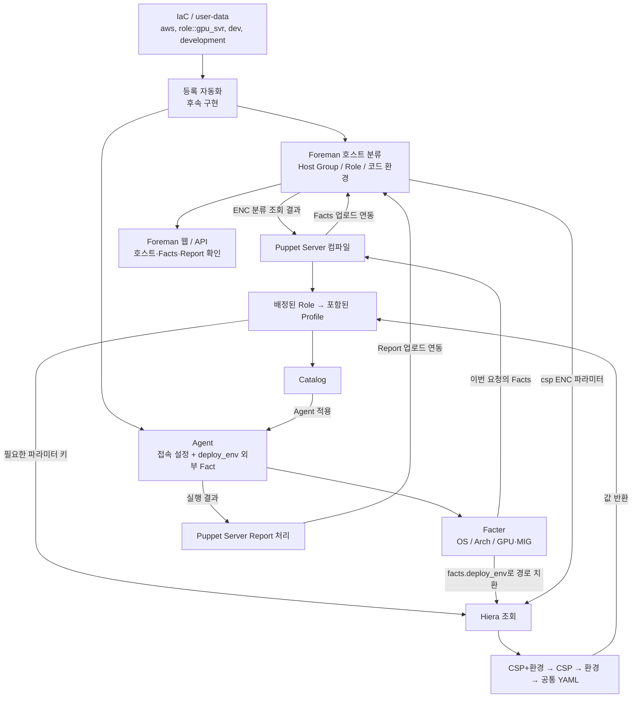
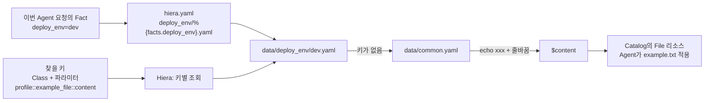
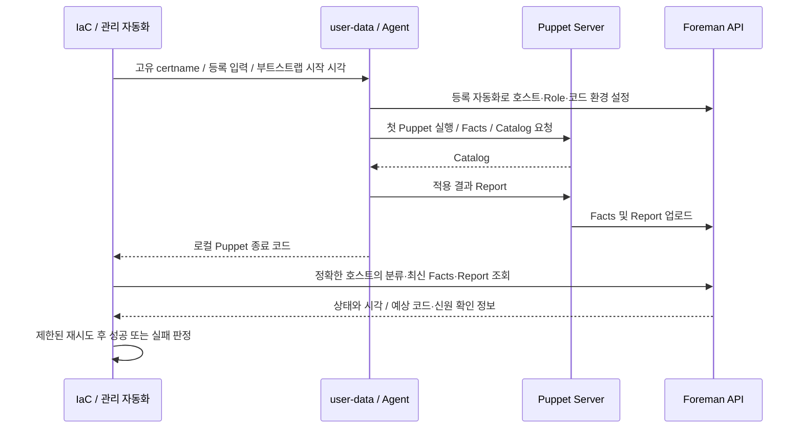

# 설정 조회 관계와 등록 성공 확인


현재 신규 Role 기준은 [서버 Role 구성](ROLES.md)이다. 기존 GPU 흐름은 호환 예제로 유지한다.
## 1. 세 종류의 정보

| 구분 | 출처 | 예시 | 사용하는 곳 |
| --- | --- | --- | --- |
| 적용 의도 | IaC/user-data → 등록 자동화 → Foreman | Host Group, csp ENC 파라미터, Role, Puppet 코드 환경 | ENC의 노드 분류 |
| 노드 속성·관측 정보 | Agent의 Facter 및 외부/Custom Facts | deploy_env, team, dr_site, OS, Arch, GPU/MIG | Catalog 컴파일, Hiera 파일 경로, Foreman 조회 |
| 설정 데이터 | Git의 Hiera YAML | 패키지 목록, 예시 파일 내용 | Profile의 파라미터 |

`deploy_env`는 user-data가 파일로 준비하는 환경 정보다. GPU/MIG는 장비에서 수집할
정보이며 수집기는 아직 구현하지 않았다. Role은 Facts로 추론하지 않고 등록 입력으로 지정한다.
Puppet Server는 이번 요청의 Facts로 Catalog를 컴파일한다. Foreman의 Facts는 업로드된
관측 결과이며 전송 주기에 따라 실제 상태보다 늦을 수 있다. Puppet Server 자체의
Facts 영구 저장은 별도 설정에 따르며 이 저장소는 PuppetDB를 도입하지 않았다.



이는 책임과 데이터 관계이며 모든 화살표가 반드시 단일 실행의 순차 작업을 의미하지 않는다.
Facts/Report 업로드, Foreman ENC, 등록 자동화는 실제 배포 시 연결해야 한다.

## 1.1. Facts와 Foreman 관리 정책을 분리하는 이유

**결정: 기존처럼 노드 속성은 대상 서버의 Facts로 제공하고, 관리 정책은 Foreman에서 관리한다.**
모든 항목을 대상 서버 파일 하나의 지속 관리 대상으로 합치지 않는다. Role을 바꿀 때 대상 서버에
파일을 다시 배포하지 않고 Foreman 웹/API에서 변경할 수 있게 하기 위한 구분이다.

user-data는 저장 위치가 아니라 최초 설정을 실행하는 수단이다. user-data/등록 자동화가
노드 속성은 외부 Facts 파일로 기록하고, 관리 정책은 Foreman API로 등록·배정하는 두 경로를 사용한다.
API 호출은 등록 자동화가 대행할 수 있으며 대상 노드에 관리자 토큰을 보관하지 않는다.
Facts 업로드만으로 Host Group이나 Role이 자동 배정된다고 가정하지 않는다.

| 항목 | 기준이 되는 저장 위치 | 최초 설정 | 등록 후 변경 방법 |
| --- | --- | --- | --- |
| deploy_env | 대상 서버의 외부 Facts 파일 | user-data로 dev/prd 지정. sandbox는 추후 TODO | 서버의 Facts 원본을 변경·배포하고 다음 수집에서 전달 |
| team | 대상 서버의 외부 Facts 파일 | 팀명 또는 미정 null 입력. null이면 외부 Fact 키 생략 | 서버의 Facts 원본 변경. 기존 팀 값을 해제할 때 키 제거 및 Foreman 반영 여부 확인 |
| dr_site | 대상 서버의 외부 Facts 파일 | primary/secondary 지정 | 서버의 Facts 원본 변경. CSP별 실제 위치 매핑은 별도 정책 문서 |
| OS·Arch·GPU/MIG | Facter/Custom Fact 수집 결과 | OS·Arch는 기본 수집, GPU/MIG 수집기는 후속 구현 | 실제 상태를 다시 수집하며 같은 이름의 수동 Fact로 중복 기록하지 않음 |
| CSP Host Group | Foreman 호스트 분류 | 등록 입력 aws/gcp/kc를 API로 배정 | Foreman 웹/API에서 Host Group 변경 |
| csp | Foreman Host Group의 ENC 파라미터 | 각 CSP 그룹에 같은 이름의 csp 값을 설정·상속 | 그룹 파라미터/호스트 소속을 Foreman에서 관리 |
| Role | Foreman의 호스트별 Puppet Class 배정 | base/unmanaged/devops/data_infra 중 하나 배정 | Foreman 웹/API에서 기존 Role을 교체 |
| puppet_managed | Foreman Boolean 파라미터 | 등록 시 적용/제외 정책 지정, 상속값 포함 확인 | Foreman 웹/API에서 유효한 Boolean 값을 변경 |
| Puppet Environment | Foreman의 호스트 코드 환경 | 등록 시 development/production 배정 | Foreman 웹/API에서 코드 환경 변경 |

CSP도 기술적으로 Fact로 수집할 수 있지만, 이 프로젝트에서는 CSP별 Host Group을 관리 기준으로
선택했으므로 Hiera에는 상속된 csp ENC 파라미터를 사용한다. 같은 분류를 Fact와 ENC 양쪽의
관리 기준으로 중복 선언하지 않는다. deploy_env/team/dr_site도 자동 감지값이 아니라 서버 생성 시
명시한 노드 분류이며, Foreman의 Facts 화면은 Agent가 업로드한 결과를 보여주는 곳이다.
Foreman에서 로컬 Facts 원본까지 자동으로 변경하는 구조가 아니다.

### user-data 지정, 자동 수집, 외부 Facts 파일의 차이

user-data는 서버 초기화 때 실행할 입력/스크립트다. deploy_env·team·dr_site는 서버 장비에서
자동으로 알아낼 수 있는 값이 아니라 IaC나 생성 담당자가 정한 값을 user-data로 전달한다.
user-data가 서버의 외부 Facts 파일에 기록하면 이후 Agent 실행 때마다 Facter가 그 파일을 읽는다.
user-data 자체가 매번 실행되거나 Facts를 계속 측정하는 구조는 아니다. 일반 환경변수만 설정하면
후속 Agent 프로세스가 자동으로 Fact로 수집한다고 가정하지 않는다.

**외부 Facts**의 외부는 네트워크 밖이라는 뜻이 아니라, Facter의 내장 수집 로직 밖에서 제공한
값이라는 뜻이다. 이 프로젝트는 대상 서버의 다음 JSON 파일을 외부 Facts 원본으로 사용한다.

```text
/etc/puppetlabs/facter/facts.d/foreman_puppet.json
```

```json
{
  "deploy_env": "dev",
  "dr_site": "primary"
}
```

위 예시는 목표 형식이며 dr_site의 bootstrap 반영은 후속 구현이다. team 미정 입력 null은
문자열 "null"로 저장하지 않고 외부 Facts 파일에서 team 키를 생략하는 규약이다.
최초 user-data 실행 이후 값을 바꾸려면 원본 파일을 갱신해야 한다. Facts 파일은 비밀 저장소가 아니므로
등록 토큰·개인키·비밀번호를 넣지 않는다.

| 방식 | 값의 출처 | 값이 바뀌는 시점 | 우리 항목 |
| --- | --- | --- | --- |
| user-data로 지정 후 파일 기록 | 서버 생성 설정/IaC | 서버의 Facts 원본을 갱신할 때 | deploy_env, team, dr_site |
| Facter 내장 자동 수집 | 현재 OS·장비 상태 | Facter가 실행되어 다시 조회할 때 | os, os.architecture |
| Custom Fact 자동 수집 | 별도로 만든 장비 조회 로직 | 수집기가 실행되어 다시 조회할 때 | gpu.present, gpu.mig.configured |

외부 Facts 파일은 Facter가 읽고, Agent가 그 결과를 Server에 보낸다. Foreman 등록 API는
별도의 경로로 Host Group·Role·적용 여부·코드 환경을 저장한다. 로컬 Facts를 바꾸는 것과
Foreman의 호스트 관리 정책을 바꾸는 것은 서로 자동 동기화되지 않는다.

### Role 변경 예시

```text
최초 등록: user-data의 role=base → 등록 API → Foreman에 role::base 배정
이후 변경: 운영자가 Foreman에서 role::base를 제거하고 role::devops 배정
다음 실행: Agent 요청 → Server가 Foreman ENC 조회 → 새 Role로 Catalog 생성·적용
```

Role 변경만을 위해 대상 서버에 새 파일을 배포하지 않는다. 새 Role의 코드는 해당 Puppet
Environment에 미리 배포되어 있어야 한다. 단일 Role 규칙을 지키고, 미관리 전환 시에는
[Role 수명 주기](ROLE_LIFECYCLE.md)의 puppet_managed 전환 순서를 따른다.
Role에서 빠진 리소스가 자동으로 삭제·원복되는 것은 아니며 필요하면 별도 리소스로 선언한다.

최초 등록 입력은 **새 호스트를 등록하기 위한 입력**이다. Agent의 정기 실행이나 부트스트랩
재실행이 과거 user-data의 Role·Host Group·적용 여부·코드 환경으로 Foreman 값을 덮어쓰지 않도록
등록 자동화를 구현한다. 기존 호스트가 있으면 신원·분류를 조회해 검증하고, 갱신은 명시적인
관리 변경 절차에서만 수행한다. 등록 후 정책의 기준은 Foreman이다.

### Facts 관련 합의와 구현 상태

현재 적용 범위의 외부 분류는 deploy_env=dev/prd, 선택적 team(null 허용),
dr_site=primary/secondary다. dr_site는 평상시 지정한 주/DR 사이트로, 장애 시 실제 서비스의
active/standby 상태와 분리한다. 실제 리전·Zone은 이번 필수 Facts에 추가하지 않는다.

sandbox는 현재 사용 범위에서 제외하고 [추후 TODO](../README.md#추후-todo)로 관리한다.
현재 bootstrap과 Catalog의 deploy_env 검증은 dev/prd 기준이다. dr_site 수집과
입력 검증, team=null의 명시적 지원 확인, API 등록 자동화는 후속 구현·검증 대상이다.
sandbox 분류만 추가해도 코드 환경이 자동 생성되거나 자동 배정되지는 않는다.
이 절은 설계 결정이며 해당 기능이 이미 실행 코드에 반영됐다는 의미가 아니다.

## 2. Hiera에서 무엇을 어디서 찾는가

전체 우선순위는 CSP+환경 → CSP → 환경 → 공통이다. 아래 그림은 해당 CSP 상위 계층에
키가 없을 때 환경·공통 계층으로 넘어온 조회를 확대해서 보여준다. 전체 경로는
[CSP별 시스템 정책](SYSTEM_POLICIES.md)을 참고한다.

현재 Profile 선언:

```puppet
class profile::example_file (
  String[1] $content,
) {
  # File 리소스의 content에 $content를 사용
}
```



`name`은 계층 이름, `path`는 `datadir: data` 기준의 상대 파일 경로다.
`content`가 `deploy_env`를 찾는 것이 아니다. 파라미터는 조회할 키를 정하고,
Fact와 경로 규칙은 조회할 파일을 정한다. Hiera가 Role을 선택하지 않는다.

## 3. 로컬 진단 파일 제거

`node.conf` 생성과 `node.conf.epp` 양식은 제거했다. 현재는 `profile::example_file`이
예시 파일 `example.txt`를 관리하며, 과거 Catalog가 만든 `/etc/foreman-puppet/node.conf`는
다음 Puppet 적용에서 `ensure => absent`로 삭제한다.

클라우드 상태나 등록 성공 여부는 로컬 파일의 존재로 판단하지 않는다.
Foreman의 최신 Facts/Report와 Agent 실행 결과를 기준으로 확인한다.
인스턴스 생성·삭제는 클라우드 인벤토리와 별도로 대조한다.

## 4. 부트스트랩 성공 판정 설계

user-data에서 API 관리자 토큰을 보관하지 않고, 로컬 결과와 관리 측 검증을 분리한다.
아래는 구현할 기준이며 현재 등록/검증 스크립트는 아직 없다.



1. 현재 부트스트랩의 고유 노드 신원을 결정한다. 호스트 이름만 재사용해서 이전 인스턴스의
   Report를 성공으로 보지 않는다. 클라우드 리소스 ID와 certname의 매핑은 등록 설계에서 정한다.
2. 사내 인증서/신뢰 체인이 준비되고 실제 Agent/Server 연결이 가능한지 확인한다.
3. `puppet agent --test --detailed-exitcodes` 결과에서 `0`과 `2`를 성공으로 처리한다.
   `4`, `6`은 리소스 실패를 포함하며, 그 외 오류도 성공으로 처리하지 않는다.
4. Foreman API에서 기대한 호스트·Host Group·단일 Role·Puppet 코드 환경을 확인한다.
5. 최신 Facts와 성공 Report가 이번 실행 이후의 것인지 확인한다. 수신 시각만으로 이전
   실행의 늦게 도착한 Report를 오인하지 않도록 실행 시각·노드 신원·가능한 코드 버전을 확인한다.
6. 최초 등록 성공은 캐시된 과거 Catalog 적용만으로 판정하지 않는다. 실제 Server 컴파일/
   코드 버전 및 Report의 관련 정보를 선택한 Puppet/Foreman 버전에서 확인한다.
7. 업로드 지연에는 횟수·시간 제한이 있는 재시도를 사용하고, 시간 초과 시 단계를 표시한다.

정확한 API 경로와 응답 필드는 설치할 Foreman 및 Puppet 플러그인 버전의 API 문서를
기준으로 정한다. Foreman API를 호출하는 관리 자동화 계정은 필요한 읽기 권한을 사용한다.

검증 성공 후의 지속 관리/미관리 전환은 [Role별 수명 주기](ROLE_LIFECYCLE.md)를 따른다.
미관리 목표는 최초 Base 적용 성공 후 false → unmanaged 순서로 전환한다.
이 전환을 수행하는 자동화 계정은 위 조회 권한에 더해 필요한 호스트 분류·파라미터 변경 권한이 필요하다.

## 5. 리소스 교체와 주기 점검

- 새 클라우드 인스턴스에는 새 노드 신원을 부여하고 필요한 인증서·등록 절차를 수행한다.
- 기존 노드의 생존 상태는 최신 Report/Facts 시각과 Agent 실행 주기를 기준으로 판단한다.
- 삭제된 인스턴스는 클라우드 인벤토리와 대조해 Foreman 호스트 정리 및 인증서 폐기를 수행한다.
- 오래된 Report가 남아 있는 것과 현재 인스턴스가 정상인 것은 구분한다.

단순한 로컬 상태 파일 하나로 이 수명 주기를 대체하지 않는다.
