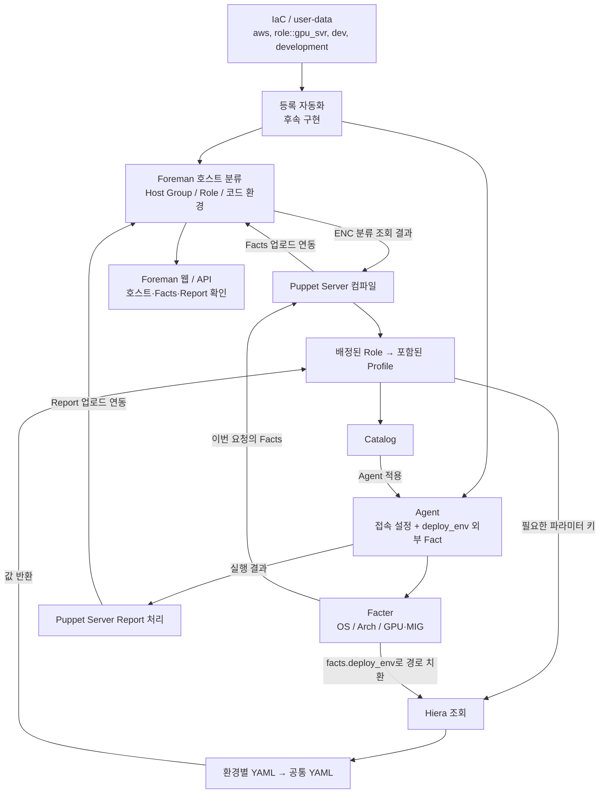
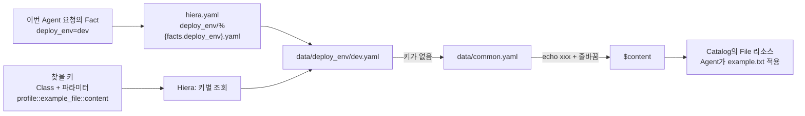
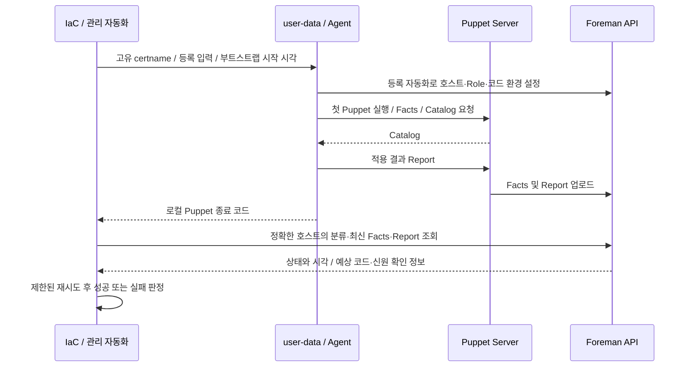

# 설정 조회 관계와 등록 성공 확인

## 1. 세 종류의 정보

| 구분 | 출처 | 예시 | 사용하는 곳 |
| --- | --- | --- | --- |
| 적용 의도 | IaC/user-data → 등록 자동화 → Foreman | Host Group, Role, Puppet 코드 환경 | ENC의 노드 분류 |
| 관측 정보 | Agent의 Facter 및 외부/Custom Facts | deploy_env, OS, Arch, GPU/MIG | Catalog 컴파일, Hiera 파일 경로, Foreman 조회 |
| 설정 데이터 | Git의 Hiera YAML | 패키지 목록, 예시 파일 내용 | Profile의 파라미터 |

`deploy_env`는 user-data가 파일로 준비하는 환경 정보다. GPU/MIG는 장비에서 수집할
정보이며 수집기는 아직 구현하지 않았다. Role은 Facts로 추론하지 않고 등록 입력으로 지정한다.
Puppet Server는 이번 요청의 Facts로 Catalog를 컴파일한다. Foreman의 Facts는 업로드된
관측 결과이며 전송 주기에 따라 실제 상태보다 늦을 수 있다. Puppet Server 자체의
Facts 영구 저장은 별도 설정에 따르며 이 저장소는 PuppetDB를 도입하지 않았다.



이는 책임과 데이터 관계이며 모든 화살표가 반드시 단일 실행의 순차 작업을 의미하지 않는다.
Facts/Report 업로드, Foreman ENC, 등록 자동화는 실제 배포 시 연결해야 한다.

## 2. Hiera에서 무엇을 어디서 찾는가

현재 Profile 선언:

```puppet
class profile::example_file (
  String[1] $content,
) {
  # File 리소스의 content에 $content를 사용
}
```



`name`은 계층 이름, `path`는 `datadir: data` 기준의 상대 파일 경로다.
`content`가 `deploy_env`를 찾는 것이 아니다. 파라미터는 조회할 키를 정하고,
Fact와 경로 규칙은 조회할 파일을 정한다. Hiera가 Role을 선택하지 않는다.

## 3. 로컬 진단 파일 제거

`node.conf` 생성과 `node.conf.epp` 양식은 제거했다. 현재는 `profile::example_file`이
예시 파일 `example.txt`를 관리하며, 과거 Catalog가 만든 `/etc/foreman-puppet/node.conf`는
다음 Puppet 적용에서 `ensure => absent`로 삭제한다.

클라우드 상태나 등록 성공 여부는 로컬 파일의 존재로 판단하지 않는다.
Foreman의 최신 Facts/Report와 Agent 실행 결과를 기준으로 확인한다.
인스턴스 생성·삭제는 클라우드 인벤토리와 별도로 대조한다.

## 4. 부트스트랩 성공 판정 설계

user-data에서 API 관리자 토큰을 보관하지 않고, 로컬 결과와 관리 측 검증을 분리한다.
아래는 구현할 기준이며 현재 등록/검증 스크립트는 아직 없다.



1. 현재 부트스트랩의 고유 노드 신원을 결정한다. 호스트 이름만 재사용해서 이전 인스턴스의
   Report를 성공으로 보지 않는다. 클라우드 리소스 ID와 certname의 매핑은 등록 설계에서 정한다.
2. 사내 인증서/신뢰 체인이 준비되고 실제 Agent/Server 연결이 가능한지 확인한다.
3. `puppet agent --test --detailed-exitcodes` 결과에서 `0`과 `2`를 성공으로 처리한다.
   `4`, `6`은 리소스 실패를 포함하며, 그 외 오류도 성공으로 처리하지 않는다.
4. Foreman API에서 기대한 호스트·Host Group·단일 Role·Puppet 코드 환경을 확인한다.
5. 최신 Facts와 성공 Report가 이번 실행 이후의 것인지 확인한다. 수신 시각만으로 이전
   실행의 늦게 도착한 Report를 오인하지 않도록 실행 시각·노드 신원·가능한 코드 버전을 확인한다.
6. 최초 등록 성공은 캐시된 과거 Catalog 적용만으로 판정하지 않는다. 실제 Server 컴파일/
   코드 버전 및 Report의 관련 정보를 선택한 Puppet/Foreman 버전에서 확인한다.
7. 업로드 지연에는 횟수·시간 제한이 있는 재시도를 사용하고, 시간 초과 시 단계를 표시한다.

정확한 API 경로와 응답 필드는 설치할 Foreman 및 Puppet 플러그인 버전의 API 문서를
기준으로 정한다. Foreman API를 호출하는 관리 자동화 계정은 필요한 읽기 권한을 사용한다.

## 5. 리소스 교체와 주기 점검

- 새 클라우드 인스턴스에는 새 노드 신원을 부여하고 필요한 인증서·등록 절차를 수행한다.
- 기존 노드의 생존 상태는 최신 Report/Facts 시각과 Agent 실행 주기를 기준으로 판단한다.
- 삭제된 인스턴스는 클라우드 인벤토리와 대조해 Foreman 호스트 정리 및 인증서 폐기를 수행한다.
- 오래된 Report가 남아 있는 것과 현재 인스턴스가 정상인 것은 구분한다.

단순한 로컬 상태 파일 하나로 이 수명 주기를 대체하지 않는다.
