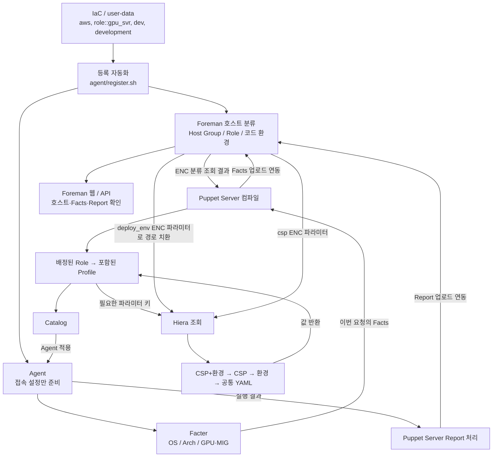
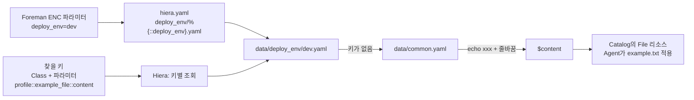
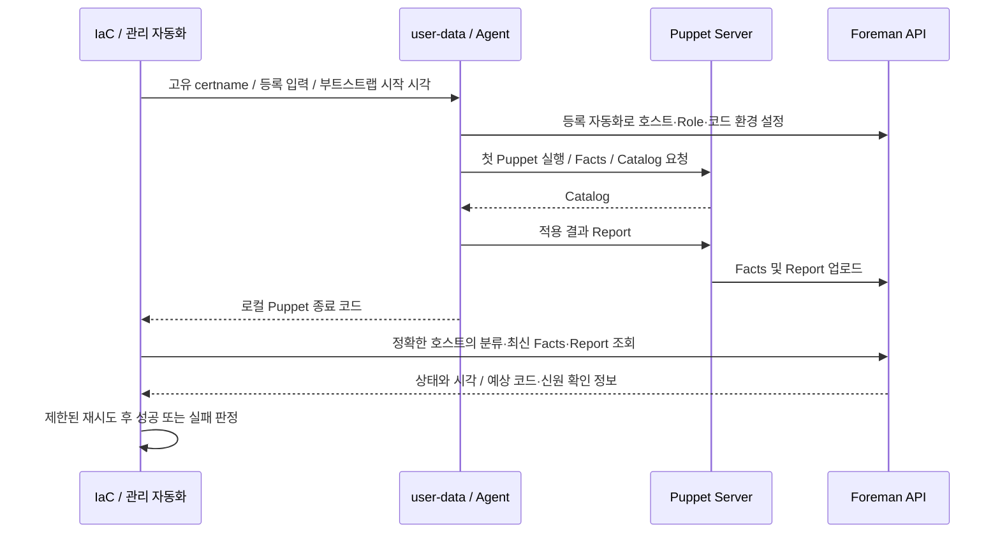

# 설정 조회 관계와 등록 성공 확인


현재 신규 Role 기준은 [서버 Role 구성](ROLES.md)이다. 기존 GPU 흐름은 호환 예제로 유지한다.
## 1. 세 종류의 정보

| 구분 | 출처 | 예시 | 사용하는 곳 |
| --- | --- | --- | --- |
| 적용 의도 | IaC/user-data → 등록 자동화 → Foreman | Host Group, csp/deploy_env/team/dr_site ENC 파라미터, Role, Puppet 코드 환경 | ENC의 노드 분류 |
| 노드 속성·관측 정보 | Agent의 Facter 및 외부/Custom Facts | OS, Arch, GPU/MIG | Catalog 컴파일, Hiera 파일 경로, Foreman 조회 |
| 설정 데이터 | Git의 Hiera YAML | 패키지 목록, 예시 파일 내용 | Profile의 파라미터 |

`deploy_env`는 Foreman 호스트 파라미터로 관리한다. GPU/MIG는 장비에서 수집할
정보이며 수집기는 아직 구현하지 않았다. Role은 Facts로 추론하지 않고 등록 입력으로 지정한다.
Puppet Server는 이번 요청의 Facts로 Catalog를 컴파일한다. Foreman의 Facts는 업로드된
관측 결과이며 전송 주기에 따라 실제 상태보다 늦을 수 있다. Puppet Server 자체의
Facts 영구 저장은 별도 설정에 따르며 이 저장소는 PuppetDB를 도입하지 않았다.



이는 책임과 데이터 관계이며 모든 화살표가 반드시 단일 실행의 순차 작업을 의미하지 않는다.
Facts/Report 업로드, Foreman ENC, 등록 자동화는 실제 배포 시 연결해야 한다.

## 1.1. 자동 Facts와 Foreman 관리 파라미터를 분리하는 이유

**결정: 실제 상태만 Agent/Facter가 수집하고, 사람이 정하는 분류·정책은 Foreman에서 중앙 관리한다.**
deploy_env·team·dr_site는 자동 측정값이 아니므로 외부 Facts로 보내지 않는다.
이 값이나 Role을 바꿀 때 대상 서버에 파일을 재배포할 필요가 없도록 하는 설계다.

| 항목 | 관리 기준/저장 위치 | 최초 설정 | 이후 변경 |
| --- | --- | --- | --- |
| OS·Arch | Facter 기본 Facts | 자동 수집 | 다음 실행에서 실제 상태 재수집 |
| GPU 존재·MIG 구성 | Custom Facts | 수집기 배포(후속 구현) | 다음 실행에서 실제 상태 재수집 |
| deploy_env | Foreman 호스트의 최상위 ENC 파라미터 | dev/prd 문자열, 필수 | Foreman 웹/API에서 변경. 코드 환경과 일치 필요 |
| team | Foreman 호스트의 최상위 ENC 파라미터 | 팀명 또는 미정 null | 웹/API에서 변경. 미정은 유효 ENC 값이 없도록 관리 |
| dr_site | Foreman 호스트의 최상위 ENC 파라미터 | primary/secondary 또는 미설정 | 웹/API에서 변경. CSP별 실제 위치는 별도 정책 문서 |
| CSP | Foreman Host Group 및 csp ENC 파라미터 | aws/gcp/kc 그룹에 배정 | 웹/API에서 그룹·상속값 관리 |
| Role | Foreman 호스트의 Puppet Class 배정 | 단일 Role 배정 | 웹/API에서 기존 Role을 제거하고 새 Role 배정 |
| puppet_managed | Foreman Boolean 파라미터 | true/false, 상속 포함 유효값 확인 | 웹/API에서 변경 |
| Puppet Environment | Foreman의 호스트 코드 환경 | development/production 배정 | Foreman·Agent의 환경 지정과 일관성 검증 |

user-data는 **최초 설정을 실행하는 수단**이다. 등록 자동화에 deploy_env·team·dr_site와 그룹·Role 등의
초기값을 전달하고, 등록 자동화가 Foreman에 저장한다. 변수 선언이나 Facts 업로드만으로 등록되지 않는다.
대상 노드에는 관리자 토큰을 보관하지 않는다. 등록 후에는 Foreman이 기준이며 부트스트랩 재실행이
과거 user-data 값으로 중앙 정책을 덮어쓰지 않도록 구현한다. 최초 API 등록은 [등록 실행기](USER_DATA_REGISTRATION.md)로 수행한다.

### ENC 전달과 값 검증

배정된 호스트 파라미터를 Foreman이 최상위 ENC parameters로 내보내도록 구성한다.
Smart Class 파라미터나 class 내부 변수가 아니라 Hiera의 ::deploy_env 등이 참조하는 최상위 값이다.
관리 대상 Catalog의 profile::base는 deploy_env=dev/prd를 필수로 요구하고
Puppet Environment와 development/dev, production/prd 조합을 검증한다.
team은 미설정 또는 영문 소문자로 시작하는 팀명(숫자·밑줄·하이픈 허용), dr_site는 미설정 또는
primary/secondary만 허용한다. 자동으로 team에서 Role을 선택하지 않는다.

team=null은 미정 입력이다. Foreman의 문자열 "null"로 저장하지 않고 파라미터를 생략하거나
실제 null/미정이 되도록 처리한다. 호스트 값 삭제 시 상위 그룹/전역 값이 다시 상속될 수 있으므로
최종 ENC를 확인한다. dr_site도 임의 primary 기본값을 부여하지 않는다.
현재는 미설정을 허용하며 신규 등록 예시에서는 primary를 명시한다. dr_site별 Hiera 계층은
실제 사이트별 설정 차이를 정한 뒤 추가한다. 장애 전환 시 active/standby 상태와는 분리한다.

### 외부 Facts 파일의 의미와 이번 변경

외부 Facts는 Facter 내장 수집 기능 밖에서 제공한 값이다. 외부 네트워크라는 뜻이 아니다.
Facter는 facts.d의 JSON/YAML 같은 파일이나 실행 가능한 수집기의 출력을 읽어 Facts에 합친다.
이번 설계에서는 deploy_env/team/dr_site를 외부 Facts 파일에 쓰지 않는다.
GPU 수집기를 Custom Fact 또는 외부 실행형 수집기로 구현할지는 후속 구현에서 정한다.
일반 환경변수만 설정해도 Agent가 자동 Fact로 보내는 것은 아니다.

과거 bootstrap은 /etc/puppetlabs/facter/facts.d/foreman_puppet.json을 생성했다.
새 bootstrap은 이를 생성하지 않고 예전 deploy_env/team/dr_site 입력을 거부한다.
기존 파일은 다른 항목이 포함됐을 수 있으므로 자동 삭제하지 않는다. 먼저 Foreman 파라미터와
최종 ENC를 준비한 뒤, foreman_puppet.json 및 예전 deployment.yaml 등에서 이전 세 키를 제거한다.
다른 Custom Facts를 지우지 않고, 다음 Facts 업로드 후 Foreman에 남은 과거 표시값도 확인한다.
동일 이름의 오래된 Fact가 있더라도 현재 코드는 정책 파라미터로 사용하지 않는다.

### Role 변경과 후속 구현

Foreman에서 Role을 교체하면 다음 Agent 요청에서 Server가 새 분류로 Catalog를 컴파일한다.
새 Role 코드는 해당 Environment에 먼저 배포되어 있어야 하며, 빠진 리소스의 삭제·원복은
별도 선언이 필요하다. 기존 호스트 재등록은 고유 신원과 현재 분류를 검증하고 자동 덮어쓰지 않는다.

현재 Hiera와 Catalog는 중앙 파라미터를 사용한다. 등록 실행기는 구현했으며, 실제 Foreman UI/API에서 null·상속·ENC
전달 확인, 실제 Agent 적용은 후속 검증이다. sandbox는 [추후 TODO](../README.md#추후-todo)다.

### 최초 user-data 등록의 API 인증

현재 [등록 실행기](USER_DATA_REGISTRATION.md)는 별도 등록 서비스 없이 user-data에서 Foreman API를 직접
호출한다. 공통 등록 서비스는 [추후 TODO](../README.md#추후-todo)다.

권장 인증은 **등록 전용 Foreman 계정 + 만료일을 설정한 Personal Access Token(PAT) + HTTPS**다.
PAT는 해당 계정 비밀번호 대신 사용하며 API의 HTTP Basic 인증에 사용자명:PAT로 전달한다.
Bearer 토큰이나 Foreman Global Registration의 JWT와는 다른 방식이다.
Foreman 5.0 공식 문서는 PAT의 만료일 설정과 폐기를 지원하며 만료일을 생략하면 자동 만료되지 않는다.

- 전용 계정은 관리자가 사전에 만든다. 기존 Host Group·Puppet Environment·Class 등 등록에 필요한
  참조 정보 조회와 신규 호스트 생성에 필요한 권한만 준비한다. 기존 호스트 조회·신원 대조 범위도
  정한다. 기존 호스트 수정·삭제나 사용자/Role 관리 권한은 주지 않는 것을 목표로 한다.
  실제 plugin API 경로와 생성 시 파라미터/Class 배정의 권한 조합은 설치 버전에서 검증한다.
- PAT는 토큰별 세밀한 범위가 아니라 소유 계정의 유효 권한을 기준으로 취급한다.
  만료일은 최초 등록 작업 기간에 맞춰 짧게 정하고 배치 완료 시 관리 측에서 폐기한다.
  PAT 자체는 일회용이나 특정 인스턴스에 묶인 신원 증명이 아니다.
- user-data에는 토큰 원문을 넣지 않고 비밀 저장소의 참조만 둔다. AWS 초기 구축에서는
  인스턴스 IAM Role로 허용된 SSM Parameter Store SecureString 또는 Secrets Manager의
  해당 비밀만 읽는 구성을 권장한다. 암호화 키의 필요한 복호화 권한도 함께 제한한다.
  Foreman은 AWS IAM을 직접 인증하는 것이 아니며 IAM은 PAT를 가져오는 경로의 인증이다.
  GCP/KC의 비밀 조회·인증 경로는 해당 CSP에서 별도로 정한다.
- Bash/Go 실행기는 SSM에서 가져온 PAT를 프로세스 메모리에서만 사용한다. 임시 인증 파일을 만들지 않는다.
  명령행 --user 사용자명:실제토큰, Git·이미지·Facts·일반 로그·cloud-init 출력에 토큰을 남기지 않는다.
  shell tracing은 끈다. 별도 file 공급 방식을 쓰면 호출자가 root 전용 0600 파일을 정리한다. 로컬 삭제만으로 원격 PAT가 폐기되지는 않는다.
- 사내 CA 체인으로 Foreman HTTPS 서버를 검증하고 인증서 검증을 끄지 않는다.
  등록 API의 계정/PAT 인증과 Agent↔OpenVox Server의 인증서 인증은 별개다.
- 기존 호스트가 있으면 고유 신원과 중앙 분류를 검증하고 덮어쓰지 않는다. 충돌은 실패로 보고한다.
  PAT를 읽을 수 있다는 사실만으로 임의 운영 Role 배정이 정당화되지 않으므로 계정 권한·참조 범위와
  등록 입력 검증을 함께 적용한다. CSP 신원 검증을 중앙에서 수행하는 기능은 공통 서비스 TODO다.

실행 흐름: IaC가 최초 등록 입력과 비밀 참조 전달 → user-data가 비밀 조회 → HTTPS API로
신규 등록/기존 호스트 검증 → 최종 ENC 확인. 인증서 준비와 첫 Puppet Report는
별도 완료 단계이며 API 호스트 생성만으로 전체 등록 성공으로 보지 않는다.

현재는 등록 실행기와 오프라인 테스트를 구현한 상태다. 계정·PAT 발급, 비밀 저장소 생성,
IAM 설정, API 등록 스크립트 실행은 아직 수행하지 않았다. Foreman Global Registration JWT 경로는
일반 호스트 CRUD용 PAT와 혼용하지 않고, 사용할 경우 별도의 템플릿/권한·요청 경로를 검증한다.

근거: [Foreman 5.0 REST API — 토큰 인증](https://docs.theforeman.org/5.0/Project_API/index-foreman-deb.html).

## 2. Hiera에서 무엇을 어디서 찾는가

전체 우선순위는 CSP+환경 → CSP → 환경 → 공통이다. 아래 그림은 해당 CSP 상위 계층에
키가 없을 때 환경·공통 계층으로 넘어온 조회를 확대해서 보여준다. 전체 경로는
[CSP별 시스템 정책](SYSTEM_POLICIES.md)을 참고한다.

현재 Profile 선언:

```puppet
class profile::example_file (
  String[1] $content,
) {
  # File 리소스의 content에 $content를 사용
}
```



`name`은 계층 이름, `path`는 `datadir: data` 기준의 상대 파일 경로다.
`content`가 `deploy_env`를 찾는 것이 아니다. 파라미터는 조회할 키를 정하고,
ENC 파라미터와 경로 규칙은 조회할 파일을 정한다. Hiera가 Role을 선택하지 않는다.

## 3. 로컬 진단 파일 제거

`node.conf` 생성과 `node.conf.epp` 양식은 제거했다. 현재는 `profile::example_file`이
예시 파일 `example.txt`를 관리하며, 과거 Catalog가 만든 `/etc/foreman-puppet/node.conf`는
다음 Puppet 적용에서 `ensure => absent`로 삭제한다.

클라우드 상태나 등록 성공 여부는 로컬 파일의 존재로 판단하지 않는다.
Foreman의 최신 Facts/Report와 Agent 실행 결과를 기준으로 확인한다.
인스턴스 생성·삭제는 클라우드 인벤토리와 별도로 대조한다.

## 4. 부트스트랩 성공 판정 설계

user-data에서 API 관리자 토큰을 보관하지 않고, 로컬 결과와 관리 측 검증을 분리한다.
아래는 전체 완료 판정 기준이다. 호스트/ENC 등록 실행기는 구현했으며, 인증서·첫 Report까지의 자동 검증은 후속 단계다.



1. 현재 부트스트랩의 고유 노드 신원을 결정한다. 호스트 이름만 재사용해서 이전 인스턴스의
   Report를 성공으로 보지 않는다. 클라우드 리소스 ID와 certname의 매핑은 등록 설계에서 정한다.
2. 사내 인증서/신뢰 체인이 준비되고 실제 Agent/Server 연결이 가능한지 확인한다.
3. `puppet agent --test --detailed-exitcodes` 결과에서 `0`과 `2`를 성공으로 처리한다.
   `4`, `6`은 리소스 실패를 포함하며, 그 외 오류도 성공으로 처리하지 않는다.
4. Foreman API에서 기대한 호스트·Host Group·단일 Role·Puppet 코드 환경을 확인한다.
5. 최신 Facts와 성공 Report가 이번 실행 이후의 것인지 확인한다. 수신 시각만으로 이전
   실행의 늦게 도착한 Report를 오인하지 않도록 실행 시각·노드 신원·가능한 코드 버전을 확인한다.
6. 최초 등록 성공은 캐시된 과거 Catalog 적용만으로 판정하지 않는다. 실제 Server 컴파일/
   코드 버전 및 Report의 관련 정보를 선택한 Puppet/Foreman 버전에서 확인한다.
7. 업로드 지연에는 횟수·시간 제한이 있는 재시도를 사용하고, 시간 초과 시 단계를 표시한다.

정확한 API 경로와 응답 필드는 설치할 Foreman 및 Puppet 플러그인 버전의 API 문서를
기준으로 정한다. Foreman API를 호출하는 관리 자동화 계정은 필요한 읽기 권한을 사용한다.

검증 성공 후의 지속 관리/미관리 전환은 [Role별 수명 주기](ROLE_LIFECYCLE.md)를 따른다.
미관리 목표는 최초 Base 적용 성공 후 false → unmanaged 순서로 전환한다.
이 전환을 수행하는 자동화 계정은 위 조회 권한에 더해 필요한 호스트 분류·파라미터 변경 권한이 필요하다.

## 5. 리소스 교체와 주기 점검

- 새 클라우드 인스턴스에는 새 노드 신원을 부여하고 필요한 인증서·등록 절차를 수행한다.
- 기존 노드의 생존 상태는 최신 Report/Facts 시각과 Agent 실행 주기를 기준으로 판단한다.
- 삭제된 인스턴스는 클라우드 인벤토리와 대조해 Foreman 호스트 정리 및 인증서 폐기를 수행한다.
- 오래된 Report가 남아 있는 것과 현재 인스턴스가 정상인 것은 구분한다.

단순한 로컬 상태 파일 하나로 이 수명 주기를 대체하지 않는다.
