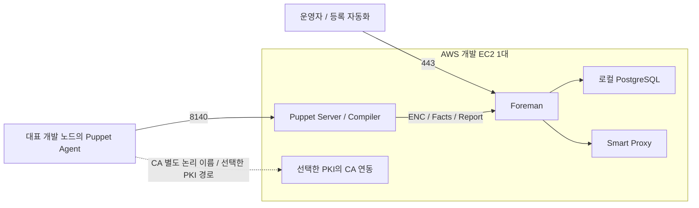

# 개발 단일 서버에서 운영까지의 구축 순서

상태: 합의한 구축 계획. 실제 서버 설치·DB 이전·LB 생성은 아직 수행하지 않았다.
시간 제약을 반영해 먼저 개발 단일 서버로 기능을 검증한다. 2단계에서 개발 이중화 구조를
검증한 뒤 운영을 별도로 구축한다. Autoscaling은 후속 고도화로 유지한다.

| 단계 | 구성 | 목표 / 다음 단계 진입 기준 |
| --- | --- | --- |
| 1. 개발 최초 구축 | AWS EC2 1대 + 로컬 PostgreSQL, LB 없음 | 대표 노드 등록·Facts·ENC·Catalog·Report·멱등성·제외 흐름 확인 |
| 2. 개발 확장 | LB + 서로 다른 AZ의 고정 EC2 2대 + RDS PostgreSQL | 로컬 DB 이전·접속 전환·동일 코드·N-1 및 DB 복구/장애 전환 검증 |
| 3. 운영 구축 | 별도 운영 LB + 고정 EC2 2대 + 별도 RDS, CA 가용성 설계 | 검증한 설치 절차·승인 commit으로 약 250대 단계적 도입 |

개발 전체 대상은 1,000~2,000대지만 1단계의 단일 서버가 그 규모를 처리한다고 보장하지 않는다.
처음에는 1~몇 대로 연결하고 부하를 확인하며 확대한다. 전체 규모 및 N-1 시험은 2단계에서 한다.

## 1단계: 지금 진행할 구성

- VM에 OS 패키지로 직접 설치한다. 관리 OS 후보는 Ubuntu 24.04 amd64이며
  Foreman·Puppet/OpenVox·PostgreSQL의 지원 조합과 공급 경로를 설치 전에 확정한다.
- EC2 사양은 소수 노드 검증부터 산정한다. 8 vCPU·32 GiB RAM·100 GiB SSD를
  공동 배치 시작 후보로 검토할 수 있으나 보장 사양이나 생성 지시가 아니다.
  DB·JVM·Report 저장량을 측정해 조정한다.
- 로컬 PostgreSQL은 이 EC2의 Foreman이 사용한다. 외부 Agent에 DB 포트를 개방하지 않는다.
- Foreman·Compiler·DB가 함께 중단되는 단일 장애점이며 HA가 아니다.
  EC2 밖에 DB 백업과 키·설정·CA 상태의 복구 가능한 백업을 둔다.
- CA/인증서 신뢰는 첫 Agent 연결부터 필요하다. 사내 PKI 세부 구현은 별도 확정하고,
  CA 개인키/신원을 새로 만드는 작업을 DB 이전과 묶어서 수행하지 않는다.

### 처음부터 유지할 이름과 상태

| 항목 | 1단계 | 2단계 |
| --- | --- | --- |
| foreman-dev.example.internal | 단일 EC2의 Foreman | LB의 Foreman 경로 |
| puppet-dev.example.internal | 단일 EC2의 Compiler | LB의 Compiler 경로 |
| puppet-ca-dev.example.internal | 선택한 CA 경로 | 기존 CA 신원 유지, 전환은 별도 설계 |
| DB 연결 | 로컬 PostgreSQL | RDS 쓰기 endpoint |
| Puppet 코드 | 승인 commit의 development | 두 Compiler에 같은 commit |

위 DNS 이름은 예시다. 실제 도메인·SAN·노드 고유 certname을 설치 전에 정한다.
논리 이름을 쓴다고 기존 인증서 SAN이 자동 변경되지는 않는다. CA 이름을 Compiler LB 풀에
무조건 포함하지 않는다. DNS TTL·경로·인증서 검증을 포함해 전환한다.

설치 기준표와 읽기 전용 사전 점검은 [개발 서버 설치 준비](DEV_SERVER_INSTALL.md)에 정리했다.

### 지금 바로 이어서 할 작업

1. 관리 서버의 OS·제품/버전·FQDN·사양·디스크·보안 그룹·접속 경로를 설치 입력으로 정리한다.
2. EC2 1대에 로컬 DB 포함 Foreman·Compiler·Smart Proxy를 설치하는 반복 가능한 절차를 만든다.
3. development 코드와 Classes를 가져오고 aws/gcp/kc Host Group의 csp 및 Boolean
   puppet_managed=true를 준비한다. 신규 Role 네 가지를 호스트별로 하나만 배정한다.
4. Ubuntu 24.04 대표 Agent 1대로 등록·인증·Facts·첫 Catalog 적용·Report를 확인한다.
5. 두 번째 적용 무변경, 설정 드리프트 교정, 제외를 확인한다. 미관리 목표는
   [Role별 최초 적용](ROLE_LIFECYCLE.md) 성공 후 false → unmanaged로 전환한다.
6. SSH는 [SSH Profile](SSH_PROFILE.md)의 이미지 전제조건과 새 로그인 검증 후 활성화한다.
   초기 연결부터 검증되지 않은 SSH 변경을 한꺼번에 켜지 않는다.

따라서 지금 우선순위는 새로운 설정 Profile을 늘리기보다 **단일 개발 관리 서버의 설치·연동**이다.
등록·성공 확인·미관리 자동 전환은 아직 구현 전이며, 먼저 수동으로 검증 가능한 경로를 확보한다.

## 2단계: 로컬 DB → RDS → 두 번째 EC2 → LB

위 순서로 변경을 나누어 실패 원인을 분리한다. DB 이전과 Foreman 버전 업그레이드를
동시에 진행하지 않는다. 이 문서는 이전 체크리스트이며 실행 가능한 마이그레이션 스크립트는 아니다.

1. 같은 Foreman 버전에서 지원하는 RDS PostgreSQL 엔진·encoding·locale·권한·extension을
   확인한다. 로컬/목표 DB 버전에 맞는 pg_dump/pg_restore 도구로 시험 복원한다.
   RDS private 접근·SG·TLS 신뢰·연결 풀·백업/PITR·보존 기간을 준비한다.
2. Foreman DB뿐 아니라 암호화 키·세션 비밀값·설정·인증서·코드 commit·별도 CA 상태를 백업한다.
   DB dump만으로 전체 서비스가 복원된다고 가정하지 않는다.
3. 이전 중 웹/API/등록·ENC 연동·Facts/Report 업로드·백그라운드 작업 등 DB 쓰기를 멈추고
   차단 여부를 확인한다. 허용 중단 시간과 Agent 실패/재시도 동작을 미리 정한다.
4. 최종 일관된 dump를 RDS에 복원하고 권한·스키마·주요 데이터 및 시퀀스를 검증한다.
   RDS의 제한된 관리자 권한 때문에 owner/ACL 복원이 달라질 수 있어 시험 결과에 맞춰 처리한다.
5. **기존 EC2 1대부터** RDS로 연결을 바꿔 Foreman과 연동 기능을 검증한다.
   양쪽 DB로 동시에 쓰지 않으며, 기존 로컬 DB는 쓰기를 막아 보관한다.
6. 서로 다른 AZ에 두 번째 EC2를 설치한다. 같은 제품 버전·비밀값·코드·설정을 사용하고
   각 서버에는 고유 certname/개인키를 발급한다. 스키마 초기화/업그레이드는 한 곳에서만 수행한다.
7. 내부 NLB의 443 Foreman TG와 8140 Compiler TG에 편입한다. 논리 DNS·SAN·
   Smart Proxy 고유 등록·NLB hairpin 경로를 [LB 설계](LB_AND_SCALING.md)에 따라 검증한다.
8. 한 EC2 중단·DB 복구/전환·등록·Catalog·Report·부하를 시험한다. RDS Multi-AZ를 권장하며
   Single-AZ를 선택하면 DB는 여전히 단일 장애점임을 명시한다. CA 전환은 별도 검증 대상이다.

RDS에 새 쓰기를 받기 전에는 검증 실패 시 기존 로컬 DB로 되돌리는 경로를 사용할 수 있다.
새 쓰기를 받은 뒤에는 오래된 로컬 DB로 단순 재접속하면 데이터가 유실된다.
다시 쓰기를 멈추고 최신 데이터의 역이전/복구 절차로 되돌려야 하며 그 절차도 시험한다.
이전 완료 후에는 로컬 DB 자동 기동과 설치 자동화의 로컬 DB 재생성을 비활성화한다.

## 3단계: 운영 구축

개발 DB를 운영 DB로 옮기지 않는다. 별도 운영 서버·DB·endpoint·인증 경계에
검증한 설치 절차와 승인한 production 코드 commit을 배포한다.
운영용 Host Group·Role·Parameters는 반복 가능한 구성 절차로 생성하며 개발 호스트·토큰을 복사하지 않는다.
약 250대도 소수부터 확대한다. N-1 용량·DB 복원·CA 가용성·모니터링·보존·롤백을 확인한다.
LB+서버 2대+RDS만으로 CA와 작업 실행 계층까지 자동 HA가 된다고 보장하지 않는다.

현재 단계별 구성·이전 계획만 문서화했다. EC2/LB/RDS 생성, DB 이전, 설치·성능/HA 시험은 후속 작업이다.
