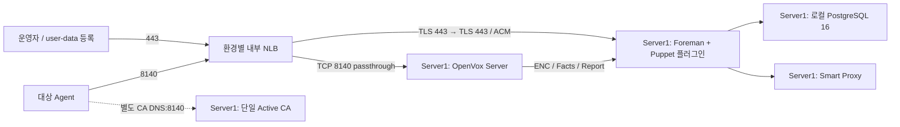

# 개발·운영 공통 단계별 구축 계획

상태: 2026-11-24 ACM/NLB 인증서 경로까지 반영한 계획. 개발·운영을 각각 분리하고 두 환경 모두 같은 순서로 진행한다.
실제 LB/EC2/RDS 생성·설치·DB 이전·장애 전환은 아직 수행하지 않았다.
개발에서 먼저 검증한 절차를 운영에 적용하되, 운영 구축을 3단계까지 기다리는 계획은 아니다.

| 단계 | 개발 | 운영 | 완료 기준 |
| --- | --- | --- | --- |
| 1. 최초 구축 | 내부 NLB + Server1 + 로컬 PostgreSQL 16 | 별도 내부 NLB + Server1 + 별도 로컬 PostgreSQL 16 | 등록·ENC·Facts·Catalog·Report·멱등성·제외·백업 검증 |
| 2. DB 분리 | NLB + Server1 + 개발 RDS PostgreSQL 16 | 운영 NLB + Server1 + 운영 RDS PostgreSQL 16 | 일관된 DB 이전·접속 전환·백업/PITR·복구 검증 |
| 3. 서버 이중화 | 기존 NLB + 다른 AZ의 Server1/2 + 개발 RDS | 기존 운영 NLB + 다른 AZ의 Server1/2 + 운영 RDS | 코드/비밀값 일치·N-1·DB 전환·CA 복구 검증 |

Server1/2에는 Foreman·Puppet 플러그인·Smart Proxy·OpenVox Server를 공동 배치한다.
개발·운영의 서버·DB·endpoint·CA 신원·등록 자격증명은 공유하지 않는다.
개발 대상은 1,000~2,000대, 운영은 약 250대지만 단일 서버가 이 규모를 처리한다고 보장하지 않는다.
대표 1~몇 대부터 검증하고 측정된 부하로 확대한다. N-1 전체 규모 시험은 3단계에서 한다.

## 1단계: LB + Server1 + Local DB

NLB를 처음부터 두되 Target Group에는 Server1 한 대만 등록한다. LB가 있어도 Server1과
로컬 DB는 단일 장애점이다. 서버 중단 시 대체 서버에 DB·코드·설정·비밀값·인증 자료를 복구해야 한다.

- 웹/API는 NLB TLS 443(ACM) → TLS target 443, Agent는 TCP 8140 passthrough로 분리한다.
- ENC/Facts/Report·Proxy의 인증서 인증은 host_fqdn 내부 HTTPS로 직접 연결한다. [ACM/내부 TLS](ACM_AND_BACKEND_TLS.md)를 따른다.
- CA 전용 DNS는 Server1 사설 주소를 가리키며 일반 Compiler 풀과 분리한다.
- NLB 동일 대상 hairpin·cross-zone·SG·TLS SAN·내부 API 연동을 [LB 설계](LB_AND_SCALING.md)대로 검증한다.
- VM에 OS 패키지로 직접 설치한다. Ubuntu 24.04 x86_64 기준이며 실제 사양·지원 조합을 확인한다.
- 8 vCPU·32 GiB RAM·100 GiB SSD는 시작 후보이고 확정 성능이 아니다. JVM·DB·디스크·Report 부하를 측정한다.
- 로컬 DB는 같은 EC2의 Foreman만 사용한다. 외부 Agent에 DB 포트를 열지 않는다.
- 로컬 DB·CA·비밀값의 복구 가능한 백업을 EC2 밖에 보관한다.
- 내장 CA 초기화·설정과 백업/복구 경계는 [장애 대응](FAILURE_RUNBOOK.md)을 따른다.

### 처음부터 유지할 접속 이름

| 이름 예시 | 1단계 | 2단계 | 3단계 |
| --- | --- | --- | --- |
| foreman-dev.example.internal | 개발 NLB 443, Server1 | 유지 | Server2를 같은 TG에 추가 |
| puppet-dev.example.internal | 개발 NLB 8140, Server1 | 유지 | Server2를 같은 TG에 추가 |
| puppet-ca-dev.example.internal | CA 담당 Server1 | 유지 | 수동 승계 후 검증된 CA 서버로 DNS 전환 |
| Foreman DB 연결 | 로컬 PostgreSQL | RDS 쓰기 endpoint | 같은 환경의 두 Foreman이 같은 RDS 사용 |
| Puppet 코드 | 검증 commit | 동일 commit 유지 | 두 Compiler에 동일 commit 배포 |

운영은 별도 운영용 이름을 사용한다. 실제 FQDN·SAN·certname은 설치 전 확정한다.
논리 이름이 같아도 CA 신원·서비스 인증서·DNS TTL은 자동으로 변경되지 않는다.

### 지금 이어서 할 작업

1. 환경별 FQDN·NLB/TG·기존 서버 OS/사양·네트워크·ACM 인증서·backend 서비스 인증서·Agent 인증 경로를 확정한다.
2. Server1에 로컬 DB 포함 설치 절차를 준비하고 NLB를 통한 웹/API·Agent 연결을 검증한다.
3. [user-data Foreman 등록 실행기](USER_DATA_REGISTRATION.md)의 호출자 SSM PAT 공급·신규 생성·중복 실패 처리을 실제 개발 서버에서 검증한다. 공통 등록 서비스는 고도화 TODO다.
4. csp Host Group, 단일 Role, deploy_env/team/dr_site와 Boolean puppet_managed를 ENC로 확인한다.
5. 대표 Agent로 최초 적용과 최신 Report, 두 번째 무변경·드리프트 교정·제외를 확인한다.
6. SSH는 [SSH Profile](SSH_PROFILE.md)의 전제조건·새 로그인 검증 후 활성화한다.
7. 개발 검증 절차를 별도 운영 Server1에 적용하고 소수 노드부터 도입한다.

## DB 엔진 권장안

**로컬은 PostgreSQL 16, 이전 대상은 Amazon RDS for PostgreSQL 16**을 권장한다.
Ubuntu 24.04의 기본 PostgreSQL 계열이며 현재 bootstrap의 postgresql-16 패키지와 맞는다.
MySQL/MariaDB 또는 Aurora 전환을 이번 범위에 추가하지 않는다.

설치 시 보안 수정이 반영된 16.x 패키지 revision을 확인하고 이전 시 선택 리전에 제공되는 RDS 16.x를
대조한다. 로컬과 RDS의 패치 번호가 반드시 같아야 하는 것은 아니지만 dump/restore 도구 호환성,
encoding·locale·collation·extension·권한을 시험한다. DB 이전과 major 업그레이드를 동시에 진행하지 않는다.
RDS 서비스에 제공된다는 사실만으로 Foreman 연동 검증을 대신하지 않는다.
운영 RDS는 Multi-AZ를 권장하며 개발은 복구/장애 시험 요구와 비용을 기준으로 결정한다.

근거: [Ubuntu Noble PostgreSQL](https://packages.ubuntu.com/noble/postgresql),
[Foreman 5.0 설치 경로](https://docs.theforeman.org/5.0/Quickstart/index-foreman-deb.html),
[RDS PostgreSQL 버전](https://docs.aws.amazon.com/AmazonRDS/latest/UserGuide/PostgreSQL.Concepts.General.DBVersions.html).

## 2단계: Local DB → RDS (Server1 유지)

DB 이전과 Foreman/엔진 버전 변경을 분리한다. 다음은 체크리스트이며 자동 마이그레이션 스크립트가 아니다.

1. 동일 환경용 RDS 16.x의 private 접근·SG·TLS·사용자/권한·extension·백업/PITR·연결 풀을 준비한다.
   로컬/대상 버전에 맞는 pg_dump/pg_restore로 먼저 시험 복원한다.
2. DB뿐 아니라 Foreman 암호화 키·세션 비밀값·설정·코드 commit·인증서·CA 상태를 백업한다.
3. 최종 이전 중 웹/API/등록·ENC·Facts/Report·백그라운드 작업 등 DB 쓰기를 멈추고 차단을 확인한다.
   허용 중단 시간과 Agent 실패/재시도 동작을 미리 정한다.
4. 일관된 최종 dump를 RDS로 복원하고 권한·스키마·주요 데이터·시퀀스를 확인한다.
   RDS의 제한된 관리자 권한에 맞춰 owner/ACL 복원을 조정한다.
5. Server1의 Foreman DB 연결을 RDS로 변경하고 NLB를 통한 API/ENC·Catalog·Report를 검증한다.
   같은 데이터를 양쪽 DB에 동시에 쓰지 않는다. 기존 로컬 DB는 쓰기를 막아 보관한다.
6. 이전 완료 후 로컬 DB 자동 기동·설치 자동화의 DB 재생성을 비활성화한다.
   현재 bootstrap의 db_manage=true/localhost 원본도 RDS 구성에 맞게 바꿔야 하며 이 변경 자동화는 후속이다.

RDS에 새 쓰기를 받기 전에는 검증 실패 시 기존 로컬 DB로 복귀할 수 있다.
새 쓰기를 받은 뒤에는 옛 로컬 DB에 단순 재접속하지 않는다. 쓰기를 멈추고 최신 데이터 역이전/복구를
시험한 절차로 수행해야 한다. 개발 DB를 운영 DB로 복사하는 절차가 아니다.

## 3단계: Server2 추가·이중화 (CA 포함)

1. 다른 AZ에 같은 검증 버전의 Server2를 설치하고 같은 환경의 RDS에 연결한다.
2. Foreman 암호화/세션 비밀값과 코드·모듈·Hiera commit은 일치시킨다. 서버별 certname/개인키는 고유하게 유지한다.
3. DB 스키마 초기화/업그레이드는 한 곳에서만 수행한다. Smart Proxy도 고유 주소로 각각 등록한다.
4. Server2의 TLS·ENC·Class·Catalog·CRL·Report를 확인한 뒤 기존 NLB TG에 편입한다.
5. CA는 단일 Active를 유지한다. 외부 백업·상태 공백 대조·fencing·서버 2 수동 복구/DNS 전환을
   [장애 대응](FAILURE_RUNBOOK.md)에 따라 리허설한다. 두 CA 동시 발급이나 자동 HA를 가정하지 않는다.
6. EC2 한 대 중단·N-1 부하·DB 복원/장애 전환·CA 장애·신규 등록을 시험한다.
   RDS Single-AZ면 DB 단일 장애점이 남는다. CA 복구 시간·RPO도 별도로 기록한다.

## 후속 고도화: API Gateway + Lambda 인증·등록

user-data의 Foreman 직접 PAT 등록에서 **API Gateway + Lambda 기반 신원 검증·등록 대행**으로 전환한다.
CSP별 신원 증명/인벤토리·허용 Role·환경 검증, Foreman 등록, 부분 실패 재시도·중복 방지·삭제 정리를
구현하고 Foreman 자격증명은 관리 측에만 둔다. 지금은 TODO이며 별도 AWS 리소스를 만들지 않는다.

CA 고도화는 먼저 Lambda가 검증한 등록 정보에 따라 기존 Puppet CA API로 CSR 승인·폐기를 대행하는
방향을 검토한다. API Gateway/Lambda는 자체로 CA 키·발급 상태·CRL·갱신을 제공하지 않는다.
CA 발급자 자체를 다른 서비스로 교체하려면 별도 서명/상태 저장 기반과 Puppet CA 프로토콜 호환,
Agent mTLS·신뢰 체인·갱신·폐기·기존 인증서 이전을 검증한 뒤 결정한다. HTTP JWT 인증을 추가했다고
Agent 인증서가 없어지거나 일반 NLB 8140 통신을 그대로 API Gateway로 옮길 수 있다고 가정하지 않는다.
Autoscaling도 고도화로 보류한다.
