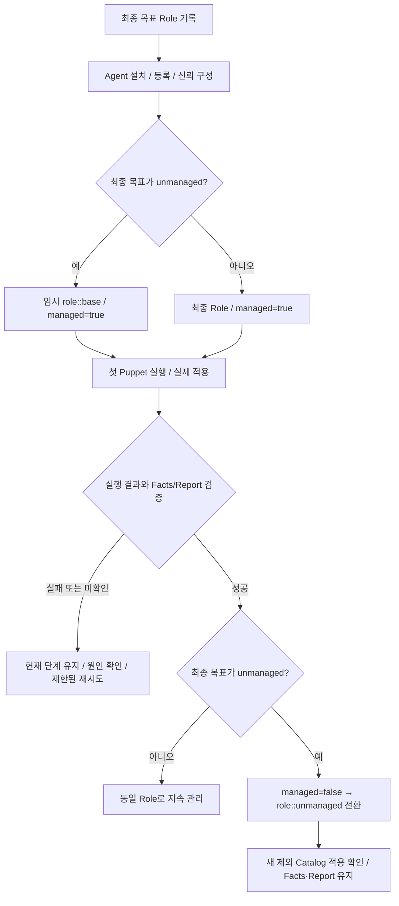

# Role별 최초 설정과 지속 관리

## 관리 단계 구분

최초 설정도 기존 Puppet Profile과 Hiera를 사용한다. user-data는 Agent 설치·등록·첫 실행을
담당하고, Foreman 분류 전환과 성공 판정은 관리 측 자동화가 담당하는 설계다.
**이 문서는 구현 기준이며 최초 적용·검증·자동 전환 스크립트는 아직 없다.**
현재 코드는 Role별 Profile 구성과 Boolean puppet_managed 제어까지 구현되어 있다.

| 최종 서버 구분 | 최초 적용 Role / puppet_managed | 최초 적용 범위 | 성공 후 Role / puppet_managed | 이후 동작 |
| --- | --- | --- | --- | --- |
| 기본 서버 | role::base / true | 공통 Base | role::base / true | 공통 설정 지속 관리 |
| 미관리 대상 | role::base / true | 공통 Base | role::unmanaged / false | 기존 설정 유지, 설정 변경 제외 |
| DevOps 대상 | role::devops / true | 공통 Base + DevOps Profile | role::devops / true | 공통·팀 설정 지속 관리 |
| 데이터인프라팀 | role::data_infra / true | 공통 Base + 데이터인프라 Profile | role::data_infra / true | 공통·팀 설정 지속 관리 |

표의 true/false는 Foreman 최상위 ENC 파라미터의 Boolean이다. 문자열이나 Fact가 아니다.
DevOps·데이터인프라 Profile은 현재 빈 확장 지점이므로 지금은 공통 Base만 실제 변경한다.
공통 Base도 현재 패키지·예시 파일·이전 node.conf 삭제를 관리하는 초기 코드이며,
SSH/DNS/NTP 등 계획된 모든 OS 설정이 구현된 상태는 아니다.
기존 gpu_svr는 호환용이며 사용 시 최초 적용 후 같은 Role/true로 지속 관리한다.

## 파일과 데이터 연결

```text
등록 자동화의 최종 목표 Role                 # 예: unmanaged, devops
    ↓ 최초 적용 Role 결정                  # unmanaged만 일시적으로 base 사용
Foreman의 호스트별 Role + puppet_managed     # 실제 현재 분류
    ↓
site-modules/role/manifests/*.pp             # 필요한 Profile 조합
    ↓
site-modules/profile/manifests/*.pp          # 공통/팀별 설정 코드
    ↓ 파라미터 조회
hiera.yaml → data/csp/ → data/deploy_env/ → data/common.yaml
    ↓
Catalog → Puppet Agent 적용 → Report 검증
```

초기화 전용 설정 파일을 따로 복사해 관리하지 않는다. 최초/정기 실행이 같은 Profile과
Hiera를 사용한다. 다만 지속 관리 대상은 이후 배포된 코드와 데이터 변경도 반영하며,
미관리 대상은 전환 시점의 설정이 남는다. 향후 Base가 변경되어도 자동 업데이트되지 않는다.
팀별 Role을 만드는 것만으로 팀별 Hiera 데이터가 선택되지는 않는다. 현재 조회 계층은
CSP·환경·공통이며 팀별 데이터 계층은 아직 없다.

## 최초 적용 흐름



최종 목표 Role과 실제 최초 적용 Role을 구분한다. 예를 들어 최종 목표 unmanaged를
등록 직후 그대로 Foreman에 배정하면 Base가 적용되지 않는다. 관리 자동화는 노드별
목표·단계·최초 실행 식별 정보·완료 여부를 보관해야 한다. 이는 논리 설계이며 새로운
Foreman 내장 필드나 API 인자를 정의한 것이 아니다. team 파라미터로 단계를 판단하지 않는다.

1. 고유 노드 신원·CSP Host Group·코드 환경·deploy_env 및 최종 목표 Role을 결정한다.
2. 표의 최초 Role 하나와 Boolean puppet_managed=true를 설정하고 ENC 결과를 확인한다.
3. 첫 실행 동안 정기 Agent 실행과 중복되지 않게 한다. Agent 잠금을 해제하거나 병렬 실행하지 않는다.
4. `puppet agent --test --detailed-exitcodes`로 실제 적용한다. noop나 캐시 Catalog 적용을
   최초 설정 완료로 인정하지 않는다. 필요한 Profile의 manage도 true인지 확인한다.
5. 로컬 종료 코드 0/2와 해당 실행의 성공 Report·최신 Facts·예상 분류·코드 버전을 확인한다.
   0은 변경 없음도 의미하므로 예상 Profile/리소스가 포함되고 관리가 활성화되었는지 함께 확인한다.
6. 일반/팀 서버는 동일 Role과 true를 유지한다. 미관리 대상만 아래 절차로 전환한다.

상세 신원·Report 확인 기준은 [등록 확인 설계](LOOKUP_AND_REGISTRATION.md)의
부트스트랩 성공 판정을 따른다. API 업로드 지연은 시간·횟수 제한 내에서 기다린다.

## 미관리 전환과 실패 처리

미관리 전환은 최초 적용 성공을 확인한 뒤 수행한다. 최초 실행 실패나 Report 미확인 시에는
완료로 표시하거나 제외하지 않는다. 무한 재시도하지 않고 실패 단계와 원인을 남긴다.

- 먼저 Foreman 호스트에 Boolean puppet_managed=false를 설정하고 반영을 확인한다.
- 그다음 Role을 role::base에서 role::unmanaged로 교체하고 최종 ENC를 확인한다.
- false 설정에 실패하면 Role을 교체하지 않는다. Role 교체만 실패하면 base/false로
  남겨도 이 프로젝트의 작업은 제외되므로 분류 교체만 재시도한다.
- unmanaged/true 조합은 컴파일 오류다. 두 변경을 원자적으로 처리할 수 없는 경우에도
  위 순서로 일시적인 잘못된 조합을 피한다.
- 이미 내려받은 true Catalog나 진행 중인 적용은 Foreman 파라미터 변경으로 취소되지 않는다.
  진행 중 실행이 끝난 뒤 전환하고, 새 제외 Catalog가 적용된 Report까지 확인해야 전환 완료다.
- 전환 확인은 서버의 새 Catalog를 사용한다. 캐시 실패 정책도 [Agent 운영](AGENT_OPERATIONS.md)을 따른다.

미관리 전환은 파일 삭제·설정 원복·Agent 중단이 아니다. 이후 빈 작업 Catalog로
Facts/Report 수집을 유지한다. 서비스 상시 감시와 알림은 Zabbix가 담당한다.
설정 관리 제외는 이 프로젝트의 Class 범위이며 외부 Class는 별도 확인한다.

재실행 시 관리 자동화는 저장한 최종 목표와 단계를 조회한다. 이미 미관리 전환이 완료된
노드에 user-data/등록 절차가 다시 실행됐다는 이유로 true를 재설정하지 않는다.
초기화 재적용이 필요하면 명시적으로 관리 대상으로 되돌려 승인된 코드로 적용하고 다시 전환한다.
새 인스턴스로 교체된 경우에는 새 신원으로 최초 설정을 수행한다.

## 구현 경계

| 항목 | 현재 상태 |
| --- | --- |
| Role·공통/팀 Profile 구성, 적용 제외 스위치 | 코드 구현 및 Catalog 검증 완료 |
| 최초/지속 관리에서 동일 Profile·Hiera 사용 | 현재 코드 구조로 가능 |
| user-data 설치·등록, 최초 실행 자동화 | 후속 구현 |
| 성공 Report 검증·목표/단계 저장·미관리 전환 API | 후속 구현 |
| 실제 OS에서 최초 적용 → 제외 → 재실행 검증 | 후속 검증 |

등록 자동화 계정에는 필요한 호스트 조회·분류·파라미터 변경 권한만 부여하고,
Foreman 관리용 장기 토큰을 user-data나 노드에 남기지 않는다.
