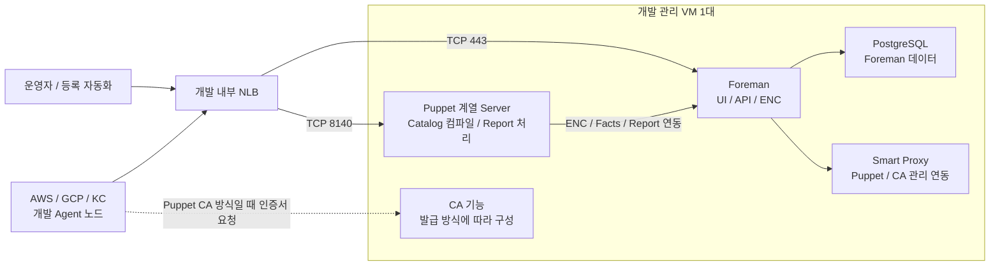

# 관리 서버 구성 정리

상태: 구현 전 구성안. 확정한 단계와 권장안·미정 사항을 구분한다.
실제 VM·네트워크·서버 패키지·인증서를 생성하지 않는다.

## 1. 확정한 방향

| 구분 | 내용 |
| --- | --- |
| 개발 | LB를 초기부터 사용하고 대상 관리 서버 1대로 먼저 구성·검증 |
| 개발 관리 서버 위치 | AWS. 리전·VPC·CSP 간 접속 경로는 미정 |
| 관리 노드 수 | 개발 1,000~2,000대, 운영 약 250대 |
| 운영 | 개발 검증 후 별도 운영 HA 구성 |
| 기능 범위 | Foreman 호스트 관리 + Puppet 계열의 시스템 설정 적용 |
| 대상 노드 | AWS/GCP/KC의 Ubuntu 20.04·24.04·26.04, Rocky 8·9 |
| Agent | 관리 대상에는 Puppet 계열 Agent/Facter. 별도 Foreman Agent 불필요 |
| Role | user-data 등록 입력으로 호스트별 base 또는 gpu_svr 선택 |
| 설정 변경 | Puppet이 변경 감지·검증·조건부 반영 |
| 모니터링 | Zabbix가 생존·응답 감시와 알림 |
| 인증서 | 사내 CA 신뢰 체계 사용 계획. 세부 발급 방식/실제 설정은 후속 결정 |

## 2. 개발 서버 권장 구성

새 전용 VM에 OS 패키지를 설치하고 foreman-installer로 구성하는 방식을 권장한다.
사용자는 설치 방식의 추천을 요청했으며 VM 직접 설치를 권장한다.
관리 서버 OS 권장 후보는 Ubuntu 24.04 amd64다.
대상 노드의 OS와 관리 서버의 OS는 같을 필요가 없다.
아래 단일 VM은 소수 노드 기능 검증용이다. 개발 전체 1,000~2,000대 수용을 보장하는 구성이 아니다.
전체 규모의 분리 구성과 용량 검증은 [AWS 규모별 구성](CAPACITY_PLAN.md)을 따른다.

CA는 사내 CA 아래에 Puppet Intermediate CA를 두는 방식일 때 관리 VM에서 운영할 수 있다.
사내 CA 직접 발급 방식을 선택하면 외부 발급/배포 절차를 사용하고 내장 CA를 끈다.
Redis/작업 실행 계층은 선택한 Foreman 플러그인과 기능의 요구에 맞춰 추가한다.
개발 초기에도 LB를 사용해 운영과 같은 접속 방식을 검증한다. 외부 DB·PuppetDB·
DHCP/TFTP/PXE·Katello는 초기 기능 검증 범위에 넣지 않는 것을 권장한다. 관리 대상의 DNS 설정을 Puppet으로 관리하는 것과 Foreman에 DNS 서버 기능을
추가하는 것은 서로 다른 결정이다.

VM 수 1대는 관리 서버 수다. Agent 시험 노드는 별도로 필요하며 관리 서버 자체에
업무 서버용 base/gpu_svr Role을 자동 배정하지 않는다.

## 3. 접속 이름과 통신

개발 예시 이름이며 실제 조직 도메인은 아직 미정이다.

| 논리 이름 | 용도 | 개발 단계 |
| --- | --- | --- |
| `foreman-dev.example.internal` | 웹·등록 API·ENC·Facts/Report 연동 | 개발 LB의 Foreman target group |
| `puppet-dev.example.internal` | Agent Catalog 통신 | 개발 LB의 Compiler target group |
| `puppet-ca-dev.example.internal` | Puppet CA 방식의 인증서 요청 | 같은 관리 VM 또는 선택한 CA 구성 |

실제 호스트 FQDN과 DNS·인증서 SAN을 일치시킨다. 처음부터 논리 접속 이름을 사용하면
운영의 LB/CA endpoint를 구성할 때 물리 서버 이름과 분리할 수 있다.

| 출발지 → 목적지 | TCP 포트 | 외부 개방 범위 |
| --- | --- | --- |
| 운영자/등록 자동화 → Foreman | 443 | 승인된 관리 경로와 대상 노드의 등록 경로 |
| Agent → Puppet Server/CA | 기본 8140 | 승인된 대상 노드 네트워크 |
| Foreman → Smart Proxy | 기본 8443 | 개발은 동일 VM 내부, 운영은 필요한 관리 서버만 |
| Foreman → PostgreSQL | 기본 5432 또는 Unix socket | 개발은 로컬 통신, 외부 노드에 개방하지 않음 |
| 운영자/설치 자동화 → 관리 VM SSH | 실제 SSH 포트 | 승인된 관리 경로만 |

기본 Puppet 적용을 위해 관리 서버가 모든 Agent의 SSH로 접속할 필요는 없다.
Foreman Remote Execution 등 SSH 기반 기능은 후속 선택 사항이다.
멀티 CSP에서 같은 관리 서버에 도달할 VPN/사설 연결·DNS 경로는 아직 확인하지 않았다.
CA 발급 모델과 실제 설치 구성에 따라 포트/endpoint는 재검증한다.

## 4. 설치 자동화와 코드 배포 구분

| 작업 | 권장 담당 |
| --- | --- |
| 관리 VM·디스크·보안 그룹·사설 연결 | 기존 IaC 프로세스와 연계. 이 채팅에서 다른 프로젝트 디렉터리를 수정하지 않음 |
| 저장소·패키지·Foreman 설치 및 반복 가능한 서버 구성 | 별도 Ansible/설치 자동화에서 foreman-installer 호출 |
| 호스트 그룹·ENC csp 파라미터·코드 환경·Role·제외 정책 | 설치 후 Foreman API 구성 자동화 |
| Puppet 코드 배포 | 현재 foreman-puppet/ 코드 하위 트리를 코드 환경별 승인 commit으로 배포 |
| Agent 등록 | 이미지/user-data와 관리 측 등록 확인 자동화 |

서버 설치 자동화는 대상 서버 설정용 manifests/site.pp와 분리해 작성한다.
개발 서버에 먼저 수동 검증 가능한 절차를 마련한 후 자동화한다.
비밀값·인증서 개인키·등록 관리자 토큰은 Git이나 이미지에 넣지 않는다.

## 5. 운영 목표

운영 이중화는 개발 VM 전체를 두 대 복제하는 것만으로 완성되지 않는다.

| 구성 요소 | 운영 목표 |
| --- | --- |
| Foreman | 2대 Active/Active + HA HTTPS LB |
| Compiler | 2대 이상 + L4 LB, 동일 코드 commit |
| PostgreSQL | 별도 HA DB endpoint와 백업/복구 |
| CA | 선택한 PKI 모델에 맞는 HA·전환·복구. Puppet CA는 단일 Active 원칙 |
| Smart Proxy / 작업 계층 | 기능별 배치·신원·실패 복구 검증 |

상세 내용은 [이중화와 인증서](HA_AND_CERTIFICATES.md)를 따른다.
노드 수·허용 중단 시간에 따라 VM 사양·배치·복제/전환 방식을 정한다.

## 6. 아직 결정할 사항

1. AWS 리전/VPC·서브넷과 GCP/KC 연결 경로
2. VM 직접 설치 권장안 채택과 전체 개발 규모의 역할별 분리 시점
3. Agent 실행 주기·분산과 Report/Facts 보존 기간
4. 관리 VM 사양·디스크·FQDN·고정 접속 주소
5. Foreman 및 실제 Puppet/OpenVox Server·Agent 버전과 패키지 공급 경로
   개발·운영 LB 및 확장 경계는 [LB/Scaling](LB_AND_SCALING.md), 실행 옵션은 [Agent 운영](AGENT_OPERATIONS.md) 참조
6. 사내 CA 직접 발급/중간 CA 위임, DNS/SAN, 등록 인증과 갱신 절차
7. 설치·서버 구성·코드 승격 자동화의 실행 위치와 인증 방식

현재 적용·제외 정책의 실제 구현은 이 서버 구성 결정 후 진행한다.

## 7. 설치 버전 확인 기록

확인한 Foreman 5.0 공식 설치 가이드는 Ubuntu 24.04/22.04, Debian 12/13 amd64를
지원 대상으로 안내하고 기본 설치 경로로 OpenVox 8 저장소를 사용한다.
기존 저장소의 Puppet 8.10.0 gem은 Catalog 컴파일 검증 버전이며 실제 배포 엔진을 고정한 것이 아니다.
제품 선택을 암묵적으로 바꾸지 않고 설치 엔진/Agent 버전·호환성을 확정한 후 설치 코드를 작성한다.

- [Foreman 5.0 Debian/Ubuntu Quickstart](https://docs.theforeman.org/5.0/Quickstart/index-foreman-deb.html)
- [Foreman 5.0 Quickstart와 기본 구성 요소](https://theforeman.org/manuals/5.0/quickstart_guide.html)
