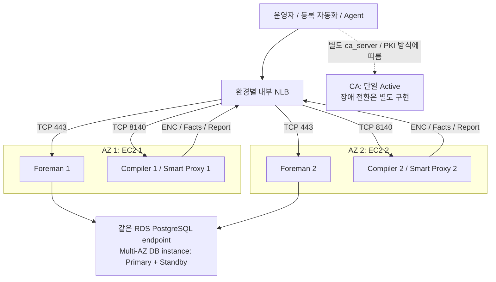

# 관리 서버 구성 정리

상태: 구현 전 구성안. 확정한 단계와 권장안·미정 사항을 구분한다.
실제 VM·네트워크·서버 패키지·인증서를 생성하지 않는다.
Foreman·Compiler·Smart Proxy 용어는 [그림 설명](ARCHITECTURE_GUIDE.md)을 참고한다.

## 1. 확정한 방향

| 구분 | 내용 |
| --- | --- |
| 개발 | 1단계 EC2 1대 + 로컬 DB → 2단계 LB + 고정 EC2 2대 + RDS |
| 개발 관리 서버 위치 | AWS. 리전·VPC·CSP 간 접속 경로는 미정 |
| 관리 노드 수 | 개발 1,000~2,000대, 운영 약 250대 |
| 운영 | 같은 방식의 LB + 고정 EC2 2대 + 공용 HA DB 구성 |
| Autoscaling | 현재 도입하지 않고 후속 고도화로 이관 |
| 2·3단계 DB 권장안 | RDS PostgreSQL Multi-AZ, 두 Foreman이 같은 DB endpoint 사용 |
| 기능 범위 | Foreman 호스트 관리 + Puppet 계열의 시스템 설정 적용 |
| 대상 노드 | AWS/GCP/KC의 Ubuntu 20.04·22.04·24.04·26.04, Rocky 8·9, Amazon Linux 2·2023 |
| Agent | 관리 대상에는 Puppet 계열 Agent/Facter. 별도 Foreman Agent 불필요 |
| Role | user-data 등록 입력으로 base/unmanaged/devops/data_infra 중 하나 선택 |
| 설정 변경 | Puppet이 변경 감지·검증·조건부 반영 |
| 모니터링 | Zabbix가 생존·응답 감시와 알림 |
| 인증서 | 사내 CA 신뢰 체계 사용 계획. 세부 발급 방식/실제 설정은 후속 결정 |

## 2. 2단계 개발 확장 및 운영 목표: 고정 EC2 2대 + LB + RDS

1단계는 EC2 1대와 로컬 PostgreSQL로 시작한다. [단계별 구축·DB 이전](PHASED_ROLLOUT.md)을 따른다.
아래는 로컬 DB를 RDS로 이전한 뒤의 2단계 및 운영 목표다.
AWS의 서로 다른 AZ에 전용 EC2 2대를 고정 배치한다. 각 EC2에 Foreman·Puppet 계열
Server/Compiler·Smart Proxy를 함께 설치하는 안으로 시작한다. 관리 OS 후보는 Ubuntu 24.04 amd64다.
두 Foreman은 로컬 DB를 따로 사용하지 않고 같은 외부 PostgreSQL DB에 연결한다.
RDS가 필수 제품은 아니지만 DB 복제·장애 전환 운영을 줄이기 위해 RDS PostgreSQL Multi-AZ를 권장한다.
DB 엔진 버전·필요한 권한/extension은 Foreman 버전과 실제 설치 전에 확인한다.

NLB의 Foreman target group과 Compiler target group에 각각 해당하는 두 EC2 포트를 등록한다.
한 EC2가 중단되면 다른 EC2가 두 역할을 모두 감당해야 하므로 N-1 성능 검증이 필요하다.
개발 1,000~2,000대와 운영 약 250대의 사양은 실제 Profile·DB 부하로 정한다.
2대가 부족하면 이후 고정 대수 수동 확장 또는 Compiler 전용 서버 분리를 검토한다.

### DB 구성

- RDS는 private subnet에 배치하고 공개 접속을 사용하지 않는 것을 기본으로 한다.
- 두 Foreman은 같은 DB·스키마와 RDS 쓰기 endpoint를 사용한다. EC2별 독립 DB를 만들지 않는다.
- 권장 기본은 Multi-AZ DB instance의 Primary + Standby다. 읽기 분산용 Read Replica와 구분한다.
- 장애 전환 시 연결 끊김/재접속이 발생할 수 있으므로 Foreman 연결 복구와 DNS 동작을 시험한다.
- 두 EC2의 DB 연결 풀 합계, Report/Facts 보존·정리, IOPS·증가량을 산정한다.
- EC2에서 로컬 DB 생성/관리는 끄고 설치 자동화에 외부 DB 연결을 지정한다.
- 스키마 migration/초기화는 두 노드에서 동시에 실행하지 않도록 설치·업그레이드 순서를 정한다.
- 백업/PITR·보존 기간·복구 시험과 RDS 자체 TLS 신뢰도 별도로 준비한다.

### 두 애플리케이션 노드가 공유·일치시켜야 하는 것

- 같은 Foreman/플러그인 버전과 DB 연결 정보
- 같은 Foreman 암호화 키·세션 서명 비밀값과 관련 서비스 설정
- 같은 Puppet 코드·모듈·Hiera commit 및 ENC/Facts/Report 연동
- 노드별 고유 인증서·개인키와 실제 LB 접속 이름의 SAN
- 사용하는 작업 실행/캐시 기능에 맞춘 공유 상태 또는 다중 인스턴스 동작 검증

DB를 외부화해도 애플리케이션의 모든 상태가 자동 공유되는 것은 아니다.
암호화 키·세션 비밀값은 안전한 저장소에서 동기화하며 인증서 개인키를 공통 이미지로 복제하지 않는다.

### CA는 별도 HA 항목

Foreman DB의 RDS에는 Puppet CA 개인키·serial·CSR·서명 인증서·CRL 등 CA 상태가 자동 저장되지 않는다.
사내 CA 직접 발급이면 외부 PKI의 발급/배포/HA 절차를 따른다.
Puppet Intermediate CA를 선택하면 EC2 중 한 대 또는 별도 위치에서 단일 Active로 운영하고,
상태 보존·Standby 전환·fencing·ca_server 경로를 따로 구현한다.
두 EC2에서 동일 CA를 독립적으로 초기화하거나 동시에 발급하지 않는다.
CA 전환 구현 전에는 EC2 1대 장애에도 신규 등록/서명/폐기를 계속할 수 있다고 보장하지 않는다.

현재는 고정 2대 설계와 RDS 권장안을 문서화한 것이며 실제 설치·생성·failover 시험은 하지 않았다.
최초 개발은 로컬 DB 1대 구성으로 기능을 확인하고, 2단계에서 RDS 이전·두 번째 EC2·LB를 검증한다.
Katello·PuppetDB·DHCP/TFTP/PXE는 초기 범위에 추가하지 않는다.
Redis/작업 실행 계층은 선택한 플러그인이 요구하면 별도 관리형/HA 구성으로 검토한다.

## 3. 접속 이름과 통신

개발 예시 이름이며 실제 조직 도메인은 아직 미정이다.

| 논리 이름 | 용도 | 1단계 → 2단계 |
| --- | --- | --- |
| `foreman-dev.example.internal` | 웹·등록 API·ENC·Facts/Report 연동 | 단일 EC2 → 개발 LB의 Foreman target group |
| `puppet-dev.example.internal` | Agent Catalog 통신 | 단일 EC2 → 개발 LB의 Compiler target group |
| `puppet-ca-dev.example.internal` | Puppet CA 방식의 인증서 요청 | 같은 관리 VM 또는 선택한 CA 구성 |

실제 호스트 FQDN과 DNS·인증서 SAN을 일치시킨다. 처음부터 논리 접속 이름을 사용하면
운영의 LB/CA endpoint를 구성할 때 물리 서버 이름과 분리할 수 있다.

| 출발지 → 목적지 | TCP 포트 | 외부 개방 범위 |
| --- | --- | --- |
| 운영자/등록 자동화 → Foreman | 443 | 승인된 관리 경로와 대상 노드의 등록 경로 |
| Agent → Puppet Server/CA | 기본 8140 | 승인된 대상 노드 네트워크 |
| Foreman → Smart Proxy | 기본 8443 | 개발은 동일 VM 내부, 운영은 필요한 관리 서버만 |
| 두 Foreman EC2 → RDS PostgreSQL | 기본 5432 | RDS SG는 승인된 Foreman 서버 경로만 허용 |
| 운영자/설치 자동화 → 관리 VM SSH | 실제 SSH 포트 | 승인된 관리 경로만 |

기본 Puppet 적용을 위해 관리 서버가 모든 Agent의 SSH로 접속할 필요는 없다.
Foreman Remote Execution 등 SSH 기반 기능은 후속 선택 사항이다.
멀티 CSP에서 같은 관리 서버에 도달할 VPN/사설 연결·DNS 경로는 아직 확인하지 않았다.
CA 발급 모델과 실제 설치 구성에 따라 포트/endpoint는 재검증한다.

## 4. 설치 자동화와 코드 배포 구분

| 작업 | 권장 담당 |
| --- | --- |
| 관리 VM·디스크·보안 그룹·사설 연결 | 기존 IaC 프로세스와 연계. 이 채팅에서 다른 프로젝트 디렉터리를 수정하지 않음 |
| 저장소·패키지·Foreman 설치 및 반복 가능한 서버 구성 | 별도 Ansible/설치 자동화에서 foreman-installer 호출 |
| 호스트 그룹·ENC csp 파라미터·코드 환경·Role·제외 정책 | 설치 후 Foreman API 구성 자동화 |
| Puppet 코드 배포 | 현재 foreman-puppet/ 코드 하위 트리를 코드 환경별 승인 commit으로 배포 |
| Agent 등록 | 이미지/user-data와 관리 측 등록 확인 자동화 |

서버 설치 자동화는 대상 서버 설정용 manifests/site.pp와 분리해 작성한다.
개발 서버에 먼저 수동 검증 가능한 절차를 마련한 후 자동화한다.
비밀값·인증서 개인키·등록 관리자 토큰은 Git이나 이미지에 넣지 않는다.

## 5. 운영 목표

2단계 개발과 운영은 같은 고정 2대 + LB 구조를 목표로 한다. 두 역할은 같은 EC2에 공동 배치할 수 있지만
DB·CA·키·작업 계층까지 별도 HA 조건을 충족해야 한다.

| 구성 요소 | 운영 목표 |
| --- | --- |
| Foreman | 2대 Active/Active + HA HTTPS LB |
| Compiler | 2대 이상 + L4 LB, 동일 코드 commit |
| PostgreSQL | 별도 HA DB endpoint와 백업/복구 |
| CA | 선택한 PKI 모델에 맞는 HA·전환·복구. Puppet CA는 단일 Active 원칙 |
| Smart Proxy / 작업 계층 | 기능별 배치·신원·실패 복구 검증 |

상세 내용은 [이중화와 인증서](HA_AND_CERTIFICATES.md)를 따른다.
노드 수·허용 중단 시간에 따라 VM 사양·배치·복제/전환 방식을 정한다.

## 6. 아직 결정할 사항

1. AWS 리전/VPC·서브넷과 GCP/KC 연결 경로
2. EC2 2대 공동 배치의 실제 사양·N-1 성능과 향후 수동 확장 시점
3. Agent 실행 주기·분산과 Report/Facts 보존 기간
4. 관리 EC2 사양·디스크·FQDN·접속 주소와 RDS 버전·사양·보존 기간
5. Foreman 및 실제 Puppet/OpenVox Server·Agent 버전과 패키지 공급 경로
   개발·운영 LB 및 확장 경계는 [LB/Scaling](LB_AND_SCALING.md), 실행 옵션은 [Agent 운영](AGENT_OPERATIONS.md) 참조
6. 사내 CA 직접 발급/중간 CA 위임, DNS/SAN, 등록 인증과 갱신 절차
7. 설치·서버 구성·코드 승격 자동화의 실행 위치와 인증 방식

적용·제외 및 SSH 공통 제어는 구현했다. 지금 다음 작업은 1단계 단일 개발 서버의 설치·연동 절차다.

## 7. 설치 버전 확인 기록

확인한 Foreman 5.0 공식 설치 가이드는 Ubuntu 24.04/22.04, Debian 12/13 amd64를
지원 대상으로 안내하고 기본 설치 경로로 OpenVox 8 저장소를 사용한다.
기존 저장소의 Puppet 8.10.0 gem은 Catalog 컴파일 검증 버전이며 실제 배포 엔진을 고정한 것이 아니다.
제품 선택을 암묵적으로 바꾸지 않고 설치 엔진/Agent 버전·호환성을 확정한 후 설치 코드를 작성한다.

- [Foreman 5.0 Debian/Ubuntu Quickstart](https://docs.theforeman.org/5.0/Quickstart/index-foreman-deb.html)
- [Foreman 5.0 Quickstart와 기본 구성 요소](https://theforeman.org/manuals/5.0/quickstart_guide.html)

- [Foreman 다중 인스턴스의 공용 DB와 키](https://theforeman.org/manuals/5.0/index.html#5.8MultipleForemaninstances)
- [RDS Multi-AZ DB instance](https://docs.aws.amazon.com/AmazonRDS/latest/UserGuide/Concepts.MultiAZSingleStandby.html)
