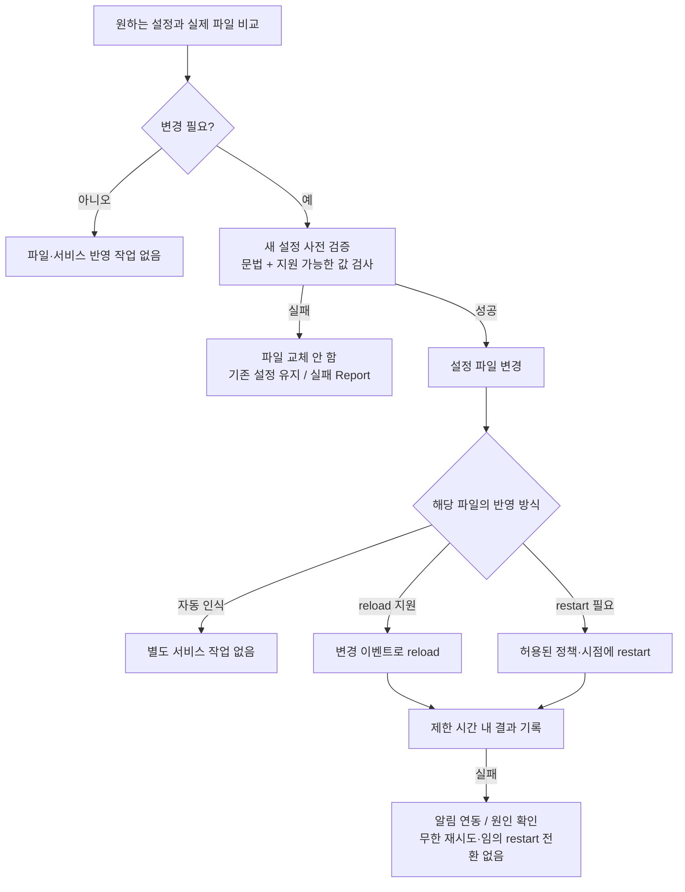

# 서비스 설정 변경의 반영 정책

## 역할 분담

- Puppet: 승인된 파일·설정값을 유지하고 실제 변경 시 필요한 반영 작업을 수행한다.
- Zabbix: 서비스 생존·응답·지연·반복 장애를 감시하고 알린다.
- Foreman/Puppet Report: 설정 적용과 reload/restart의 변경·실패 결과를 기록한다.

Puppet의 주기 실행은 유지하지만, 모든 서비스에 `ensure => running`을 선언해 꺼진 서비스를
매번 시작하는 정책은 사용하지 않는다. Agent가 주기적으로 설정을 적용하는 것과 각 서비스의
생존 상태를 지속적으로 보장하는 것은 구분한다. 별도의 승인 없이 자동 복구 기능을 추가하지 않는다.

## 설정 변경 흐름

이 문서는 후속 Profile의 구현 규칙이다. 현재 실제 서비스 설정·반영 리소스는 구현하지 않았다.

## 항목별로 다른 반영 방식

| 설정 | 반영 원칙 |
| --- | --- |
| sshd_config / SSH drop-in | 새 설정 검증 후 변경 시 reload. 기존 연결을 유지하며 새 로그인 확인 |
| DNS | 실제 systemd-resolved/netplan/NetworkManager 관리 주체에 맞는 반영 절차. KC만 대상 |
| NTP | 데몬과 변경 항목이 지원하는 reload 또는 승인된 restart. KC만 대상 |
| Zabbix Agent 설정 | Agent 종류·버전·변경 항목에 맞게 reload/restart. 전체 설정 reload를 지원한다고 가정하지 않음 |
| Puppet Agent 설정 | 현재 실행을 종료시키지 않도록 변경 반영 시점을 설계. 필요한 서비스 재시작은 별도 절차 |
| apt/yum/dnf 저장소 | 저장소 변경 시 필요한 메타데이터 갱신. 무관한 서비스 재시작 없음 |
| authorized_keys | 다음 인증 요청에서 읽히므로 일반적으로 SSH 데몬 reload 불필요 |
| cloud.cfg / cloud-init drop-in | 해당 cloud-init 모듈의 실행 시점에 따름. 변경했다고 전체 cloud-init 재실행/재부팅을 자동 수행하지 않음 |

## 구현 시 지킬 조건

1. 설정 파일의 검증 명령·경로·전체 파일과 drop-in의 관계를 OS/서비스별로 정한다.
   Puppet `file`의 `validate_cmd` 등으로 새 내용 검증에 실패하면 파일 교체를 막는다.
   문법 검사 성공만으로 실제 서비스 정상 응답까지 보장하지 않는다.
2. 여러 파일이 한 서비스 설정을 구성한다면 개별 파일 검증 외에 조합된 설정 검증과
   변경 반영 순서를 마련한다. 부분적으로 교체된 설정에 먼저 reload하지 않는다.
3. 변경 알림과 `refreshonly` 실행 등으로 이벤트 발생 시에만 반영한다.
   `notify => Service[...]`의 기본 반영을 reload라고 가정하지 않는다.
4. 서비스가 이미 중단되어 있으면 기본적으로 시작시키지 않는다. 변경 반영의 대상 상태를
   실행 직전에 확인하고 의도된 중단 상태를 유지한다. 다음 정상 시작 시 새 파일을 읽는다.
5. reload를 지원하지 않는 경우 restart로 조용히 전환하지 않는다. 서비스별로 허용 방식과
   영향·점검 시간대를 명시한다. DB/Hadoop/GPU 작업의 재시작은 별도 승인 절차에 따른다.
6. 반영 명령에는 실행 시간 제한과 필요한 systemd 시작/종료 제한을 둔다. 즉시 반복 재시도하지 않는다.
7. 반영 실패는 Report에 남긴다. 파일 교체 후 실패했다고 자동 rollback이 된다고 가정하지 않는다.
   복구 또는 rollback은 서비스별로 설계하고, 잘못된 설정을 무조건 다시 적용하지 않는다.
8. 순수 변경 이벤트 방식에서는 파일이 다음 실행에 그대로면 실패한 reload가 자동 재시도되지
   않을 수 있다. 실패 후 실제 반영 여부를 확인하고, 수정 commit 또는 명시적인 재반영 작업으로
   해결한다. Report 성공만으로 그 서비스의 최신 설정 반영을 오판하지 않도록 감시·이력을 연결한다.
9. 지속적인 프로세스 감시·endpoint 검사·알림은 Zabbix에 둔다. Puppet 반영 작업의 실패도
   별도 Report/알림 연동 대상으로 삼으며 현재 이 연동은 구현하지 않았다.

## 현재 코드 상태

현재 Catalog에는 패키지·예시 파일·이전 진단 파일 삭제만 있으며 `Service` 리소스는 없다.
DNS/NTP 키는 비활성 예약 데이터이고 SSH/Zabbix 등 서비스 Profile은 후속 구현이다.
실제 Profile을 만들 때 이 정책을 함께 적용하고 실제 OS에서 검증한다.
