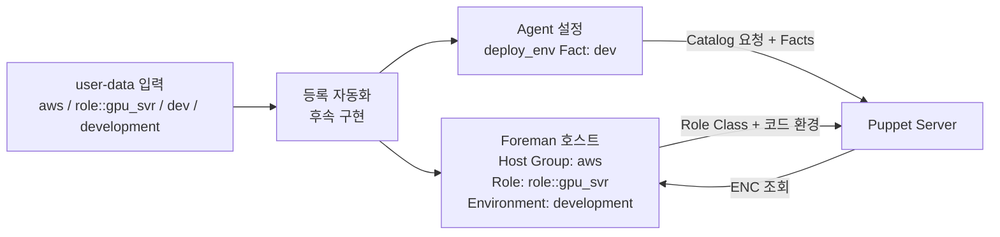
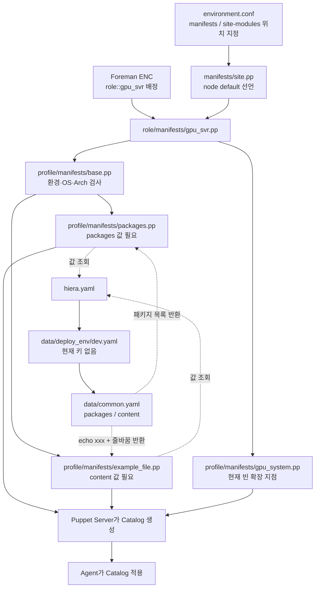

# 파일로 따라가는 개발 GPU 서버 예시

[설정 조회·등록 확인 관계도](LOOKUP_AND_REGISTRATION.md)에서 키/경로 조회와 등록 성공 판정 기준을 이어서 확인할 수 있다.

## 1. 서버 생성과 Foreman 등록

아래는 user-data 등록 자동화에 전달할 논리 입력이다. 아직 실행 가능한 등록 스크립트는
구현하지 않았으며, 변수만 선언한다고 Foreman에 자동 배정되지는 않는다.

```text
HOST_GROUP=aws
PUPPET_ROLE=role::gpu_svr
DEPLOY_ENV=dev
PUPPET_ENV=development
```

등록 자동화가 이 입력을 받아 Foreman 호스트에 Host Group·Role Class·코드 환경을
설정하고, Agent 설정과 `deploy_env` 외부 Fact를 준비하는 방식으로 구현한다.
`PUPPET_ROLE`은 Fact가 아니며 Foreman 기본 API 인자 이름도 아니다.
일반 서버에는 `role::base`, GPU 서버에는 `role::gpu_svr` 하나를 지정한다.
수집된 GPU Facts로 Role을 자동 변경하지 않는다.



## 2. 읽어볼 파일 지도

```text
foreman-puppet/
├── environment.conf                  # 코드 위치: manifests와 site-modules
├── manifests/site.pp                 # 기본 노드 선언; Role 배정은 Foreman 담당
├── site-modules/
│   ├── role/manifests/
│   │   ├── base.pp                   # 일반 서버: 공통 Profile 포함
│   │   └── gpu_svr.pp                # GPU 서버: 공통 + GPU Profile 포함
│   └── profile/
│       └── manifests/
│           ├── base.pp               # 환경·OS·Arch 검사 후 공통 기능 포함
│           ├── packages.pp           # Hiera의 목록으로 패키지 설치
│           ├── example_file.pp       # 예시 파일 생성·이전 진단 파일 삭제
│           └── gpu_system.pp         # GPU용 확장 지점; 현재 변경 리소스 없음
├── hiera.yaml                        # 필요한 설정값의 조회 순서
└── data/
    ├── deploy_env/dev.yaml           # 개발 환경 우선 조회; 현재 비어 있음
    ├── deploy_env/prd.yaml           # 운영 환경 우선 조회; 현재 비어 있음
    └── common.yaml                   # 환경별 키가 없을 때 공통값 제공
```

## 3. Role에서 기능을 선택하고 Hiera에서 값을 읽기



그림은 파일 사이의 책임과 데이터 연결을 설명한다. 모든 파일이 위에서 아래로 순차
실행되는 셸 스크립트는 아니다. Hiera는 파라미터가 필요할 때 키별로 조회하고,
Agent는 Catalog에 기록된 리소스와 의존 관계를 따라 적용한다.

## 4. 실제 파일 내용 연결

[`role/manifests/gpu_svr.pp`](../site-modules/role/manifests/gpu_svr.pp):

```puppet
class role::gpu_svr {
  include profile::base
  include profile::gpu_system
}
```

[`data/common.yaml`](../data/common.yaml)의 값:

```yaml
profile::packages::packages:
  - ca-certificates
  - curl
profile::example_file::content: "echo xxx\n"
```

`profile::example_file::content`는 `profile::example_file` Class의
`$content` 파라미터로 자동 조회되어 `File` 리소스의 `content`로 들어간다.

## 5. Agent 적용 후 기대 결과

```text
Ubuntu 24.04 개발 GPU 서버
├── ca-certificates, curl 설치 상태 유지
└── /etc/foreman-puppet/
    └── example.txt     # 내용: echo xxx + 줄바꿈
```

현재 GPU Profile은 비어 있어 GPU 드라이버나 MIG를 변경하지 않는다.
일반 서버도 같은 공통 설정을 받지만 GPU Profile을 포함하지 않는다.
운영 노드는 `production` 코드 환경에서 `prd.yaml`을 우선 조회한다.
현재 두 환경 파일 모두 비어 있으므로 같은 공통값을 사용한다.

검증은 Catalog 컴파일까지 수행했으며, 위 결과는 실제 노드 적용 후 확인할 기대 상태다.

`node.conf`와 EPP 양식은 제거했다. 이전 Catalog로 생성된 파일도 다음 적용에서 삭제한다.
등록 성공은 Foreman의 최신 Facts/Report와 Puppet 실행 결과로 확인한다.
