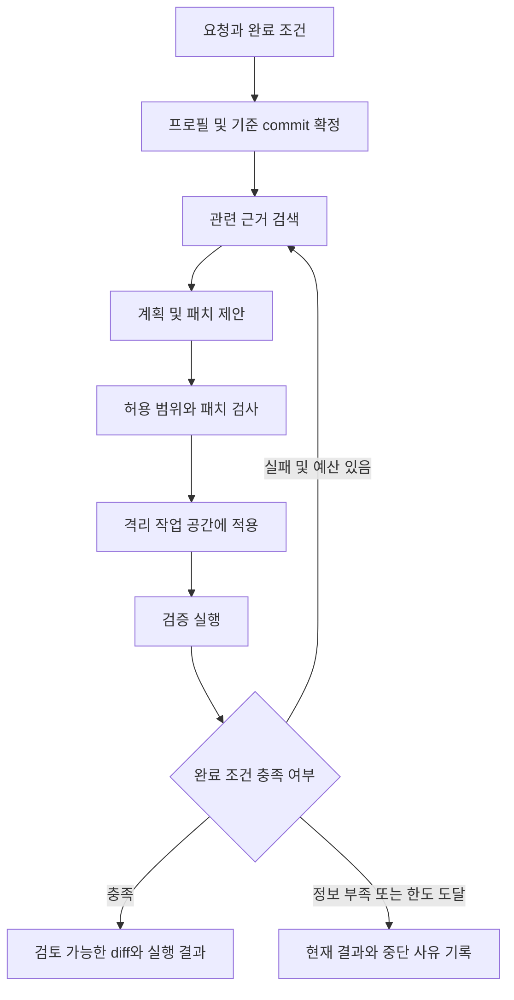

# 개발 에이전트 아키텍처 초안

## 목표와 범위

프로젝트의 개발 규칙과 근거를 바탕으로 변경을 제안하고, 격리된 환경에서 검증하는
개발 에이전트를 설계합니다. 첫 적용 대상은 `infra-terraform`이며 이후 다른 언어와
실행 환경에도 같은 실행 흐름을 사용하도록 합니다.
현재는 문서만 작성하며 아래의 구성 요소와 계약은 모두 구현 제안입니다.

## 구성 요소

| 구성 요소 | 책임 | 프로젝트에 따라 바뀌는 부분 |
| --- | --- | --- |
| 공통 오케스트레이터 | 단계 전환, 상태, 예산, 재시도 및 종료 관리 | 변경하지 않는 것을 목표로 함 |
| 프로젝트 프로필 | 저장소, 규칙, 수집 범위, 검증과 완료 조건 선언 | 언어·저장소·환경 |
| 근거 검색기 | 관련 문서·코드와 출처 반환 | 로컬 검색 또는 RAG |
| 개발 모델 어댑터 | 구조화된 계획과 패치 제안 반환 | 모델·SDK·호출 방식 |
| 작업 공간 관리자 | 기준 commit 고정, 격리 checkout, 패치 검사와 적용 | 로컬·컨테이너·원격 환경 |
| 검증 실행기 | 검사 실행과 결과 수집 | 언어별 빌드·테스트·정적 검사 |
| 정책 검사기 | 파일·도구·네트워크·자격 증명 접근 판단 | 조직·프로젝트 정책 |
| 기록 및 평가 계층 | 실행 추적, 실패 분류, 품질 비교 | 프로젝트별 평가 사례 |

하네스는 모델이 개발 작업을 반복 가능하게 수행하도록 작업 공간, 도구, 컨텍스트,
검증, 실행 제한과 기록을 제공하는 실행 기반으로 설계합니다.
RAG는 이 중 근거 검색기의 한 구현이며 전체 실행 흐름과 분리합니다.

## 처리 흐름

정책 검사에서 허용되지 않은 변경은 적용하지 않고 수정 가능한 제안 오류와 별도 승인이
필요한 작업을 구분합니다. 최초 구현은 읽기 전용 근거 수집과 패치 제안까지로 제한할 수 있습니다.
자동 병합과 배포는 초기 구현 범위에 포함하지 않습니다.

## 공통 데이터 계약

| 데이터 | 필수 항목 제안 |
| --- | --- |
| TaskSpec | 요청, 대상 경로, 요구사항, 완료 조건, 미확정 항목 |
| ProjectProfile | 저장소 위치, 규칙 문서, 허용 범위, 검사 목록, 환경 요구사항 |
| Evidence | 저장소, commit, 경로, 줄 범위, 내용, 내용 해시 |
| ChangeProposal | 변경 계획, 패치, 근거 참조, 가정과 미해결 질문 |
| CheckResult | 검사 이름, 실행 위치, 상태, 종료 코드, 로그, 미실행 사유 |
| RunRecord | 작업 ID, 기준 commit, 프로필·정책 버전, 모델 설정, 단계별 결과, 사용 예산 |

검사 상태는 passed/failed/skipped를 구분합니다. 전체 실행 결과는 검증 성공,
검증 실패, 입력 필요, 정책 차단, 예산 소진을 구분하고 완료 조건에 따라 판단합니다.
근거 부족이나 검사 미실행을 성공으로 취급하지 않습니다.

## 하네스 설계

작업별로 격리된 checkout을 만들고 기준 commit을 기록합니다.
프롬프트, 모델 응답, 패치, 검사 결과와 최종 diff를 같은 작업 ID에 연결합니다.
패치 적용 전에 허용 경로, 경로 탈출, 링크와 변경량을 검사합니다.
검사 실패 시 실패 원인과 필요한 근거를 다음 시도에 전달하되 반복 횟수, 시간 및
토큰 예산을 적용합니다. 수정 반복은 동일 기준으로 재검증해야 합니다.

검증 명령은 argv와 명시적인 cwd로 실행하고 필요한 환경 변수만 전달합니다.
실행기는 timeout, 종료 코드와 출력 제한을 기록합니다.
로컬 검사, 의존성 설치, 네트워크 접근과 클라우드 인증 요구를 구분합니다.
환경 어댑터를 통해 로컬 프로세스를 컨테이너 또는 원격 실행으로 교체할 수 있게 합니다.

## RAG 설계

초기에는 필수 아키텍처 문서와 파일 경로 기반 로컬 검색을 기준선으로 삼습니다.
이후 검색 품질이 부족한 부분에 청킹, 키워드·벡터 검색, 재정렬을 추가합니다.
Markdown 제목, Terraform 블록 등 언어별 청킹은 검색 어댑터 내부에서 처리합니다.

청크에는 저장소, commit, 경로, 줄 범위와 내용 해시를 기록하고 검색 시 버전을 고정합니다.
변경·삭제된 파일의 인덱스를 갱신하고 다른 브랜치의 근거가 섞이지 않게 합니다.
인덱싱 전 제외 규칙과 비밀값 검사를 적용하고 검색 후 접근 범위와 컨텍스트 예산을 확인합니다.
검색 결과는 참고 자료이며 실행 권한이나 운영 지침을 변경하는 입력으로 취급하지 않습니다.

## 구현 순서와 미정 사항

1. 첫 작업의 TaskSpec과 완료 조건, 프로필 계약을 확정합니다.
2. 로컬 근거 수집과 실행 기록을 구현하고 수집 누락을 확인합니다.
3. 모델 어댑터를 연결해 검토 가능한 패치만 생성합니다.
4. 격리 작업 공간, 정책 검사, 패치 적용 및 검증 실행기를 구현합니다.
5. 평가 사례를 자동 실행하고 실패 분류와 제한된 수정 반복을 추가합니다.
6. 기준선과 비교하면서 RAG를 도입하고 두 번째 언어·환경에서 재사용성을 확인합니다.

구현 언어, 모델 제공자, SDK, 벡터 DB, 실행 환경, 기록 저장소 및 예산 값은 미정입니다.
선택 시 내부망 여부, 데이터 전송 조건, 운영 환경과 유지보수 비용을 함께 고려합니다.
