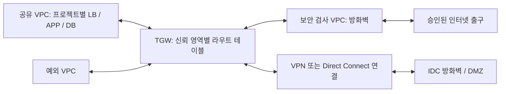

# AWS 네트워크 정책

- 문서 상태: 검토 초안 v0.1 (운영 승인 전)
- 작성일: 2026-10-27
- 적용 대상: 공유 VPC, 보안 검사 VPC, 예외 VPC, TGW 및 IDC 연결
- 목적: Terraform 예제와 후속 모듈의 공통 설계 기준 수립

이 문서의 **필수**는 정책 채택 시 준수할 기준, **권장**은 기본 설계안,
**미정**은 구현 전에 결정할 항목입니다. 현재 운영에 적용되었거나 자동 검증되는 정책은 아닙니다.
실제 계정, CIDR, 포트, 제품 및 리소스 이름은 아직 지정하지 않습니다.

## 1. 기본 원칙

1. 환경과 신뢰 경계를 우선해 네트워크를 구분하고, 그 범위 안에서 공유를 통해 운영·트래픽 비용을 줄입니다.
2. 신규 연결은 기본 거부하고, 승인된 출발지·목적지·프로토콜·포트만 허용합니다.
   상태 추적이 허용한 연결의 응답은 별도로 취급합니다.
3. 라우팅은 검사 경로를 강제하고, 방화벽은 경계를 통과하는 트래픽을 검사하며,
   SG는 리소스 접근을 제어하고, NACL은 서브넷 단위의 보조 통제를 담당합니다.
4. 사설 IP, 같은 VPC, 같은 프로젝트라는 이유만으로 신뢰하지 않습니다.
5. 예외에는 담당자, 사유, 영향 범위, 대체 통제, 만료일을 남깁니다.
6. 네트워크 변경은 코드와 검토 기록으로 관리하며, 장애 복구 절차를 함께 준비합니다.

## 2. 통합 네트워킹 구조

### 2.1 VPC 역할과 격리

| 구분 | 정책 | 기본 소유자 |
| --- | --- | --- |
| 공유 VPC (Shared VPC) | 같은 환경·신뢰 경계의 프로젝트에 전용 서브넷을 공유 | 네트워크 담당 계정 |
| 보안 검사 VPC (Inspection VPC) | 중앙 방화벽 및 검사 경로 수용. 일반 업무 리소스 배치 금지 | 네트워크/보안 담당 계정 |
| 예외 VPC | 별도 규제, 격리, 라우팅, 제품 제약이 있는 서비스 수용 | 승인된 네트워크 또는 서비스 계정 |
| TGW | VPC 간 및 IDC 연결 허브. 경로를 신뢰 영역별로 분리 | 네트워크 담당 계정 |

여기서 ‘공유’는 여러 계정이 서브넷을 함께 사용하는 의미이며 인터넷 공개를 뜻하지 않습니다.
PRD와 비운영 환경은 공유 VPC를 분리하는 것을 기본으로 합니다.
프로젝트별로 `프로젝트 × 역할 × AZ` 전용 서브넷을 배정하고, 다른 프로젝트와 같은 서브넷을
공유하는 것은 예외로 취급합니다. AZ는 계정별 문자 이름 대신 AZ ID로 대응 관계를 확인합니다.

AWS RAM 기반 서브넷 공유는 같은 AWS Organizations 조직 내 계정을 전제로 합니다.
워크로드가 공유 서브넷에서 지원되는지 서비스별로 확인합니다.
[AWS VPC 공유](https://docs.aws.amazon.com/vpc/latest/userguide/vpc-sharing.html)

공유 VPC의 동일 VPC 통신을 사용하면 일부 TGW 경유를 줄일 수 있지만, 비용 절감이 보장되는 것은 아닙니다.
트래픽량, AZ 이동, TGW 처리, NAT, 방화벽, 엔드포인트, 로그 비용을 경로별로 비교하고
비용 절감만을 이유로 격리 또는 검사 요구사항을 완화하지 않습니다. 금액은 설계 시점에 산정합니다.
[AWS TGW 요금](https://aws.amazon.com/transit-gateway/pricing/),
[AWS VPC FAQ](https://aws.amazon.com/vpc/faqs/)

### 2.2 개념 흐름

그림은 연결 관계만 표현합니다. TGW의 존재만으로 방화벽 경유가 보장되지 않습니다.
검사 대상 VPC 간/IDC 통신은 TGW 라우트 테이블에서 검사 attachment를 거친 뒤
목적지 attachment로 전달하도록 왕복 경로를 설계해야 합니다.
인터넷 ingress/egress는 아래 분류별 경로 설계를 별도로 확정합니다.

### 2.3 서브넷 역할

| 역할 | 용도 | 인터넷/라우팅 기준 |
| --- | --- | --- |
| lb-public | 외부 공개 LB. 공개 서비스가 있는 경우에만 생성 | 승인된 ingress 경로만 허용 |
| lb-private | 내부 LB | 인터넷 직접 노출 금지 |
| app | 애플리케이션, EKS 노드 등 | 공인 IP·IGW 직접 경로 금지. 승인된 egress만 허용 |
| db | 데이터베이스, 캐시 등 데이터 계층 | 공인 IP·인터넷 기본 경로 금지. 백업/관리 통신만 별도 승인 |
| tgw-attachment | TGW 연결용 | 업무 리소스 배치 금지 |
| firewall / gwlbe | 방화벽 endpoint 또는 승인된 어플라이언스 경로 | 업무 리소스와 분리 |
| egress | 중앙 NAT/프록시 등 인터넷 출구 | 보안 검사 경로와 함께 설계 |
| endpoint | Interface VPC Endpoint | 필요 시 별도 생성, endpoint SG/정책 적용 |
| resolver / management | DNS 전달, 운영 도구 | 필요 시 생성, 승인된 관리 주체만 접근 |

`lb / app / db`를 기본 업무 계층으로 사용하되 public/private LB를 구분합니다.
인프라 역할 서브넷은 해당 기능이 필요할 때만 생성하며, 모든 VPC에 일괄 생성하지 않습니다.
PRD는 최소 2개 AZ를 기본으로 하고 서비스 지원 범위와 IP 여유량을 확인합니다.
EKS는 노드·Pod IP 소비와 제어 평면 ENI 요구량을 별도로 산정하고 필요 시 Pod 서브넷을 분리합니다.
TGW 연결 서브넷은 별도로 두는 설계를 사용합니다.
[AWS TGW 설계 권고](https://docs.aws.amazon.com/vpc/latest/tgw/tgw-best-design-practices.html)

### 2.4 CIDR 및 DNS

- IPAM 또는 중앙 CIDR 대장으로 VPC, 프로젝트, 역할, AZ별 대역을 관리합니다.
- VPC·IDC·VPN·연결 대상과 중복되지 않는 CIDR을 할당합니다.
- 보조 CIDR 추가는 네트워크 담당자의 검토를 거칩니다. 기존 CIDR 크기를 변경하는 방식으로 취급하지 않습니다.
- 추가 CIDR의 local 경로 생성, TGW/IDC 경로, 방화벽, NACL, prefix list,
  DNS 및 IP 사용량·서비스 할당량 영향을 함께 확인합니다.
- IPv4를 초기 예제 기준으로 사용합니다. IPv6 활성화 시 `::/0`, SG/NACL, DNS 및 검사 경로를
  별도로 검토하고 IPv4 정책을 우회하는 경로를 허용하지 않습니다.
- AWS 내부 서비스 접근은 필요에 따라 VPC Endpoint와 endpoint policy를 사용합니다.
- IDC DNS 연동은 승인된 Resolver 전달 경로를 사용하고 무제한 재귀·전달 루프를 금지합니다.
  AmazonProvidedDNS 필터링은 SG/NACL 대신 Resolver DNS Firewall 등의 별도 통제를 검토합니다.

[AWS CIDR 제약](https://docs.aws.amazon.com/vpc/latest/userguide/vpc-cidr-blocks.html),
[AWS TGW VPC 연결 제약](https://docs.aws.amazon.com/vpc/latest/tgw/tgw-vpc-attachments.html),
[AWS NACL 제한](https://docs.aws.amazon.com/vpc/latest/userguide/vpc-network-acls.html)

## 3. 방화벽 및 라우팅 정책

### 3.1 검사 범위

| 통신 유형 | 기본 정책 | 강제 지점 |
| --- | --- | --- |
| 인터넷 → 공개 LB | 공개한 서비스 포트만 허용 | ingress 방화벽 경로 + LB SG, HTTP(S)는 WAF 검토 |
| APP → 인터넷 | 승인된 업데이트/API 등만 허용 | 중앙 egress 검사 + SG |
| DB → 인터넷 | 기본 금지 | 경로 제거 + SG, 필요 시 만료 있는 예외 |
| VPC 간 / 프로젝트 간 | 기본 거부, 명시적으로 승인 | VPC 간은 TGW 검사 경로 + SG, 같은 VPC는 SG |
| AWS ↔ IDC | 지정한 네트워크와 서비스만 허용 | 왕복 검사 경로 + AWS/IDC 양측 접근 제어 |
| 동일 모듈 내부 | 승인된 모듈 내부 허용 프로파일 적용 | SG, 동일 서브넷 통신도 SG로 제어 |

**공유 VPC 내부 통신은 local 경로를 사용하므로 중앙 검사 VPC를 자동으로 통과하지 않습니다.**
같은 VPC의 프로젝트 간 방화벽 검사가 필수라면 별도 VPC 분리 또는 지원되는 VPC 내부
middlebox routing을 추가 설계합니다. 같은 서브넷 내부 통신을 NACL이나 TGW로
검사할 수 있다고 가정하지 않습니다.
[AWS 라우팅 옵션](https://docs.aws.amazon.com/vpc/latest/userguide/route-table-options.html),
[AWS 게이트웨이 라우트 제약](https://docs.aws.amazon.com/vpc/latest/userguide/gateway-route-tables.html)

### 3.2 경로 및 가용성

- TGW의 라우트 테이블 association/propagation을 명시적으로 관리하고,
  PRD·비운영·검사·IDC 경계를 무조건 상호 전파하지 않습니다.
- 검사 대상 경로가 더 구체적인 직접 경로, peering, IGW/NAT, VPN 등으로 우회되지 않게 검증합니다.
- 왕복 트래픽은 같은 상태 추적 방화벽 경로를 통과해야 합니다.
- 검사 VPC의 TGW VPC attachment에는 제품·토폴로지에 맞게 appliance mode를 적용합니다.
  Palo Alto 사용 시 GWLB/ENI 방식, HA, health check, SNAT 유무를 제품별로 검증합니다.
- AZ별 검사 경로와 장애 전환을 설계합니다. 장애 시 무검사 우회는 기본 금지하고,
  가용성 목표에 따른 복구와 예외 승인 절차를 정의합니다.
- AWS NFW의 TGW 직접 attachment 등 다른 배포 모델은 이 초안의 검사 VPC 모델을 대체하는
  별도 설계안으로 평가합니다. 제품 선택 없이 배포 모델을 확정하지 않습니다.

[AWS NFW 대칭 라우팅](https://docs.aws.amazon.com/network-firewall/latest/developerguide/asymmetric-routing.html),
[AWS TGW 동작](https://docs.aws.amazon.com/vpc/latest/tgw/how-transit-gateways-work.html)

## 4. NACL 정책

NACL은 서브넷 단위의 보조 경계로 사용하며 업무별 세부 접근 제어의 주 수단으로 삼지 않습니다.
NACL은 상태 비저장 방식이므로 요청과 응답을 양방향으로 허용해야 하고,
같은 서브넷 내부 통신에는 적용되지 않습니다.
[AWS NACL 동작](https://docs.aws.amazon.com/vpc/latest/userguide/vpc-network-acls.html)

1. ‘모든 사설망 전체 허용’ 대신 **승인된 연결 대역 목록**을 사용합니다.
   RFC1918 전체를 신뢰하지 않고 프로젝트·IDC·운영 대역을 중앙 관리합니다.
2. 승인 대역 간 넓은 포트 허용이 필요한 경우 해당 프로파일을 문서화하고,
   SG와 실제 경유 방화벽이 세부 통제를 담당함을 명시합니다.
3. 사설 전용 APP/DB, public LB, egress, 검사 서브넷은 서로 다른 NACL 프로파일을 사용합니다.
4. public LB는 공개 서비스 포트와 클라이언트 응답용 ephemeral 포트를 허용해야 합니다.
   인터넷 egress 역시 실제 관측되는 공인 상대 IP와 응답 포트를 고려해야 합니다.
5. 방화벽을 경유해도 상대 IP가 사설 IP로 바뀐다고 가정하지 않습니다.
   NAT 위치·LB 종류·클라이언트 IP 보존 여부를 확인한 뒤 규칙을 정합니다.
6. ephemeral 포트 범위는 OS·LB·NAT·서비스 특성에 따라 확정합니다.
   범용 범위가 필요하면 TCP 1024–65535 등을 검토하되 방향·상대 대역·사유를 기록합니다.
7. 낮은 rule number부터 평가되는 순서를 명시하고 최종 미일치 트래픽은 거부합니다.
   health check, DNS 전달, 모니터링, MTU/PMTUD 관련 ICMP도 통신표에서 확인합니다.

따라서 ‘공인 대역 전면 차단’을 모든 서브넷에 적용하지 않습니다.
공인 상대와 통신하지 않는 서브넷에만 해당 프로파일을 적용하고,
public LB/egress에는 승인된 기능별 규칙을 추가합니다.
[AWS NACL 규칙 예제 및 ephemeral 포트](https://docs.aws.amazon.com/vpc/latest/userguide/custom-network-acl.html)

## 5. Security Group 정책

### 5.1 구성 단위

| 종류 | 역할 | 허용 범위 |
| --- | --- | --- |
| 리소스 SG | 특정 리소스에만 필요한 추가 통신 | 개별 출발지/목적지와 포트 |
| 모듈 SG | 동일 서비스 내 배포·기능 단위의 내부 통신 | 같은 모듈 SG 멤버, 승인된 포트 프로파일 |
| 역할 공통 SG | 프로젝트/서비스별 LB·APP·DB의 공통 운영 통신 | 보안 솔루션·모니터링 등 승인된 대역과 포트 |

여기서 모듈은 Terraform 디렉터리가 아닌 업무 기능 및 신뢰 경계입니다.
모듈 SG를 서로 다른 프로젝트·환경·LB/APP/DB에 관행적으로 함께 부착하지 않습니다.
모듈 내부 자유 통신이 필요하면 동일 모듈 SG self-reference의 all-protocol 허용을
명시적인 프로파일로 제공합니다. PRD에서는 신뢰 경계, 구성원과 필요성을 검토하고
기본 예제는 필요한 포트만 허용하는 프로파일을 사용합니다.
self-reference는 자동 생성되는 허용이 아니므로 필요한 방향의 규칙을 정의합니다.

### 5.2 허용 규칙

- 여러 SG를 부착하면 허용 규칙은 합집합입니다. 리소스 SG가 공통 SG의 넓은 허용을
  축소할 수 없으므로 각 SG의 규칙은 단독으로도 허용 가능한 범위여야 합니다.
- 초기 생성 시 존재할 수 있는 전체 egress 허용을 그대로 사용하지 않고,
  업무에 필요한 목적지·프로토콜·포트를 명시합니다.
- 같은 VPC에서 지원되는 직접 통신은 SG 참조를 우선 검토합니다.
  방화벽/middlebox 경유, TGW, NAT 경로는 참조 지원과 실제 관측 IP를 확인하고
  필요하면 승인 CIDR 또는 prefix list를 사용합니다.
- DB는 승인된 APP 및 관리 주체의 DB 포트만 허용합니다. LB에서 DB로의 직접 연결은 금지합니다.
- SSH/RDP를 인터넷 전체에 공개하지 않습니다. 운영 접근은 SSM 등 승인된 경로를 사용합니다.
- 연구개발망은 PRD 상시 허용 대역에 포함하지 않습니다. PRD 접근이 필요하면 별도 예외로 관리합니다.
- 역할 공통 SG는 명시적인 관리·보안 포트만 허용하며, 모든 사설망/all-port를 기본값으로 넣지 않습니다.
- VPC 기본 SG는 업무 배포에 사용하지 않으며 초기 예제에서 기본 SG 관리는 별도 소유권을 정합니다.

[AWS SG 규칙과 합집합](https://docs.aws.amazon.com/vpc/latest/userguide/security-group-rules.html),
[AWS SG 생성 기본값](https://docs.aws.amazon.com/vpc/latest/userguide/creating-security-groups.html),
[AWS middlebox와 SG 참조 제약](https://docs.aws.amazon.com/vpc/latest/userguide/middlebox-routing-console.html)

## 6. 최소 통신 매트릭스

아래는 허용 검토의 출발점입니다. `APP_PORT`, `DB_PORT` 등은 미정 값이며
실제 포트·목적지·담당자 없이 실행 가능한 규칙으로 만들지 않습니다. 표에 없는 신규 연결은 기본 거부합니다.
SG의 상태 추적 응답과 NACL의 명시적 응답 규칙은 구분해 구현합니다.

| 출발지 | 목적지 | 서비스 | 기본 결정 | 추가 조건 |
| --- | --- | --- | --- | --- |
| 인터넷 | public LB | TCP 443 | 공개 서비스에 한해 허용 | ingress 검사, TLS, HTTP(S) WAF 검토 |
| 인터넷 | public LB | TCP 80 | 기본 거부 | HTTPS 전환이 필요한 경우만 허용 |
| public/private LB | 해당 서비스 APP | APP_PORT, health check | 명시 허용 | LB 종류와 SG/클라이언트 IP 처리 확인 |
| APP | 해당 서비스 DB | DB_PORT | 명시 허용 | DB 엔진별 최소 포트 |
| 동일 모듈 멤버 | 동일 모듈 멤버 | 승인 모듈 프로파일 | 명시 허용 | self-reference, 계층 간 과도한 허용 방지 |
| 다른 프로젝트 | 서비스 진입점 | 승인 API 포트 | 기본 거부 | 소비자/제공자 양측 승인 |
| 보안/모니터링 솔루션 | 지정 LB/APP/DB | 솔루션별 포트 | 명시 허용 | 전체 운영망 포괄 허용 금지 |
| 연구개발망 | PRD | 전체 | 거부 | 만료 있는 별도 예외 |
| APP | 인터넷 | 승인 HTTPS 등 | 기본 거부 | egress 검사, 승인 목적지 |
| DB | 인터넷 | 전체 | 거부 | 운영상 필요 시 대체 경로 우선 검토 |
| 워크로드 | AWS Endpoint / DNS / 운영 서비스 | 서비스별 포트 | 명시 허용 | endpoint policy, Resolver 및 실제 경로 확인 |
| IDC | 지정 서비스 진입점 | 승인 포트 | 기본 거부 | AWS/IDC 양방향 경로·정책 승인 |

## 7. DMZ 및 IDC 연계

DMZ는 인터넷과 내부 업무망 사이의 제한된 보안 구역입니다. IDC로 통신을 전달하는
모든 트래픽을 DMZ라고 부르지 않고, 공개 서비스의 진입점/프록시/릴레이 역할을 명시합니다.

- 기본 검토안은 TGW 중심으로 VPN 또는 Direct Connect 경로를 통합하고,
  지정한 IDC DMZ 또는 서비스 대역으로만 연결하는 방식입니다.
- VGW는 단일 VPC 전용 연결 등의 요구에 따른 대안으로 검토합니다.
  TGW와 VGW 자체가 VPN 회선이나 전용회선은 아니며 실제 연결 방식을 별도로 선택합니다.
- Direct Connect는 TGW 연결 시 DX Gateway 및 transit VIF 등 연결 구성을 검토합니다.
- AWS 공개 LB가 IDC backend를 사용하는 경우 LB 종류별 target 지원,
  원본 IP, TLS 종료, health check, MTU, 타임아웃, 왕복 경로를 먼저 검증합니다.
- AWS와 IDC 중 어디에 DMZ를 둘지, NAT·TLS·검사·로그 책임을 어느 쪽이 소유할지는 미정입니다.
- AWS APP/DB로의 우회 진입, DEV에서 PRD IDC로의 무조건적 접근, 무검사 장애 우회는 금지합니다.

[AWS TGW 개요](https://docs.aws.amazon.com/vpc/latest/tgw/what-is-transit-gateway.html),
[AWS Direct Connect VIF 유형](https://docs.aws.amazon.com/directconnect/latest/UserGuide/WorkingWithVirtualInterfaces.html)

## 8. 소유권과 운영

| 대상 | 변경 책임 | 검토 책임 |
| --- | --- | --- |
| VPC/CIDR/서브넷/RAM/라우팅/TGW/NACL | 네트워크 담당 | 네트워크 및 보안 담당 |
| 방화벽 정책/검사 범위 | 보안 담당 | 보안 및 네트워크 담당 |
| 서비스 리소스와 SG | 해당 참여 계정의 서비스 담당 | 서비스 및 보안 담당 |
| 공통 운영 SG | 명시된 소유 계정의 담당자 | 보안 담당 |
| IDC 경로/DMZ | IDC 담당 | IDC·네트워크·보안 담당 |

공유 VPC의 소유자는 서브넷·NACL·라우팅을 관리하고, 참여자는 자신이 소유한 SG와 리소스를 관리합니다.
소유자가 참여자의 SG를 임의로 수정할 수 있다고 가정하지 않습니다.
공통 SG를 다른 계정에서 사용하려면 SG RAM 공유 요구사항과 서비스 지원 여부를 확인합니다.
[AWS 공유 VPC 책임](https://docs.aws.amazon.com/vpc/latest/userguide/vpc-share-limitations.html),
[AWS SG 공유](https://docs.aws.amazon.com/vpc/latest/userguide/security-group-sharing.html)

VPC Flow Logs, 방화벽 로그, TGW Flow Logs, LB 접근 로그 및 변경 이력을 필요한 지점에 활성화하고
보관 기간·조회 권한·민감정보 처리·알림 기준은 운영 정책으로 확정합니다.
Flow Logs의 ACCEPT를 애플리케이션 정상 처리나 방화벽 통과의 증거로 단독 사용하지 않습니다.

예외 요청에는 ID, 대상 환경, 담당자, 사유, 트래픽 5-tuple, 왕복 경로,
검사 여부, 영향 범위, 대체 통제, 승인자, 만료일, 원복 방법을 포함합니다.
정기 검토 시 사용하지 않는 규칙과 만료 예외를 제거합니다. 검토 주기는 미정입니다.

## 9. Terraform 예제 반영 기준

- `tf-network/accounts`는 VPC, 서브넷, RAM 공유, NACL, route table 등 네트워크 소유 리소스를 담당합니다.
- `tf-workload/accounts`는 공유 서브넷을 참조해 워크로드와 해당 계정 소유 SG를 배포합니다.
- `tf-modules/network/security-group`은 규칙 생성 기능을 제공하고, 프로젝트 간 허용 정책을 숨은 기본값으로 넣지 않습니다.
- 인터페이스 계층은 선택한 역할·모듈 프로파일을 조합하며 입력과 생성 규칙의 관계를 추적 가능하게 합니다.
- 모듈 내부 자유 통신, 인터넷 공개, 전체 egress는 명시적 선택으로만 활성화합니다.
- 임의 CIDR과 포트를 실환경 값처럼 사용하지 않고, 예제 값과 필수 입력을 구분합니다.
- 같은 AWS 리소스를 account/project의 여러 state에서 중복 관리하지 않습니다.
- 이 문서만으로 방화벽 제품이나 배포를 구현하지 않습니다. 아래 미정 항목을 확정한 뒤 예제 범위를 정합니다.

## 10. 구현 전 결정 목록

| 항목 | 초안 제안 | 결정할 내용 |
| --- | --- | --- |
| 환경 및 계정 | PRD/비운영 공유 VPC 분리 | 계정 목록, 조직/RAM 조건, 신뢰 경계 |
| 주소 계획 | 중앙 CIDR 대장, 향후 IPAM 검토 | 리전·VPC·IDC CIDR, AZ 수, IP 수요 |
| 방화벽 | 중앙 검사 VPC | Palo Alto/AWS NFW, 배포 모델, 라이선스·비용 |
| 동일 VPC 검사 | 기본 SG 격리 | 프로젝트 간 FW 검사 필수 여부와 분리 방식 |
| 인터넷 ingress | 승인된 공개 LB만 | 중앙/분산 ingress, WAF, TLS 및 검사 위치 |
| egress | 중앙 검사 경로 | NAT/프록시 위치, 목적지 식별, 예외 처리 |
| 모듈 자유 통신 | 명시적인 선택 프로파일 | 동일 모듈 정의, 허용 프로토콜, PRD 적용 여부 |
| 공통 SG | 최소 운영 포트 | 보안 솔루션/운영망 목록, 포트, SG 소유 계정 |
| NACL | 역할별 프로파일 | 승인 대역, 응답 포트, NAT/LB 관측 IP |
| IDC/DMZ | TGW 통합 우선 검토 | VPN/DX/VGW, DMZ 위치, NAT/TLS/검사 책임 |
| 가용성 | PRD 2개 이상 AZ, 무검사 우회 금지 | RTO, 장애 경로, 점검 시나리오 |
| 감사 | 경로별 로그 수집 | 보관 기간, 알림, 정기 검토 주기 |

## 11. 예제 및 배포 검증 기준

- 필수 통신과 응답이 허용되고 인터넷→APP/DB, 프로젝트 간 미승인 통신,
  연구개발망→PRD가 차단되는 양방향 테스트 계획이 있어야 합니다.
- 실제 라우트 테이블에서 검사 대상 왕복 경로와 우회 경로 유무를 확인합니다.
- 다중 SG 합집합, SG 참조 제약, NACL 순서·ephemeral 포트 및 LB health check를 검증합니다.
- CIDR 추가와 AZ/방화벽 장애 시 정책이 유지되는지 확인합니다.
- `terraform fmt`/`validate`는 구성 검증이며 실제 도달성·검사·차단 검증을 대체하지 않습니다.
- 후속 plan/apply와 실환경 테스트는 이 문서 작성과 별도 작업으로 수행합니다.
